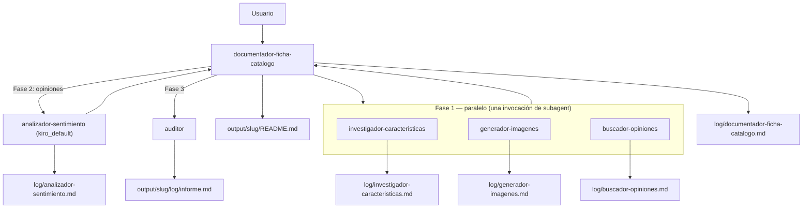

# Laboratorio 1 (Kiro): Agentes y subagentes en Kiro CLI

## Objetivo

Practicar **orquestación multiagente** en **Kiro CLI** mediante un generador de **fichas de catálogo**: agente coordinador, subagentes en paralelo, una fase encadenada y trazabilidad por logs — **sin usar skills**, solo agentes personalizados en `.kiro/agents/` y políticas en `AGENTS.md`. Es la versión Kiro del [laboratorio de Cursor](../cursor/README.md), basada en la documentación oficial de [Kiro — Custom agents](https://kiro.dev/docs/custom-agents/) y [Kiro — Subagents](https://kiro.dev/docs/custom-agents/subagents/).

Al final del laboratorio podrás:

1. Diferenciar **agente personalizado** (`.kiro/agents/<nombre>.json` invocado por nombre) y **subagente por defecto** (`kiro_default`) que lee un `.md` de instrucciones.
2. Diseñar un flujo con **tres subagentes en paralelo** y una **fase 2 encadenada** (`buscador-opiniones` → documentador → `analizador-sentimiento`).
3. Expresar **mínimo privilegio** de forma declarativa con `tools`, `allowedTools` y `toolsSettings` (`write`, `shell`, `subagent`).
4. Interpretar la salida en `output/<slug>/` (ficha consolidada, imagen, logs e informe del auditor).

**Prerrequisitos:**

- Kiro CLI **2.x** instalado y con sesión iniciada (`kiro-cli --version`, `kiro-cli login`). Probado con `kiro-cli-chat 2.18.1`.
- Terminal abierta en esta carpeta (`etapa-1/laboratorios/agents/kiro`): los agentes del workspace se leen de `.kiro/agents/` del directorio actual.
- Recomendado: haber hecho el [laboratorio de Cursor](../cursor/README.md) para comparar.

**Material técnico del laboratorio:** políticas en [`AGENTS.md`](./AGENTS.md) (permisos, logging, estándares de salida), configuración de agentes en [`.kiro/agents/`](./.kiro/agents/) e instrucciones en [`.kiro/agents/prompts/`](./.kiro/agents/prompts/).

> Este laboratorio **no usa skills**. Contrasta con [Laboratorio 2: Prompts y skills](../../skills/README.md).

---

## Marco teórico

### Agentes personalizados en Kiro

En Kiro CLI un **agente personalizado** es un archivo JSON en `.kiro/agents/` (workspace) o `~/.kiro/agents/` (global). A diferencia de Cursor, donde el agente es un `.md` con frontmatter, en Kiro la **configuración** (herramientas, permisos, recursos) y las **instrucciones** (`prompt`) están separadas:

```json
{
  "name": "investigador-caracteristicas",
  "description": "Investiga y estructura las características ...",
  "prompt": "file://./prompts/investigador-caracteristicas.md",
  "tools": ["read", "write", "shell", "web_search", "web_fetch"],
  "allowedTools": ["read", "web_search"],
  "resources": ["file://AGENTS.md"],
  "toolsSettings": {
    "write": {
      "allowedPaths": ["./output/*/log/investigador-caracteristicas.md", "./output/*/caracteristicas.json"],
      "deniedPaths": ["./.kiro/**", "./AGENTS.md", "./README.md", "./output/*/README.md"]
    },
    "shell": {
      "allowedCommands": ["powershell -NoProfile -Command \"Get-Date -Format 'yyyy-MM-ddTHH:mm:ss'\"", "..."],
      "denyByDefault": true
    }
  }
}
```

| Campo | Para qué sirve en este lab |
|-------|----------------------------|
| `prompt` | Instrucciones del agente. `file://` relativo se resuelve desde la carpeta del JSON |
| `tools` | Herramientas **disponibles** (`read`, `write`, `shell`, `web_search`, `web_fetch`, `subagent`). Lo que no esté aquí no existe para el agente |
| `allowedTools` | Herramientas que se usan **sin pedir confirmación** (aquí solo `read` y, en los investigadores, `web_search`) |
| `toolsSettings.write` | `allowedPaths` (escritura sin confirmar) y `deniedPaths` (bloqueada siempre) |
| `toolsSettings.shell` | `allowedCommands` (regex anclada) y `denyByDefault: true` (todo lo demás se deniega, sin preguntar) |
| `resources` | Archivos cargados en contexto al iniciar (`AGENTS.md`) |
| `toolsSettings.subagent` | `availableAgents` (a quién puede delegar) y `trustedAgents` (sin pedir confirmación) |

### Subagentes en Kiro

El agente coordinador delega con la herramienta **`subagent`**. Cada subagente corre en **contexto aislado**, en paralelo con los demás, y devuelve su resultado al padre. Diferencias clave frente a Cursor:

| Aspecto | Cursor | Kiro CLI |
|---------|--------|----------|
| Definición del agente | `.cursor/agents/<nombre>.md` (frontmatter + instrucciones) | `.kiro/agents/<nombre>.json` + `prompt` en `.md` |
| Herramienta de delegación | `Task({ subagent_type })` | `subagent` (una invocación con varias tareas) |
| Subagentes anidados | Sí (profundidad 2 en este lab) | **No**: un subagente no puede lanzar otros |
| Permisos | Convención en `AGENTS.md` + `readonly` | Declarativos en el JSON (`tools`, `allowedTools`, `toolsSettings`) |
| Generación de imágenes | Herramienta `GenerateImage` | No existe: el agente escribe una ilustración **SVG** |
| Activación | `AGENTS.md` redirige al documentador | `kiro-cli chat --agent documentador-ficha-catalogo` |

Por la falta de anidamiento, `buscador-opiniones` ya no lanza a `analizador-sentimiento`: devuelve las opiniones al documentador, que encadena el análisis como **fase 2**. El patrón "pipeline de dos fases" se mantiene; lo que cambia es **quién** encadena.

### Forma 1 — Agente personalizado

JSON en `.kiro/agents/<nombre>.json`. El documentador lo invoca por nombre dentro de `subagent`; Kiro carga sus `tools`, `toolsSettings` y `prompt`.

Usado por: `documentador-ficha-catalogo`, `investigador-caracteristicas`, `generador-imagenes`, `buscador-opiniones`, `auditor`.

### Forma 2 — Subagente por defecto + archivo de instrucciones

El documentador lanza el subagente por defecto (`kiro_default`) con un prompt que dice:

```text
Actúa como el agente analizador-sentimiento. Lee tus instrucciones en
.kiro/agents/prompts/analizador-sentimiento.md y síguelas al pie de la letra.
```

El subagente hace `read` del archivo — visible en la salida. **No es un skill** ni un agente registrado: no hay JSON, así que tiene las herramientas del agente por defecto, sus acciones piden confirmación y sus límites dependen solo de las instrucciones.

Usado por: `analizador-sentimiento`.

### Mínimo privilegio

Cada JSON aplica las reglas de [`AGENTS.md`](./AGENTS.md):

- `tools`: solo `documentador-ficha-catalogo` tiene `subagent`; solo `investigador-caracteristicas` y `buscador-opiniones` tienen `web_search` / `web_fetch`.
- `toolsSettings.write`: `allowedPaths` solo con los archivos propios de cada agente; `deniedPaths` en `.kiro/**`, `AGENTS.md` y `README.md` raíz (y en la ficha, salvo el documentador).
- `toolsSettings.shell`: `allowedCommands` solo con el comando de hora y `denyByDefault: true`. Cualquier otro comando se deniega sin preguntar.
- `toolsSettings.subagent.availableAgents`: el documentador solo puede delegar en los agentes del lab y en `kiro_default`; `trustedAgents` evita la confirmación para los cuatro agentes del lab.
- Los subagentes **no heredan** la confianza del padre: cada JSON declara sus propios `allowedTools` y `toolsSettings`.

> **Kiro CLI V3** (`kiro-cli --v3`) sustituye `allowedTools` y `toolsSettings.write/shell` por el campo `permissions` (reglas `allow` / `ask` / `deny`). Al abrir estos agentes con V3, Kiro avisa de que "necesitan actualización": usa `/upgrade-agent` para convertirlos. Ver [Configuration reference](https://kiro.dev/docs/custom-agents/configuration-reference/).

---

## Componentes del laboratorio



Flujo resumido:

```
[Usuario: "Genera ficha de catálogo para Cafetera X"]
                    │
                    ▼
   documentador-ficha-catalogo
                    │
    ┌───────────────┼───────────────┐
    │  FASE 1: PARALELO (subagent)  │
    ▼               ▼               ▼
investigador-   generador-     buscador-
caracteristicas imagenes       opiniones
   (Forma 1)     (Forma 1)     (Forma 1)
    └───────────────┼───────────────┘
                    ▼
   FASE 2: analizador-sentimiento (Forma 2, kiro_default)
                    │
                    ▼
         README.md + logs + imagen SVG
                    │
                    ▼ FASE 3 (secuencial)
                 auditor → log/informe.md
```

Estructura del proyecto:

```
kiro/
├── README.md                              # Este archivo
├── AGENTS.md                              # Políticas: activación, permisos, logs, salida
├── .kiro/
│   └── agents/
│       ├── documentador-ficha-catalogo.json   # tools: subagent
│       ├── investigador-caracteristicas.json  # tools: web_search
│       ├── generador-imagenes.json
│       ├── buscador-opiniones.json            # tools: web_search
│       ├── auditor.json
│       └── prompts/
│           ├── documentador-ficha-catalogo.md
│           ├── investigador-caracteristicas.md
│           ├── generador-imagenes.md
│           ├── buscador-opiniones.md
│           ├── analizador-sentimiento.md      # Sin JSON: Forma 2
│           └── auditor.md
└── output/                                # Generado al ejecutar (gitignored)
    └── <slug-producto>/
        ├── README.md
        ├── imagen-producto.svg
        └── log/
            ├── *.md                       # Un log por agente
            └── informe.md                 # Auditor
```

---

## Pasos

### Preparación

1. Abre una terminal en esta carpeta:

   ```bash
   cd etapa-1/laboratorios/agents/kiro
   ```

2. Verifica que Kiro detecta los agentes del workspace:

   ```bash
   kiro-cli agent list
   ```

   Deben aparecer los cinco agentes JSON (`Workspace`). `analizador-sentimiento` **no** aparece: solo existe como `.md` (Forma 2).

3. Lee [`AGENTS.md`](./AGENTS.md): activación, **Agent Permissions**, **Logging Standards** y **Output Standards**.
4. Recorre los cinco JSON en [`.kiro/agents/`](./.kiro/agents/) y localiza en cada uno: `tools`, `allowedTools`, `toolsSettings.write` / `toolsSettings.shell` y, en el documentador, `toolsSettings.subagent`.

---

### Fase A — Entender la arquitectura

**Meta:** saber quién orquesta, quién trabaja en paralelo y cómo se encadena la fase 2.

1. Identifica el **punto de entrada**: el agente `documentador-ficha-catalogo`, que arrancas explícitamente con `--agent`.

2. Clasifica cada agente:

   | Agente | Forma | `subagent` en `tools` | Fase |
   |--------|-------|-----------------------|------|
   | `documentador-ficha-catalogo` | 1 | Sí | Coordinador |
   | `investigador-caracteristicas` | 1 | No | 1 |
   | `generador-imagenes` | 1 | No | 1 |
   | `buscador-opiniones` | 1 | No | 1 |
   | `analizador-sentimiento` | 2 | No | 2 |
   | `auditor` | 1 | No | 3 |

3. Compara con la tabla equivalente del [lab de Cursor](../cursor/README.md#fase-a--entender-la-arquitectura): ¿qué agente perdió la capacidad de delegar y por qué?

4. Anota el **slug** que usarías para el producto de prueba. Ejemplo: `iphone-15-pro`.

---

### Fase B — Generar una ficha de catálogo

**Meta:** ejecutar el flujo completo y observar los subagentes en la terminal.

1. Inicia el chat con el agente coordinador:

   ```bash
   kiro-cli chat --agent documentador-ficha-catalogo
   ```

2. Escribe:

   ```prompt
   Genera una ficha de catálogo para el iPhone 18 Pro Max
   ```

3. Durante la ejecución, observa:
   - **Una sola** invocación de `subagent` con tres tareas en paralelo (investigador, generador, buscador).
   - Los subagentes de `trustedAgents` arrancan sin pedir confirmación; `kiro_default` (fase 2) sí la pide.
   - El documentador lanza **`analizador-sentimiento`** con las opiniones del buscador (Forma 2: verás el `read` del `.md`).
   - Cada agente escribe su log bajo `output/<slug>/log/` con timestamps obtenidos por Shell (solo hora).
   - El documentador consolida `output/<slug>/README.md` y luego lanza al `auditor`.

4. Si Kiro pide aprobar una escritura fuera de los archivos de la matriz, o un comando Shell del analizador distinto del de la hora, **recházalo**: es una violación de la matriz de permisos.

---

### Fase C — Validar salida y trazabilidad

**Meta:** comprobar que la ficha y los logs cumplen los estándares del proyecto.

1. Revisa la estructura generada (ejemplo):

   ```
   output/iphone-15-pro/
   ├── README.md
   ├── imagen-producto.svg
   ├── caracteristicas.json    # opcional
   ├── opiniones.json          # opcional
   └── log/
       ├── documentador-ficha-catalogo.md
       ├── investigador-caracteristicas.md
       ├── generador-imagenes.md
       ├── buscador-opiniones.md
       ├── analizador-sentimiento.md
       ├── auditor.md
       └── informe.md
   ```

2. Abre `README.md` y verifica secciones: descripción, imagen (`./imagen-producto.svg`), opiniones con resumen de sentimiento, metadatos.

3. Abre al menos **dos logs** de agentes distintos y comprueba la plantilla obligatoria de `AGENTS.md`: **Inicio**, **Input**, **Actividades** (con hora), **Output**, **Fin**.

4. Abre `log/informe.md` del auditor y contrasta el diagrama de secuencia con lo que viste en la terminal: el bloque `par` de la fase 1 y el mensaje documentador → analizador de la fase 2.

---

### Fase D — Probar el mínimo privilegio (opcional)

**Meta:** comprobar que las reglas del JSON se aplican, no solo las instrucciones.

1. Sal del chat y entra directamente como un subagente:

   ```bash
   kiro-cli chat --agent buscador-opiniones
   ```

2. Pide algo fuera de su rol, por ejemplo: `Escribe "hola" en AGENTS.md` o `Delega en el auditor el análisis de output/iphone-15-pro`.
3. Observa que la escritura queda bloqueada por `deniedPaths` y que la herramienta `subagent` no está disponible (no figura en `tools`).
4. Pide `Ejecuta dir`: `denyByDefault` lo deniega, mientras que el comando de hora se ejecuta sin pedir confirmación.

---

### Fase E — Reflexión (opcional)

1. ¿Por qué lanzar las tres tareas en **una sola** invocación de `subagent` en lugar de tres turnos? ¿Qué trade-off hay en tokens y latencia?
2. Sin subagentes anidados, el coordinador encadena la fase 2. ¿Qué ganas (visibilidad, control) y qué pierdes (contexto del coordinador, encapsulamiento del buscador)?
3. ¿Cuándo usarías **Forma 2** (`kiro_default` + `.md`) frente a registrar otro JSON en `.kiro/agents/`? Piensa en que la Forma 2 no tiene `toolsSettings` propios.
4. Compara los permisos **declarativos** de Kiro (JSON) con la **convención** de Cursor (`AGENTS.md` + `readonly`). ¿Cuál es más fácil de auditar?
5. Propón un subagente hipotético (p. ej. verificador de precios). ¿En qué fase iría y cómo quedaría su JSON?

---

## Conclusiones del laboratorio

- La **orquestación** separa coordinación (`documentador-ficha-catalogo`) de especialistas; el paralelismo reduce tiempo cuando las tareas son independientes.
- En Kiro el agente se define en **JSON**: herramientas y permisos quedan fuera del prompt y el runtime los hace cumplir.
- **Forma 1** (agente personalizado) y **Forma 2** (`kiro_default` + `.md`) son dos maneras de reutilizar instrucciones versionadas sin confundirlas con skills.
- Sin subagentes anidados, los pipelines de varias fases se modelan **encadenando desde el coordinador**.
- Los **logs por instancia** en `output/<slug>/log/` hacen auditable el flujo multiagente (quién hizo qué y cuándo).
- **`AGENTS.md`** sigue centralizando las políticas; los JSON las materializan.

---

## Referencias

| Tema | Fuente |
|------|--------|
| Agentes personalizados | [Kiro — Custom agents](https://kiro.dev/docs/custom-agents/) |
| Referencia de configuración | [Kiro — Configuration reference](https://kiro.dev/docs/custom-agents/configuration-reference/) |
| Subagentes | [Kiro — Subagents](https://kiro.dev/docs/custom-agents/subagents/) |
| Permisos (V3) | [Kiro — Permissions](https://kiro.dev/docs/permissions/) |
| Herramientas integradas | [Kiro — Tools](https://kiro.dev/docs/tools/) |
| Versión Cursor | [Laboratorio 1 (Cursor)](../cursor/README.md) |
| Políticas del lab | [`AGENTS.md`](./AGENTS.md) |
