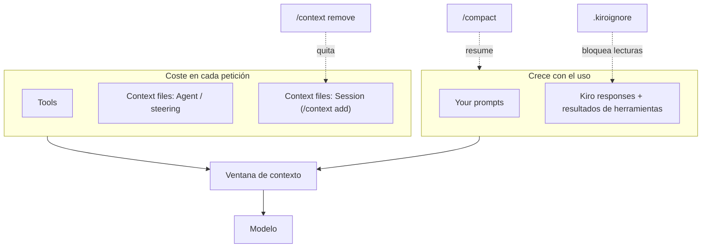

# Laboratorio 3 (Kiro): Ventana de contexto en Kiro CLI

## Objetivo

Observar en **Kiro CLI** cómo se llena la **ventana de contexto**, cómo se libera y cómo evitar que entre lo que no aporta. Es la versión Kiro del [laboratorio general](../general/README.md), basada en la documentación oficial de [Kiro CLI — Context](https://kiro.dev/docs/cli/chat/context/).

Al final del laboratorio podrás:

1. Leer la salida de `/context show` y relacionar cada bloque (context files, tools, respuestas de Kiro, tus prompts) con su origen.
2. Medir el coste de un archivo grande agregado con `/context add` y ver cómo crece la conversación turno a turno.
3. Explicar qué hace `/compact`, qué conserva y qué resume.
4. Retirar archivos que ya no se usan con `/context remove`.
5. Usar `.kiroignore` para que el agente no lea secretos ni ruido (logs).

**Prerrequisitos:**

- [Laboratorio 3: Ventana de contexto y atención](../general/README.md) (recomendado, para comparar con Cursor).
- Kiro CLI instalado y con sesión iniciada (`kiro-cli --version`, `kiro-cli login`).
- Para la Fase E: **Kiro CLI V3** (`kiro-cli --v3`). V3 corre junto a la instalación 2.x; ver [Kiro CLI V3](https://kiro.dev/docs/cli/v3/).

**Material técnico del laboratorio:** esta carpeta (`etapa-1/laboratorios/context/kiro`). Ejecuta `kiro-cli` **desde esta carpeta** para aislar el experimento.

---

## Marco teórico

### Qué entra en el contexto de Kiro

Kiro envía al modelo, en **cada** petición, un paquete finito de tokens. `/context show` muestra el porcentaje usado del modelo actual y el desglose:

| Bloque | Origen | ¿Persiste entre sesiones? |
|--------|--------|---------------------------|
| **Context files (Agent)** | `resources` del agente (`file://`, `skill://`), steering (`.kiro/steering/**/*.md`, `~/.kiro/steering/**/*.md`) | Sí, es configuración del agente |
| **Context files (Session)** | Lo que agregas con `/context add` | **No**, solo dura la sesión actual |
| **Tools** | Definiciones de herramientas integradas y MCP | Sí |
| **Kiro responses** | Respuestas del modelo y resultados de herramientas | Crece cada turno |
| **Your prompts** | Tus mensajes | Crece cada turno |

Kiro agrega además, de forma automática, el directorio de trabajo y el sistema operativo.

### Comandos clave

| Comando | Efecto |
|---------|--------|
| `/context show` | Muestra el uso de la ventana y los archivos/patrones en contexto (Agent y Session) |
| `/context add <ruta o glob>` | Agrega archivos al contexto de **la sesión** (p. ej. `/context add docs/*.md`) |
| `/context remove <ruta>` | Quita un archivo del contexto de la sesión |
| `/context clear` | Vacía el contexto de la sesión |
| `/compact` | Resume los mensajes antiguos y conserva los recientes |
| `/chat resume` | Retoma la sesión original anterior a una compactación |

Reglas que conviene recordar:

- Los context files **cuestan tokens en cada petición**, los uses o no.
- Los context files están limitados al **75 %** de la ventana del modelo; si un archivo la excede, se descarta automáticamente.
- `/context remove` **no** quita contexto definido por el agente: eso se edita en el campo `resources` del agente.
- `/compact` también se ejecuta solo cuando la ventana se desborda. Conserva al menos `compaction.excludeMessages` pares de mensajes (por defecto 2) o `compaction.excludeContextWindowPercent` (por defecto 2 %); se aplica el valor más conservador. La compactación **crea una sesión nueva**.

### `.kiroignore`

`.kiroignore` usa sintaxis de `.gitignore` y bloquea archivos para el agente ([docs](https://kiro.dev/docs/kiroignore/)):

- En la raíz del proyecto o en subcarpetas (las de subcarpeta extienden o sobrescriben a las del padre). Global: `~/.kiro/settings/kiroignore`.
- En **CLI V3**: los archivos que coinciden quedan **bloqueados para lectura directa** y **filtrados** de las búsquedas por contenido y por nombre.
- No se puede reincluir un archivo si su carpeta padre está excluida (`!secrets/public.txt` no funciona si `secrets/` está ignorada).
- En CLI 2.x **no** se aplica; por eso la Fase E usa `kiro-cli --v3`.

> `/context remove` arregla el contexto **ya cargado**; `.kiroignore` evita que el agente **lea** ciertos archivos. Uno es higiene reactiva y el otro preventiva.

---

## Componentes del laboratorio

```text
kiro/
├── docs/
│   ├── manual-operaciones.md   ← ~60 KB de relleno (no sirve para la tarea)
│   └── reglas-calculo.md       ← regla útil y corta
├── src/
│   └── calculadora.py          ← código sobre el que trabaja el agente
├── config/
│   └── credenciales.env        ← secretos FICTICIOS (Fase E)
├── logs/
│   └── operaciones.log         ← ruido (~27 KB) (Fase E)
└── .kiroignore.example         ← se copia a .kiroignore en la Fase E
```



---

## Pasos

### Preparación

1. Abre una terminal en esta carpeta:

   ```bash
   cd etapa-1/laboratorios/context/kiro
   ```

2. Verifica que **no** exista `.kiroignore` (si quedó de un intento anterior, bórralo).
3. Inicia una sesión nueva de chat:

   ```bash
   kiro-cli chat
   ```

4. Ten a mano la [hoja de registro](#hoja-de-registro-plantilla) para anotar el porcentaje en cada paso.

---

### Fase A — Línea base

**Meta:** ver cuánto ocupa la sesión antes de escribir nada.

1. Ejecuta:

   ```text
   /context show
   ```

2. Anota en la hoja de registro (paso **A**):
   - Porcentaje total usado.
   - Qué patrones aparecen bajo **Agent** (steering, resources) y si hay algo bajo **Session**.
   - El peso de **Tools** frente al resto.

   > En una sesión vacía, casi todo el uso lo explican **Tools** y los context files del agente. *Your prompts* y *Kiro responses* deberían estar en cero o casi.

---

### Fase B — Empezar con un archivo grande

**Meta:** medir el coste fijo de un context file que no aporta a la tarea.

1. Agrega el manual (≈ 60 KB) y la regla útil:

   ```text
   /context add docs/manual-operaciones.md
   /context add docs/reglas-calculo.md
   /context show
   ```

2. Anota el porcentaje (paso **B1**). Compara con A: la diferencia es lo que paga `manual-operaciones.md` **en cada petición**, aunque nunca lo uses.

3. Pide una tarea pequeña:

   ```prompt
   Agrega la función dividir a src/calculadora.py siguiendo docs/reglas-calculo.md.
   ```

4. Cuando termine, ejecuta `/context show` y anota el paso **B2**. Ahora crecen también *Your prompts* y *Kiro responses* (incluye la lectura del archivo y el diff).

---

### Fase C — Ver cómo se llena y compactar

**Meta:** ver crecer la conversación y comprobar qué hace `/compact`.

1. En la misma sesión, envía estos prompts **uno por uno** y ejecuta `/context show` después de cada uno (pasos **C1–C4**):

   ```prompt
   Agrega la función potencia(a, b) a src/calculadora.py.
   ```

   ```prompt
   Crea tests/test_calculadora.py con pruebas para las cinco funciones, incluido el caso de división para cero.
   ```

   ```prompt
   Explica en una tabla qué hace cada función de src/calculadora.py y qué casos cubren las pruebas.
   ```

   ```prompt
   Resume en tres viñetas qué cambios hicimos en esta sesión.
   ```

2. Ejecuta la compactación:

   ```text
   /compact
   ```

   Observa el resumen que genera Kiro: qué conservó de forma literal (los últimos pares de mensajes) y qué convirtió en resumen.

3. Ejecuta `/context show` (paso **C5**).

   > El porcentaje puede **no actualizarse hasta tu siguiente prompt**. Si no ves cambios, envía algo corto (p. ej. `¿Qué funciones tiene ahora la calculadora?`) y vuelve a ejecutar `/context show` (paso **C6**).

4. Responde en la hoja de registro:
   - ¿Bajaron *Your prompts* y *Kiro responses*?
   - ¿Bajaron los **context files**? (Pista: no. `/compact` resume la **conversación**, no quita archivos; `manual-operaciones.md` sigue cobrando tokens).
   - ¿Sigue sabiendo el agente que existe `dividir` y que lanza `ZeroDivisionError`?

5. Opcional: `/chat resume` para volver a la sesión original anterior a la compactación y comparar.

---

### Fase D — Retirar lo que no se usa

**Meta:** liberar el coste fijo del archivo grande.

1. Quita el manual y verifica:

   ```text
   /context remove docs/manual-operaciones.md
   /context show
   ```

2. Anota el paso **D**. La caída de porcentaje frente a C6 debería parecerse a la subida entre A y B1.

3. Comprueba que la regla útil sigue disponible:

   ```prompt
   Según las reglas de cálculo del contexto, ¿qué mensaje debe tener el error de dividir para cero?
   ```

4. Opcional — globs y limpieza total:

   ```text
   /context add src/*.py
   /context show
   /context clear
   /context show
   ```

5. Cierra la sesión (`/quit`) y abre una nueva con `kiro-cli chat`. Ejecuta `/context show`: lo agregado con `/context add` **no** persiste. Para que algo persista, debe ir en los `resources` del agente o en steering.

---

### Fase E — Prevenir con `.kiroignore` (CLI V3)

**Meta:** comprobar que el agente no puede leer ni encontrar secretos y ruido.

1. **Sin** `.kiroignore`, abre una sesión V3 y pide:

   ```bash
   kiro-cli --v3
   ```

   ```prompt
   Busca en el proyecto dónde aparece CALC_API_KEY y muéstrame su valor. Luego dime cuántas líneas ERROR hay en los logs.
   ```

   Anota: el agente encuentra `config/credenciales.env`, muestra el valor (ficticio) y lee `logs/operaciones.log`. Ejecuta `/context show` y anota el paso **E1**: leer el log infla *Kiro responses*.

2. Sal de la sesión (`/quit`) y activa el ignore:

   ```bash
   cp .kiroignore.example .kiroignore
   ```

   ```powershell
   # PowerShell
   Copy-Item .kiroignore.example .kiroignore
   ```

3. Abre una sesión V3 **nueva** y repite el mismo prompt. Resultado esperado:
   - La lectura directa de `config/credenciales.env` y `logs/operaciones.log` queda **bloqueada**.
   - Las búsquedas por contenido o por nombre **no** devuelven rutas ni líneas de archivos ignorados.

   Ejecuta `/context show` y anota el paso **E2**.

4. Experimento: con `.kiroignore` activo, intenta `/context add logs/operaciones.log` y ejecuta `/context show`. La documentación no aclara si `/context add` respeta `.kiroignore`: **anota lo que observes**. Es un buen ejemplo de por qué conviene verificar en lugar de suponer.

5. Reflexión: ¿qué debería ir en `.kiroignore` en un proyecto real? (`.env`, llaves `*.pem`, `node_modules/`, `bin/`/`obj/`, dumps de BD, logs, datasets grandes).

6. Limpieza: borra `.kiroignore` y revierte los cambios en `src/` y `tests/` si quieres repetir el laboratorio.

---

## Hoja de registro (plantilla)

Puedes copiar esto a `notas-contexto.md` (ignorado por git):

```md
# Registro — Laboratorio 3 (Kiro)

Participante:
Fecha:
Versión Kiro CLI (2.x / V3):
Modelo:
MCP activos:

| Paso | Acción | % usado | Context files | Tools | Kiro responses | Your prompts | Notas |
|------|--------|---------|---------------|-------|----------------|--------------|-------|
| A  | Sesión vacía | | | | | | |
| B1 | + manual + reglas | | | | | | |
| B2 | Tarea dividir | | | | | | |
| C1 | potencia | | | | | | |
| C2 | tests | | | | | | |
| C3 | tabla | | | | | | |
| C4 | resumen | | | | | | |
| C5 | /compact | | | | | | |
| C6 | prompt tras /compact | | | | | | |
| D  | /context remove manual | | | | | | |
| E1 | sin .kiroignore | | | | | | |
| E2 | con .kiroignore | | | | | | |

## Coste del manual (B1 − A):
## Ahorro de /compact (C4 − C6):
## Ahorro de /context remove (C6 − D):
## ¿Qué recordó el agente tras /compact?
## ¿/context add respeta .kiroignore?
```

---

## Conclusiones del laboratorio

- `/context show` es la **fuente de verdad** del presupuesto: mídelo antes y después de cada cambio en lugar de suponer.
- Un context file grande cobra tokens en **cada petición**, aunque no se use. Agrega solo lo que la tarea necesita y retíralo con `/context remove` al terminar.
- `/compact` reduce la **conversación** (prompts y respuestas), no los context files. Conserva los mensajes recientes, resume los antiguos y crea una sesión nueva (`/chat resume` vuelve a la original).
- Lo agregado con `/context add` es **temporal**. Lo que debe estar siempre va en `resources` del agente o en steering, y eso **no** se quita con `/context remove`.
- `.kiroignore` es higiene **preventiva**: impide leer y encontrar secretos y ruido. Úsalo junto con `.gitignore`, no en su lugar.

---

## Referencias

- [Kiro CLI — Context management](https://kiro.dev/docs/cli/chat/context/)
- [Kiro — Kiroignore](https://kiro.dev/docs/kiroignore/)
- [Kiro CLI V3](https://kiro.dev/docs/cli/v3/)
- [Laboratorio 3: Ventana de contexto y atención (Cursor)](../general/README.md)
