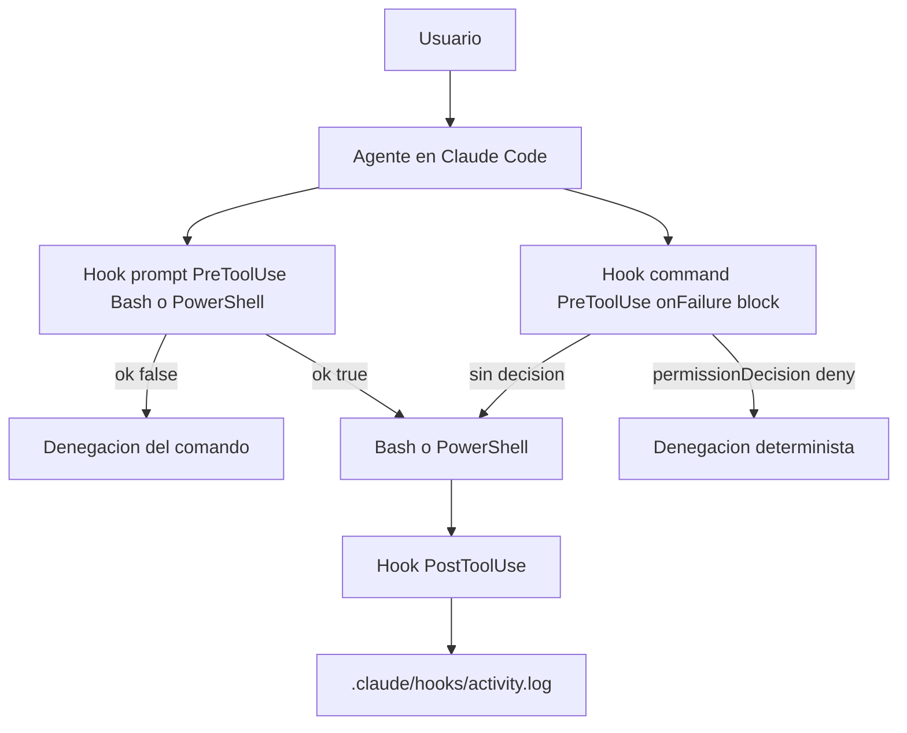

# Laboratorio 5: Hooks en Claude Code

> Esta es la **ruta Claude Code**. La ruta Cursor está en [README.md](./README.md). La ruta Kiro está en [README.kiro.md](./README.kiro.md).

## Objetivo

Explorar cómo usar hooks para observar, controlar y ampliar el bucle del agente en Claude Code: procesos que reciben el evento en JSON (stdin en un hook `command`, cuerpo POST en un hook `http`) y responden con código de salida o con un objeto JSON.

Al final del laboratorio podrás:

1. Distinguir el ritmo de los eventos (sesión, turno, llamada a herramienta) y los tipos `command` y `prompt`.
2. Entender el contrato JSON, el `matcher`, `onFailure` y el impacto de un evento anterior o posterior a la herramienta.
3. Implementar y validar un hook de observabilidad (`PostToolUse`) con registro en archivo.
4. Implementar y validar hooks preventivos sobre `PreToolUse` (uno `prompt` y uno `command`) para bloquear comandos de shell peligrosos.

**Prerrequisitos:**

- Tener **Claude Code** instalado (`claude --version`) y esta carpeta como proyecto.
- Conocer nociones básicas de terminal y ejecución de scripts.
- Haber recorrido la [ruta Cursor](./README.md) ayuda a comparar nombres de eventos; no es obligatorio.

**Material técnico del laboratorio:** la declaración vive en `.claude/settings.json`. Los scripts viven en `.claude/hooks/` (`log-activity.ps1`, `guard-shell.ps1`, `activity.log`). El contrato de cada pieza está en [Componentes](#componentes-del-laboratorio).

---

## Marco teórico

### Qué son los hooks

Los hooks ejecutan lógica tuya en puntos fijos del ciclo de vida de Claude Code. Se declaran en los archivos de settings (usuario, proyecto, local, política gestionada, plugin o skill) y, en el tipo `command`, hablan JSON por **stdin/stdout**.

Casos de uso típicos:

| Patrón        | Descripción                                                | Ejemplo en este lab                                      |
|---------------|------------------------------------------------------------|----------------------------------------------------------|
| **Observar**  | Registrar lo que hace el agente (trazabilidad / auditoría) | `PostToolUse` → `activity.log`                           |
| **Bloquear**  | Impedir una herramienta antes de que corra                 | `PreToolUse` sobre `Bash` y `PowerShell`                 |
| **Modificar** | Reescribir argumentos o inyectar contexto                  | `updatedInput`, `additionalContext`                      |
| **Encadenar** | Impedir que el turno termine si aún falta trabajo          | `Stop` con `decision: "block"` o un prompt `ok: false`   |

Piensa en ellos como **middleware del agente**: se sitúan entre lo que el agente quiere hacer y lo que realmente ocurre.

### Ritmo de los eventos

Claude Code agrupa los eventos por cuándo disparan, no por una categoría Tab o de ciclo de vida de la app:

| Ritmo                         | Cuándo se activan                                      | Ejemplos                                              |
|-------------------------------|--------------------------------------------------------|-------------------------------------------------------|
| **Sesión**                    | Al abrir o cerrar la sesión                            | `SessionStart`, `SessionEnd`                          |
| **Turno**                     | Al enviar un prompt o al terminar la respuesta         | `UserPromptSubmit`, `Stop`, `StopFailure`             |
| **Llamada a herramienta**     | Dentro del bucle, antes o después de cada tool         | `PreToolUse`, `PostToolUse`, `PostToolUseFailure`     |

En este laboratorio trabajamos con **`PreToolUse`** y **`PostToolUse`**. El shell no tiene un evento propio: en Claude Code es la herramienta `Bash` o `PowerShell`, y se filtra con el `matcher`.

### Tipos de ejecución

Hay cinco tipos de handler: `command`, `http`, `mcp_tool`, `prompt` y `agent`. Este laboratorio usa los dos que cubren el mismo terreno que la ruta Cursor.

| Tipo        | Cómo funciona                                                                                          | Cuándo preferirlo                                              |
|-------------|--------------------------------------------------------------------------------------------------------|----------------------------------------------------------------|
| `command`   | Script: JSON por stdin → JSON por stdout y código de salida (determinista)                            | Políticas auditables (p. ej. denegar `rm -rf`)                 |
| `prompt`    | Un modelo evalúa el evento. `$ARGUMENTS` inserta el JSON de entrada. Responde `{ "ok": true/false }`  | Políticas escritas en texto (p. ej. “solo lectura”)            |

En `PreToolUse`, un prompt con `"ok": false` deniega la herramienta. Con `continueOnBlock: true` el motivo vuelve a Claude como error de la tool y el turno sigue; sin ese campo el turno termina y el motivo aparece como aviso.

**Códigos de salida** (hooks `command`):

| Código | Efecto                                                                                          |
|--------|-------------------------------------------------------------------------------------------------|
| `0`    | Sin objeción. Si hay JSON válido en stdout, ese JSON decide (`permissionDecision`, etc.)       |
| `2`    | Bloquea la acción en los eventos que lo permiten (`PreToolUse` sí; `PostToolUse` ya ocurrió)   |
| Otro   | Fallo del hook. Por defecto la acción **sigue** (fail-open), salvo `onFailure: "block"`        |

`onFailure: "block"` (Claude Code 2.1.295 o posterior) es el equivalente de `failClosed`: un fallo, un timeout o una salida inesperada **bloquea** la acción. En un control de seguridad va en el hook `command`.

### Dónde se configuran

Las entradas de hooks **se suman** entre niveles: usuario, proyecto y local añaden los suyos y no quitan los de la política gestionada.

| Ubicación                         | Alcance              | ¿Se puede versionar?      |
|-----------------------------------|----------------------|---------------------------|
| Política gestionada               | Organización         | La controla un administrador |
| `~/.claude/settings.json`         | Todos tus proyectos  | No                        |
| `.claude/settings.json`           | Este proyecto        | Sí                        |
| `.claude/settings.local.json`     | Este proyecto        | No (queda fuera de git)   |
| `hooks/hooks.json` de un plugin   | Con el plugin activo | Sí, dentro del plugin     |

En este laboratorio la declaración de proyecto es `.claude/settings.json`. Un handler `command` con `args` arranca el ejecutable directo, sin shell; la ruta estable es `${CLAUDE_PROJECT_DIR}/.claude/hooks/script.ps1`.

Los hooks de settings se cargan con la sesión. Si acabas de guardarlos y no disparan, abre una sesión nueva o revísalos con `/hooks`. `"disableAllHooks": true` apaga los hooks de usuario, proyecto y local; no apaga los de la política gestionada.

### Eventos relevantes y contrato JSON

**Regla clave:** `PreToolUse` puede **bloquear o modificar** la llamada. `PostToolUse` corre cuando la herramienta **ya terminó**: sirve para observar, auditar o ampliar contexto (`additionalContext`, `updatedToolOutput`). Un código de salida `2` en `PostToolUse` solo muestra stderr a Claude.

Un hook tiene dos partes:

1. **Declaración** en `.claude/settings.json`: evento, grupo con `matcher`, handler (`type`, `command` o `prompt`, `timeout`, `onFailure`, …).
2. **Implementación**: script o texto de prompt.

```
stdin (desde Claude Code)      stdout (tu respuesta)
┌──────────────────┐         ┌──────────────────────────────────┐
│ {                │         │ { "hookSpecificOutput": {        │
│   "tool_name",   │   ──→   │     "hookEventName":"PreToolUse",│
│   "tool_input"   │         │     "permissionDecision": "deny" │
│ }                │         │ } }                              │
└──────────────────┘         └──────────────────────────────────┘
```

Campos comunes del evento: `session_id`, `cwd`, `hook_event_name`, y en una tool `tool_name` más `tool_input`. En `Bash` y `PowerShell` el texto del comando llega en `tool_input.command`.

Valores de `permissionDecision` en `PreToolUse` (dentro de `hookSpecificOutput`, con `hookEventName: "PreToolUse"`):

| Valor      | Efecto                                                                 |
|------------|------------------------------------------------------------------------|
| `"allow"`  | Salta el prompt interactivo de permiso. Las reglas deny/ask siguen vigentes |
| `"deny"`   | Cancela la herramienta. `permissionDecisionReason` vuelve a Claude     |
| `"ask"`    | Pide confirmación al usuario                                           |
| `"defer"`  | Cierra el turno para retomar la tool más tarde. Solo en modo `-p`     |

Salir con `0` y sin JSON no aprueba la tool: la deja en el flujo normal de permisos. Para denegar con un motivo legible, imprime el JSON y sal con `0`. El código `2` también bloquea; el JSON de arriba es el que entrega la razón al modelo.

### Matchers

El `matcher` del grupo se evalúa con una expresión regular sobre el campo del evento. En `PreToolUse` y `PostToolUse` ese campo es `tool_name`. Un matcher hecho solo de letras, dígitos, `_` y `|` se compara como lista de nombres exactos: `Bash|PowerShell` coincide con esas dos herramientas y no con un nombre que solo las contenga. `Edit.*` ya es regex y coincide en cualquier parte del nombre; para anclar usa `^Edit$`.

Sin `matcher`, o con `"*"`, el grupo corre en **todos** los disparos de ese evento.

El campo opcional `if` del handler afina más (por ejemplo `Bash(rm *)`) y solo aplica a eventos de herramienta. Es un filtro de mejor esfuerzo: la denegación dura sigue siendo el script o las reglas de permisos.

Referencias:

- [Hooks reference (Claude Code)](https://code.claude.com/docs/en/hooks)
- [Automate actions with hooks](https://code.claude.com/docs/en/hooks-guide)
- [Documentación de Cursor Hooks](https://cursor.com/es/docs/hooks)
- [Documentación de Kiro Hooks](https://kiro.dev/docs/hooks/)

---

## Componentes del laboratorio



Estructura de esta ruta:

```
.claude/
├── settings.json           # Declaración: evento, matcher y handler
└── hooks/
    ├── log-activity.ps1    # Registra cada tool (PostToolUse) y escribe {}
    ├── guard-shell.ps1     # Deniega comandos destructivos (PreToolUse)
    └── activity.log        # Log generado tras la primera ejecución
README.claude.md            # Este archivo
```

Declaración de proyecto:

```json
{
  "hooks": {
    "PostToolUse": [
      {
        "hooks": [
          {
            "type": "command",
            "command": "powershell.exe",
            "args": [
              "-NoProfile",
              "-ExecutionPolicy",
              "Bypass",
              "-File",
              "${CLAUDE_PROJECT_DIR}/.claude/hooks/log-activity.ps1"
            ],
            "timeout": 10
          }
        ]
      }
    ],
    "PreToolUse": [
      {
        "matcher": "Bash|PowerShell",
        "hooks": [
          {
            "type": "prompt",
            "prompt": "¿Este comando de shell es seguro? Solo permite operaciones de lectura (ls, dir, Get-ChildItem, cat, type, Get-Content, git status, git log, etc.). Deniega cualquier operación destructiva o de escritura: rm -rf, Remove-Item, del, DROP TABLE, git push --force, git reset --hard, formato de disco, o cualquier borrado/modificación de archivos. Entrada del hook: $ARGUMENTS",
            "timeout": 30,
            "continueOnBlock": true
          }
        ]
      },
      {
        "matcher": "Bash|PowerShell",
        "hooks": [
          {
            "type": "command",
            "command": "powershell.exe",
            "args": [
              "-NoProfile",
              "-ExecutionPolicy",
              "Bypass",
              "-File",
              "${CLAUDE_PROJECT_DIR}/.claude/hooks/guard-shell.ps1"
            ],
            "timeout": 10,
            "onFailure": "block"
          }
        ]
      }
    ]
  }
}
```

Contrato de `log-activity.ps1`: lee stdin hasta el final, toma `tool_name`, añade una línea `[fecha] tool=<nombre>` a `.claude/hooks/activity.log`, escribe `{}` en stdout y sale con `0`. Un fallo de log no debe tumbar el hook.

Contrato de `guard-shell.ps1`: lee stdin, mira `tool_input.command` y, si el texto contiene `rm -rf`, `Remove-Item`, `del`, `DROP TABLE`, `git push --force` o `git reset --hard`, escribe este objeto y sale con `0`:

```json
{
  "hookSpecificOutput": {
    "hookEventName": "PreToolUse",
    "permissionDecision": "deny",
    "permissionDecisionReason": "Comando destructivo bloqueado por el hook del laboratorio."
  }
}
```

Si el comando no coincide, sale con `0` y sin JSON.

---

## Pasos

### Preparación

1. Abre esta carpeta en Claude Code.
2. Verifica que existan `.claude/settings.json` y los scripts `.claude/hooks/log-activity.ps1` y `.claude/hooks/guard-shell.ps1`.
3. Abre una sesión nueva para que Claude Code cargue los hooks. Compruébalos con `/hooks`.

---

### Fase A — Observabilidad con `PostToolUse`

**Meta:** comprobar que puedes registrar actividad del agente sin bloquear su ejecución.

1. Revisa el hook de registro:
   - **Archivo:** `.claude/hooks/log-activity.ps1`
   - **Evento:** `PostToolUse`, sin `matcher` (corre tras cada tool que termina bien).
   - Lee stdin, anota `tool_name` en `activity.log` y responde `{}` con salida `0`.

2. Ejecuta una acción simple, por ejemplo:

   ```prompt
   Lista los archivos de este directorio.
   ```

3. Valida el resultado:
   - Revisa `.claude/hooks/activity.log`.
   - En la sesión, `/hooks` muestra los handlers cargados.

---

### Fase B — Prevención con `PreToolUse`

**Meta:** verificar que un hook anterior a la herramienta puede detener un comando destructivo.

1. Revisa el hook de shell en lenguaje natural:
   - **Tipo:** `prompt`
   - **Evento:** `PreToolUse` con **matcher** `Bash|PowerShell`
   - Usa `$ARGUMENTS` para recibir el JSON del evento.
   - `continueOnBlock: true` devuelve el rechazo a Claude y el turno continúa.
   - Marca patrones peligrosos como `rm -rf`, `DROP TABLE`, `push --force` o reset con `--hard`.

2. Revisa el hook determinista:
   - **Tipo:** `command` (script `guard-shell.ps1`)
   - **Mismo matcher:** `Bash|PowerShell`
   - **`onFailure: "block"`**: si el script falla o expira, la tool no corre
   - Devuelve `permissionDecision: "deny"` dentro de `hookSpecificOutput`

3. Solicita una acción riesgosa, por ejemplo:

   ```prompt
   Borra la carpeta temp con rm -rf
   ```

   ```prompt
   Ejecuta en consola lo indicado en el archivo important-files/dangerous-command.txt
   ```

   ```prompt
   Elimina el archivo important-files/core.file.md
   ```

4. Resultado esperado:
   - El prompt hook o el command hook deniegan `Bash` / `PowerShell` cuando el comando es destructivo.
   - Claude Code no tiene una herramienta `Delete` aparte: borrar un archivo pasa por el shell, y ese es el matcher que lo cubre.
   - `PostToolUse` no registra la tool denegada, porque esa tool no llegó a ejecutarse. `PostToolUseFailure` sería el evento posterior a un fallo, no a una denegación previa.

---

### Fase C — Extensión del laboratorio

**Meta:** identificar cómo escalar el enfoque de hooks a más controles del agente.

1. Propón hooks adicionales para tu proyecto:
   - `PostToolUse` con matcher `Edit|Write` — formatear después de una edición.
   - `UserPromptSubmit` — revisar el prompt en busca de secretos. Este evento sí puede bloquearse.
   - `PreToolUse` con `updatedInput` — reescribir los argumentos de una tool antes de ejecutarla.
   - `Stop` — impedir que el turno cierre si el trabajo pedido sigue pendiente.

2. Usa la documentación oficial para revisar eventos, matchers, `onFailure` y campos de salida:
   - [Hooks reference (Claude Code)](https://code.claude.com/docs/en/hooks)
   - [Automate actions with hooks](https://code.claude.com/docs/en/hooks-guide)
   - [Documentación de Cursor Hooks](https://cursor.com/es/docs/hooks)
   - [Documentación de Kiro Hooks](https://kiro.dev/docs/hooks/)

---

## Conclusiones del laboratorio

- Los hooks son middleware del bucle del agente: observan, bloquean, modifican o encadenan pasos mediante JSON.
- `command` es determinista; `prompt` expresa la política en texto y responde `ok`. En un control de seguridad conviene `command` con `onFailure: "block"`.
- `PreToolUse` es el punto de control. `PostToolUse` es el punto de trazabilidad, cuando la tool ya corrió.
- El `matcher` limita el handler a una tool. El shell se llama `Bash` o `PowerShell`; no existe un evento `beforeShellExecution`.
- Un `PostToolUse` de logging da visibilidad inmediata. El par prompt + command sobre el mismo matcher separa la política legible del bloqueo auditable.
- Versionar `.claude/settings.json` y los scripts comparte la política con el equipo. `.claude/settings.local.json` queda fuera de git.

Tras el taller, puedes añadir hooks por dominio (seguridad, calidad, cumplimiento) y revisar el resto de eventos en la documentación de [Claude Code](https://code.claude.com/docs/en/hooks), [Cursor](https://cursor.com/es/docs/hooks) y [Kiro](https://kiro.dev/docs/hooks/).
