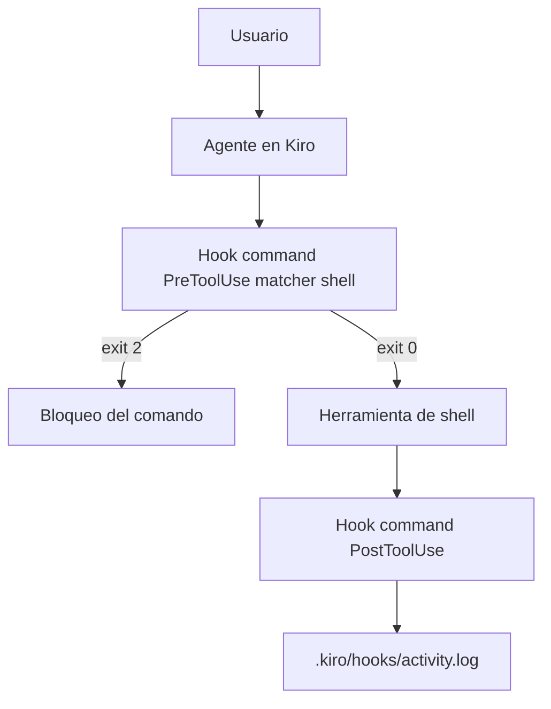

# Laboratorio 5: Hooks en Kiro

> Esta es la **ruta Kiro**. La ruta Cursor está en [README.md](./README.md). La ruta Claude Code está en [README.claude.md](./README.claude.md).

## Objetivo

Explorar cómo usar hooks para observar, controlar y ampliar el bucle del agente en Kiro: archivos JSON en `.kiro/hooks/` que, al dispararse un trigger, ejecutan un comando de shell o inyectan un prompt del agente.

Al final del laboratorio podrás:

1. Distinguir triggers (sesión, turno, herramienta y archivos) y las acciones `command` y `agent`.
2. Entender el JSON que llega por stdin, el `matcher`, el `timeout` y qué puede bloquear un hook anterior a la herramienta.
3. Implementar y validar un hook de observabilidad (`PostToolUse`) con registro en archivo.
4. Implementar y validar un hook preventivo (`PreToolUse`, matcher `shell`) que bloquea comandos peligrosos con el código de salida.

**Prerrequisitos:**

- Tener **Kiro IDE** (o Kiro CLI V3) e iniciar sesión. Los triggers de este laboratorio corren en IDE y en CLI; una sesión Web no los ejecuta.
- Conocer nociones básicas de terminal y ejecución de scripts.
- Haber recorrido la [ruta Cursor](./README.md) ayuda a comparar nombres; no es obligatorio.

**Material técnico del laboratorio:** un archivo JSON por hook en `.kiro/hooks/` y los scripts junto a ellos (`log-activity.ps1`, `guard-shell.ps1`, `activity.log`). El contrato está en [Componentes](#componentes-del-laboratorio).

---

## Marco teórico

### Qué son los hooks

Un hook de Kiro declara un **trigger** y una **acción**. La configuración de proyecto son archivos JSON en `.kiro/hooks/`. Kiro CLI V3 también carga `~/.kiro/hooks/`; los hooks globales y los del workspace corren a la vez. Cada archivo lleva `"version": "v1"` y un arreglo `hooks`.

Casos de uso típicos:

| Patrón        | Descripción                                                     | Ejemplo en este lab                                      |
|---------------|-----------------------------------------------------------------|----------------------------------------------------------|
| **Observar**  | Registrar lo que hace el agente                                 | `PostToolUse` → `activity.log`                           |
| **Bloquear**  | Impedir una herramienta, o un prompt, antes de que ocurra       | `PreToolUse` con matcher `shell` y salida distinta de 0  |
| **Orientar**  | Inyectar un prompt para que el agente actúe sobre el evento     | acción `agent`                                           |
| **Encadenar** | Lanzar un comando al cerrar el turno, con confirmación opcional | `Stop` + `confirm`                                       |

Piensa en ellos como **middleware del agente**: la acción `command` se ejecuta entre el trigger y el efecto; la acción `agent` mete una instrucción en la conversación.

### Triggers

| Grupo            | Cuándo se activan                                      | Ejemplos de `trigger`                                      |
|------------------|--------------------------------------------------------|------------------------------------------------------------|
| **Sesión**       | Al abrir la sesión, y al compactar el contexto         | `SessionStart`, `PreCompact`, `PostCompact`                |
| **Turno**        | Al enviar un prompt o al terminar la respuesta         | `UserPromptSubmit`, `Stop`                                 |
| **Herramienta**  | Antes o después de invocar una tool                    | `PreToolUse`, `PostToolUse`                                |
| **Archivos**     | Cuando el agente crea, guarda o borra un archivo       | `PostFileCreate`, `PostFileSave`, `PostFileDelete`         |

Los triggers de archivo solo ven cambios del agente, no una edición hecha a mano en el editor. `PostFileDelete` avisa **después** del borrado: no puede impedirlo. El punto para impedir una acción es `PreToolUse` (y, en el IDE, `UserPromptSubmit`).

En este laboratorio el shell no tiene un evento aparte. Las herramientas de shell se filtran con el matcher `shell`.

### Tipos de acción

| Tipo        | Cómo funciona                                                                                         | Cuándo preferirlo                                              |
|-------------|-------------------------------------------------------------------------------------------------------|----------------------------------------------------------------|
| `command`   | Ejecuta un comando en la raíz del proyecto. El evento llega como JSON por **stdin**                  | Reglas fijas y auditables (p. ej. bloquear `rm -rf`)           |
| `agent`     | Inyecta `action.prompt` en la conversación. El agente responde como ante un mensaje del chat         | Orientar al agente con lenguaje natural                        |

Una acción `agent` consume un turno del modelo. Una acción `command` corre en local y no llama al modelo. La acción `agent` **no devuelve** una decisión `allow` / `deny`: quien bloquea `PreToolUse` es el código de salida del comando.

**Códigos de salida** (acción `command`):

La [guía de acciones](https://kiro.dev/docs/hooks/actions/) y las notas de [IDE 1.0](https://kiro.dev/docs/ide/whats-new-v1/hooks/) describen el código distinto de 0 con distinto matiz. Este laboratorio usa solo `0` y `2`, que bloquean `PreToolUse` en las dos lecturas.

| Código | Qué hacer en este lab                                                                 |
|--------|----------------------------------------------------------------------------------------|
| `0`    | Éxito. En la guía de acciones, stdout puede añadirse al contexto del agente           |
| `2`    | Bloqueo de `PreToolUse`. Escribe el motivo en **stderr** para que el agente lo reciba |
| Otro   | Trátalo como fallo. No lo uses para “permitir con aviso”: las dos fuentes no coinciden |

Con salida `0`, un comando de `PreToolUse` deja seguir la herramienta. El timeout va en segundos en el campo `timeout` (predeterminado 60; `0` lo desactiva). No hay un campo `failClosed`: un timeout cuenta como fallo del comando.

### Dónde se configuran

- **Proyecto** (este lab): `.kiro/hooks/*.json`. Cualquier nombre en kebab-case sirve (`log-activity.json`, `guard-shell.json`). Un archivo puede declarar varios hooks en `hooks[]`.
- **Usuario, CLI V3:** `~/.kiro/hooks/`. Corren junto a los del proyecto, no los reemplazan.
- **`enabled: false`** deja el hook en el archivo sin ejecutarlo.
- Se activan al **iniciar la sesión**. El panel **Agent Hooks** permite crearlos, editarlos y apagarlos con el icono del ojo. El panel de salida de Kiro muestra la ejecución.

### Eventos relevantes y contrato JSON

**Regla clave:** `PreToolUse` puede **bloquear** la tool. `PostToolUse` corre cuando la tool **ya terminó** (salida distinta de 0 solo muestra un aviso; la tool ya corrió). `PostFileSave` y `PostFileDelete` también son posteriores al cambio.

Un hook tiene dos partes:

1. **Declaración** en `.kiro/hooks/<nombre>.json`: `name`, `trigger`, `matcher`, `timeout`, `action`.
2. **Implementación**: el comando, o el texto del prompt si `action.type` es `agent`.

```
stdin (desde Kiro)              salida del comando
┌──────────────────┐         ┌─────────────────────────────┐
│ {                │         │ exit 0  → la tool sigue     │
│   "tool_name",   │   ──→   │ exit 2  → PreToolUse bloquea│
│   "tool_input"   │         │ stderr  → motivo al agente  │
│ }                │         └─────────────────────────────┘
└──────────────────┘
```

El evento documentado incluye `hook_event_name`, `cwd`, `session_id`, `tool_name` y `tool_input`. En un MCP, `tool_name` llega como id interno `mcp_<servidor>_<tool>`, y el matcher puede usar `@servidor` o `@servidor/tool`.

### Matchers

| Trigger                         | Sobre qué se evalúa el matcher                                      | Ejemplo                          |
|---------------------------------|---------------------------------------------------------------------|----------------------------------|
| `PreToolUse` / `PostToolUse`    | Id de tool, categoría, selector de origen, regex o comodín          | `shell`, `write`, `@mcp`, `@builtin` |
| Archivos                        | Expresión regular contra la ruta                                    | `\\.(ts\|tsx)$`                  |
| `UserPromptSubmit`, `Stop`      | El trigger de prompt no usa el matcher de la misma forma            | se omite                         |

Categorías integradas en el matcher de tools: `read`, `write`, `shell`, `web`, `spec`. Selectores: `@mcp`, `@powers`, `@builtin`, `@<servidor>`, `@<servidor>/<tool>`.

Un nombre plano se prueba también como expresión regular contra el id de la tool, así que `read` puede coincidir con cualquier id que contenga ese texto. Sin `matcher`, el hook corre en todos los disparos de ese trigger. Los comodines `*` y `?` se escriben en el JSON; el editor visual del IDE los rechaza como regex inválida.

Referencias:

- [Hooks (Kiro)](https://kiro.dev/docs/hooks/)
- [Hook triggers](https://kiro.dev/docs/hooks/types/)
- [Hook actions](https://kiro.dev/docs/hooks/actions/)
- [Documentación de Cursor Hooks](https://cursor.com/es/docs/hooks)
- [Documentación de Claude Code Hooks](https://code.claude.com/docs/en/hooks)

---

## Componentes del laboratorio



Estructura de esta ruta:

```
.kiro/hooks/
├── log-activity.json       # PostToolUse → script de registro
├── log-activity.ps1        # Añade una línea a activity.log y sale 0
├── guard-shell.json        # PreToolUse matcher shell → script de bloqueo
├── guard-shell.ps1         # Sale 2 si el evento trae un comando destructivo
├── shell-policy.json       # Acción agent, enabled false (solo referencia)
└── activity.log            # Log generado tras la primera ejecución
README.kiro.md              # Este archivo
```

`log-activity.json`:

```json
{
  "version": "v1",
  "hooks": [
    {
      "name": "Log activity",
      "description": "Registra cada uso de herramienta",
      "trigger": "PostToolUse",
      "timeout": 10,
      "action": {
        "type": "command",
        "command": "powershell.exe -NoProfile -ExecutionPolicy Bypass -File .kiro/hooks/log-activity.ps1"
      }
    }
  ]
}
```

`guard-shell.json`:

```json
{
  "version": "v1",
  "hooks": [
    {
      "name": "Guard shell",
      "description": "Bloquea comandos de shell destructivos",
      "trigger": "PreToolUse",
      "matcher": "shell",
      "timeout": 10,
      "action": {
        "type": "command",
        "command": "powershell.exe -NoProfile -ExecutionPolicy Bypass -File .kiro/hooks/guard-shell.ps1"
      }
    }
  ]
}
```

Referencia de acción `agent`, apagada para no consumir un turno en cada tool. No sustituye al guardia: no puede devolver un deny.

```json
{
  "version": "v1",
  "hooks": [
    {
      "name": "Politica de shell",
      "description": "Orientacion en lenguaje natural. No bloquea por si sola.",
      "trigger": "PreToolUse",
      "matcher": "shell",
      "enabled": false,
      "action": {
        "type": "agent",
        "prompt": "¿Este comando de shell es seguro? Solo permite operaciones de lectura (ls, dir, Get-ChildItem, cat, type, Get-Content, git status, git log, etc.). Si es destructivo (rm -rf, Remove-Item, del, DROP TABLE, git push --force, git reset --hard, formato de disco o cualquier borrado), no lo ejecutes y explica el rechazo."
      }
    }
  ]
}
```

Contrato de `log-activity.ps1`: lee stdin hasta el final, toma `tool_name`, añade `[fecha] tool=<nombre>` a `.kiro/hooks/activity.log`, no escribe nada en stdout y sale con `0`. Así el log no se inyecta otra vez en el contexto.

Contrato de `guard-shell.ps1`: lee el JSON de stdin. Si el texto del comando contiene `rm -rf`, `Remove-Item`, `del`, `DROP TABLE`, `git push --force` o `git reset --hard`, escribe el motivo en stderr y sale con `2`. Si no coincide, sale con `0` y sin stdout.

---

## Pasos

### Preparación

1. Abre esta carpeta en Kiro IDE.
2. Verifica `.kiro/hooks/`: `log-activity.json`, `guard-shell.json`, `shell-policy.json` (`"enabled": false`) y los scripts `log-activity.ps1` y `guard-shell.ps1`.
3. Inicia una sesión nueva. En el panel **Agent Hooks** deben verse *Log activity* y *Guard shell* encendidos.

---

### Fase A — Observabilidad con `PostToolUse`

**Meta:** comprobar que puedes registrar actividad del agente sin bloquear su ejecución.

1. Revisa el hook de registro:
   - **Archivo:** `.kiro/hooks/log-activity.json` y `log-activity.ps1`
   - **Trigger:** `PostToolUse`, sin `matcher` (corre después de cada tool).
   - Lee stdin, anota `tool_name` y sale con `0`.

2. Ejecuta una acción simple, por ejemplo:

   ```prompt
   Lista los archivos de este directorio.
   ```

3. Valida el resultado:
   - Revisa `.kiro/hooks/activity.log`.
   - El panel de salida de Kiro muestra la ejecución del hook.

---

### Fase B — Prevención con `PreToolUse`

**Meta:** verificar que un hook anterior a la herramienta puede detener un comando destructivo.

1. Revisa por qué el bloqueo es un `command` y no un `agent`:
   - La acción `agent` inyecta un prompt. Sirve para orientar.
   - El bloqueo de `PreToolUse` lo decide el código de salida del comando.
   - `shell-policy.json` queda en el repo como ejemplo, con `enabled: false`.

2. Revisa el hook determinista:
   - **Tipo:** `command` (`guard-shell.ps1`)
   - **Trigger:** `PreToolUse` con **matcher** `shell`
   - Sale con `2` y escribe el motivo en stderr cuando el evento trae un comando destructivo
   - Sale con `0` cuando el comando es de lectura

3. Solicita una acción riesgosa, por ejemplo:

   ```prompt
   Borra la carpeta temp con rm -rf
   ```

   ```prompt
   Ejecuta en consola lo indicado en el archivo important-files/dangerous-command.txt
   ```

   ```prompt
   Elimina el archivo important-files/core.file.md
   ```

4. Resultado esperado:
   - Kiro bloquea la herramienta de shell y el agente recibe el motivo por stderr.
   - `PostToolUse` no anota esa tool, porque no llegó a ejecutarse.
   - Si el agente borra por una vía que no es shell, `PostFileDelete` solo lo registra después. Para impedirlo hace falta otro `PreToolUse` cuyo matcher sea esa tool (en el chat puedes pedir a Kiro los nombres de las tools disponibles).

---

### Fase C — Extensión del laboratorio

**Meta:** identificar cómo escalar el enfoque de hooks a más controles del agente.

1. Propón hooks adicionales para tu proyecto:
   - `PostFileSave` con matcher de ruta — formatear el archivo que el agente acaba de guardar.
   - `UserPromptSubmit` con acción `command` — revisar el prompt en busca de secretos. En el IDE una salida distinta de 0 puede bloquear el envío.
   - `PreToolUse` con matcher `write` — controlar escrituras concretas.
   - `Stop` con `confirm` — preguntar antes de lanzar un comando al cerrar el turno.

2. Usa la documentación oficial para revisar triggers, matchers y acciones:
   - [Hooks (Kiro)](https://kiro.dev/docs/hooks/)
   - [Hook triggers](https://kiro.dev/docs/hooks/types/)
   - [Hook actions](https://kiro.dev/docs/hooks/actions/)
   - [Documentación de Cursor Hooks](https://cursor.com/es/docs/hooks)
   - [Documentación de Claude Code Hooks](https://code.claude.com/docs/en/hooks)

---

## Conclusiones del laboratorio

- Los hooks de Kiro son archivos `v1` en `.kiro/hooks/`: un trigger y una acción `command` o `agent`.
- `command` es determinista y es el que puede bloquear `PreToolUse` (salida `2`, motivo en stderr). `agent` inyecta un prompt y no devuelve deny.
- `PreToolUse` es el punto de control. `PostToolUse` y los triggers de archivo (`PostFileSave`, `PostFileDelete`) observan algo que ya ocurrió.
- El matcher `shell` cubre las tools de shell. No existe un evento `beforeShellExecution` ni una herramienta `Delete` con ese nombre.
- Un `PostToolUse` de logging da visibilidad inmediata. El preventivo de shell reduce el riesgo de comandos destructivos sin frenar las lecturas.
- Versionar `.kiro/hooks/` comparte la política con el equipo. `enabled: false` apaga un hook sin borrarlo. Los hooks de `~/.kiro/hooks/` (CLI V3) se suman a los del proyecto.

Tras el taller, puedes añadir hooks por dominio (seguridad, calidad, cumplimiento) y revisar el resto de triggers en la documentación de [Kiro](https://kiro.dev/docs/hooks/), [Cursor](https://cursor.com/es/docs/hooks) y [Claude Code](https://code.claude.com/docs/en/hooks).
