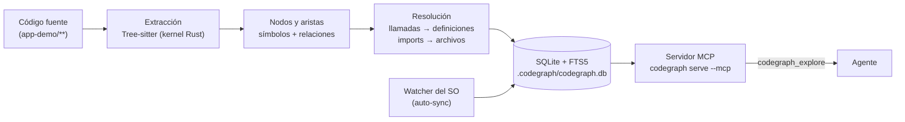

# Laboratorio 4B: MCP avanzado (CodeGraph + Figma + Playwright)

## Objetivo

Llevar el agente más allá del navegador del [Laboratorio 4](../fundamentos/README.md): conectar tres servidores MCP que cubren huecos distintos del ciclo de desarrollo y encadenarlos en un solo flujo — **entender el código** (CodeGraph), **recibir el diseño** (Figma) y **verificar el resultado** (Playwright). El foco está en las herramientas, no en la aplicación: la app de práctica es una mini-app de HTML/JS que se sirve sin instalar nada.

Al final del laboratorio podrás:

1. Explicar cómo CodeGraph convierte el código en un grafo consultable (Tree-sitter → SQLite → una tool MCP) y medir cuándo reduce llamadas y tokens frente a `grep`/lectura de archivos.
2. Conectar un servidor MCP **remoto con OAuth** (Figma) y dos **locales por stdio** (CodeGraph, Playwright), y distinguir ambos formatos en `mcp.json` / `.mcp.json`.
3. Cerrar el ciclo diseño → código → verificación con evidencia versionable, incluido un **spec de Playwright ejecutable** generado con ayuda del agente.

**Prerrequisitos:**

- [Laboratorio 4: MCP (fundamentos)](../fundamentos/README.md) — configuración de `mcp.json` y primer servidor.
- [Laboratorio 3: Ventana de contexto y atención](../../context/general/README.md) — para leer el panel Context al medir consumo.
- **Node.js** v20.19 o superior y **Google Chrome** actual (ya requeridos en el Laboratorio 4).
- **Cursor** (ruta principal) o **Claude Code** (ruta alternativa, ver [Fase 0](#preparación)).
- **Figma:** *no es obligatorio.* La Fase B la **demuestra el instructor**; quien no tenga acceso sigue el **Plan B** con [`fixtures/figma-referencia.md`](./fixtures/figma-referencia.md).

**Material técnico del laboratorio:** [`.cursor/mcp.json`](./.cursor/mcp.json) (Cursor), [`.mcp.json`](./.mcp.json) (Claude Code), [`app-demo/`](./app-demo/) (app de práctica), [`serve.mjs`](./serve.mjs) (servidor estático sin dependencias), [`tests/`](./tests/) (Playwright Test) y [`fixtures/`](./fixtures/figma-referencia.md) (Plan B de Figma).

---

## Marco teórico

### Tres servidores, tres huecos del ciclo

| Servidor | Pregunta que responde | Dirección | Transporte | Dónde corre |
|----------|----------------------|-----------|------------|-------------|
| **CodeGraph** | ¿Qué hay en mi código y qué se rompe si lo toco? | Entender el repo | stdio (`codegraph serve --mcp`) | Local; el código no sale de tu máquina |
| **Figma** | ¿Cómo debe verse y qué tokens usa? | Diseño → código | HTTP remoto (`https://mcp.figma.com/mcp`) + OAuth | Nube de Figma |
| **Playwright** | ¿Se ve y funciona como se diseñó? | Verificación | stdio (`npx @playwright/mcp`) | Local; controla un navegador |

Los tres se invocan igual desde el agent loop (ver [Laboratorio extra: Agent Loop](../../agent-loop/README.md)): el modelo pide una tool, Cursor la ejecuta contra el servidor y el resultado vuelve al contexto. Lo que cambia es **qué contexto aporta cada uno** y **qué datos cruzan la frontera de tu máquina**.

---

### CodeGraph en detalle

#### El problema que resuelve

Para responder “¿cómo funciona X?” o “¿qué toca este cambio?”, un agente sin índice descubre la estructura **a pie**: `glob` → `grep` → `Read` archivo por archivo, reconstruyendo a mano quién llama a quién. Cada paso es una llamada a herramienta y cada resultado entra a la ventana de contexto. CodeGraph precalcula esa estructura y la sirve ya resuelta.

#### Pipeline de indexación



1. **Extracción.** Tree-sitter parsea cada archivo y extrae **nodos** (funciones, clases, métodos, constantes…) y **aristas** (llama a, importa, extiende, implementa). Para 20 lenguajes el parseo corre en un kernel nativo en Rust; si un archivo tiene errores de sintaxis o la plataforma no tiene binario, cae al motor portable y el grafo resultante es el mismo.
2. **Resolución.** Tras extraer, las referencias se resuelven: una llamada `validateTask(...)` se enlaza con la **definición** en otro archivo; un `import` con el archivo de origen. En frameworks web también se enlazan rutas con sus handlers (Express, Django, Next.js, React Router, Angular…).
3. **Almacenamiento.** Todo se guarda en una base SQLite local (`.codegraph/codegraph.db`) con búsqueda de texto completo FTS5. No hay API keys ni servicios externos.
4. **Sincronización automática.** Un watcher con eventos nativos del SO reindexa solo lo que cambia (con un *debounce* de 2 s por defecto). Si consultas en esa ventana, la respuesta antepone un aviso de archivo pendiente para que el agente lo lea directamente. Al reconectar, el servidor concilia los cambios hechos mientras no estaba corriendo (`git pull`, otro editor).

#### Qué contiene el grafo

| Elemento | Ejemplos en `app-demo` |
|----------|------------------------|
| **Nodos** | `validateTask`, `addTask`, `formatDuration`, `renderTaskItem`, `LIMITS`, los archivos de `src/` |
| **Aristas `calls`** | `addTask` → `validateTask`; `renderStats` → `formatDuration` |
| **Aristas `imports`** | `store.js` → `validators.js`; `render.js` → `components/task-item.js` |
| **Rutas / navegación** | No aplica en esta app; sí en proyectos con Express, Next.js, React Router, etc. |

#### Una sola tool MCP, varias en la CLI

Por diseño, el servidor MCP expone **una única tool: `codegraph_explore`**. Con una pregunta (“cómo funciona X”, “cómo llega X a Y”) devuelve en una llamada el **código verbatim** de los símbolos relevantes agrupado por archivo, los **caminos de llamadas** entre ellos (incluidos saltos de *dynamic dispatch* que `grep` no sigue) y un resumen del **radio de impacto**. Si nombras un archivo o símbolo, devuelve su fuente actual con números de línea.

Las demás capacidades siguen existiendo pero **no se listan por defecto** (ya llegan dentro de `explore`); se pueden reactivar con `CODEGRAPH_MCP_TOOLS` y siempre están en la CLI:

| CLI | Equivalente MCP (oculto por defecto) | Uso |
|-----|--------------------------------------|-----|
| `codegraph explore <consulta>` | `codegraph_explore` | Fuente + caminos de llamada + impacto en una pasada |
| `codegraph query <texto>` | `codegraph_search` | Búsqueda de símbolos por nombre (FTS5) |
| `codegraph node <símbolo\|archivo>` | `codegraph_node` | Un símbolo con su fuente y sus *callers* |
| `codegraph callers <símbolo>` / `callees <símbolo>` | `codegraph_callers` / `codegraph_callees` | Quién lo llama / a quién llama |
| `codegraph impact <símbolo>` | `codegraph_impact` | Qué código se afecta si lo cambias |
| `codegraph files` | `codegraph_files` | Estructura de archivos indexados |
| `codegraph affected <archivos…>` | — | Tests afectados por cambios (siguiendo imports) |
| `codegraph status` | `codegraph_status` | Estadísticas y archivos pendientes de sync |

#### Qué se indexa y qué no

Cero configuración por defecto: omite `node_modules`, `dist`, `build`, `target`, `.venv`…, respeta `.gitignore` e ignora archivos de más de 1 MB. Opcionalmente, un `codegraph.json` en la raíz permite `exclude`, `include`, `deprioritize` (bajar el ranking sin sacar del índice) y mapear extensiones personalizadas.

#### Frente a otras formas de dar contexto

| Enfoque | Cómo encuentra | Fortaleza | Límite |
|---------|----------------|-----------|--------|
| **`grep` / `glob` / `Read`** | Texto literal, archivo a archivo | Siempre disponible, exacto | Muchas llamadas; reconstruye relaciones a mano |
| **Índice semántico del IDE** (embeddings) | Similitud de significado | Encuentra por intención, no por nombre | No garantiza estructura (quién llama a quién) |
| **CodeGraph** (grafo) | Símbolos y relaciones resueltas | Caminos de llamada e impacto en una llamada | Solo análisis estático; depende del lenguaje soportado |

#### Costo, contexto y honestidad de los números

El README del proyecto publica un benchmark propio (7 repos, Claude Code, mediana de 4 ejecuciones): en promedio **88 % menos llamadas a herramientas, 62 % menos tokens y 44 % menos costo**, con cero lecturas de archivos. Léelo con criterio:

- Son cifras **del proveedor**, medidas en repos grandes (VS Code, Excalidraw, Tokio…). La ganancia crece con el **descubrimiento** que exige la pregunta: 57–78 % en preguntas que sin grafo requerían 28–43 llamadas, y prácticamente igual donde bastaban 7.
- Miden **procesamiento**, no ocupación: tras una sesión, CodeGraph deja ~**80 % más** de contexto de recuperación residente en la ventana (un payload denso que se queda), un costo real en sesiones largas con ventana pequeña.
- En una app de 6 módulos como `app-demo` **no esperes** una gran diferencia; el ejercicio de la Fase A sirve para medirlo, no para confirmarlo.

#### Límites y privacidad

- **Análisis estático:** no ve reflexión, inyección de dependencias en runtime ni código generado. Un test E2E que habla con la app por el navegador **no importa** el código fuente, así que el grafo de imports no lo conecta con los módulos que prueba (lo comprobarás con `codegraph affected` en la Fase D).
- **Local-first:** el índice y las consultas no salen de tu máquina. El proyecto sí envía **telemetría anónima** de uso (herramientas y lenguajes, sin código ni rutas); se desactiva con `codegraph telemetry off`.
- **Instalación:** el instalador oficial se ejecuta con `irm … | iex` (PowerShell) o `curl … | sh` (macOS/Linux). Es una práctica que debes evaluar en tu entorno; la alternativa es `npm i -g @colbymchenry/codegraph`.

---

### Figma MCP

El servidor de Figma da al agente **contexto de diseño estructurado** (no solo una imagen) para generar código, y permite escribir de vuelta al lienzo.

| Modalidad | Cómo se conecta | Notas |
|-----------|-----------------|-------|
| **Remoto** (recomendado) | `https://mcp.figma.com/mcp`, sin app de escritorio; OAuth la primera vez | Funcionalidad más amplia; **basado en enlaces**: pegas la URL del frame o capa |
| **Escritorio** | Servidor local vía la app de Figma | Para necesidades de organización; requiere asiento Dev o Full en ciertos planes; permite trabajar con tu selección actual |

Tools de lectura más relevantes para este laboratorio:

| Tool | Qué devuelve |
|------|--------------|
| `get_design_context` | Contexto y código de una capa o selección. Por defecto React + Tailwind; puedes pedir otro destino (“HTML y CSS planos”, Vue…) |
| `get_variable_defs` | Variables y estilos usados en la selección (color, espaciado, tipografía) |
| `get_metadata` | Esquema XML ligero (ids, nombres, tipos, posiciones) para diseños grandes |
| `get_screenshot` | Captura PNG de la selección (consume más tokens) |
| `download_assets` | Exports (PNG/JPG/SVG/PDF) e imágenes originales |
| `get_code_connect_map` / `search_design_system` | Reutilización de componentes reales del código y búsqueda en librerías |
| `whoami` | Identidad, planes y asientos (no cuenta para el límite) |

Escritura (solo servidor remoto): `use_figma` crea y edita contenido; `generate_figma_design` convierte UI en vivo (producción, staging o `localhost`) en capas editables. El tipo de asiento determina qué puedes crear o editar, y añadir a un archivo existente requiere permiso de edición.

#### Límites de uso: por qué la Fase B es una demostración

| Asiento | Starter | Professional | Organization | Enterprise |
|---------|---------|--------------|--------------|------------|
| View, Collab | 20 / mes | 20 / mes | 20 / mes | 20 / mes |
| Full, Dev | — | 200 / día, 10 / min | 200 / día, 15 / min | 600 / día, 20 / min |

Los planes Education tienen los mismos límites que Full/Dev en Professional. Los límites aplican a las tools que **leen** de Figma; solo están exentas `whoami`, `generate_figma_design`, `create_new_file` y `add_code_connect_map` (no todas las de escritura: `use_figma`, por ejemplo, no figura como exenta). Figma puede cambiar estas reglas. Con 20 llamadas al mes, un grupo no puede practicar libremente: el instructor usa **tres llamadas de lectura** (`get_variable_defs`, `get_design_context`, `get_screenshot`) más `whoami`, que no cuenta, y los participantes cuentan con el Plan B.

#### Skills de Figma

El MCP expone herramientas sueltas; las *skills* empaquetan el **orden recomendado** para usarlas (implementar un diseño, Code Connect, reglas de design system). En Cursor se instalan con el plugin de Figma (`/add-plugin figma`), que además trae las reglas de manejo de assets. No añaden capacidades nuevas: reducen la improvisación del agente.

---

### Playwright MCP

Playwright MCP controla un navegador a través de **snapshots de accesibilidad**: el agente recibe el árbol de roles y nombres accesibles de la página, con una **referencia (`ref`)** por elemento, y actúa sobre esas referencias. No requiere modelos de visión y es más determinista que hacer clic por coordenadas.

| Familia | Tools (selección) |
|---------|-------------------|
| Navegación y lectura | `browser_navigate`, `browser_snapshot`, `browser_find`, `browser_evaluate`, `browser_take_screenshot`, `browser_console_messages`, `browser_network_requests` |
| Interacción | `browser_click`, `browser_type`, `browser_fill_form`, `browser_select_option`, `browser_press_key`, `browser_wait_for` |
| Programación de pruebas (`--caps=testing`) | `browser_generate_locator`, `browser_verify_element_visible`, `browser_verify_text_visible`, `browser_verify_list_visible`, `browser_verify_value` |
| Opt-in adicionales | `--caps=network` (mocks con `browser_route`), `storage`, `devtools` (trazas, vídeo, grabación), `vision`, `pdf` |

#### Playwright MCP frente a Chrome DevTools MCP (Laboratorio 4)

| Criterio | Chrome DevTools MCP | Playwright MCP |
|----------|--------------------|----------------|
| Enfoque | Inspección y depuración de Chrome | Automatización y pruebas |
| Fortaleza | Rendimiento, Lighthouse, CSS computado, consola, memoria | Interacción determinista por `ref`, locators y *verify* para tests |
| Navegadores | Chrome | Chrome, Firefox, WebKit, Edge |
| Salida típica | Diagnóstico de una sesión | Specs `.spec.ts` reproducibles |
| Cuándo usarlo | “¿Por qué es lento / qué error hay en consola?” | “¿Funciona el flujo y puedo dejarlo como test?” |

#### MCP o CLI + skills

El propio proyecto advierte que, para **agentes de código**, un flujo CLI + skills (`playwright-cli`) suele ser **más eficiente en tokens**, porque evita cargar esquemas de tools grandes y árboles de accesibilidad extensos. El MCP sigue teniendo sentido para bucles exploratorios con estado persistente. En este laboratorio usamos el MCP para observar el contrato de las tools; ten presente el compromiso al elegir en tu equipo.

#### Seguridad

Playwright MCP **no es un límite de seguridad**: `--allowed-origins` / `--blocked-origins` no actúan como frontera ni afectan redirecciones, y la tool `browser_run_code_unsafe` ejecuta JavaScript arbitrario en el proceso del servidor (equivalente a ejecución remota de código). Cualquier página que el agente abra es **contenido no confiable** que entra al contexto: es el vector del [Laboratorio 7: Seguridad](../../security/README.md).

Referencia conceptual: **[Cursor — MCP](https://cursor.com/docs/context/mcp)**.

---

## Componentes del laboratorio

Diagrama de componentes del laboratorio:

```mermaid
flowchart LR
    U[Usuario / Instructor] --> A[Agente<br/>Cursor o Claude Code]

    A -->|stdio| CG[codegraph serve --mcp]
    CG --> DB[(.codegraph/<br/>SQLite)]
    DB --- APP

    A -->|HTTP + OAuth| FG[Figma MCP remoto]
    FG --> FIG[(Archivo de Figma)]

    A -->|stdio| PW[@playwright/mcp]
    PW --> CH[Chrome]
    CH --> APP[app-demo<br/>servida por serve.mjs :5173]

    A -->|edita| APP
    A -->|escribe| EV[evidencia/<br/>informe.md + capturas]
    A -->|genera| SPEC[tests/specs/*.spec.ts]
    SPEC -->|npx playwright test| CH
```

Estructura de archivos de este laboratorio:

```
avanzado/
├── README.md                  # Este archivo
├── .cursor/mcp.json           # Servidores MCP (Cursor)
├── .cursor/hooks.json         # Hooks de medición automática (Fase A)
├── .cursor/hooks/metrics.mjs  # Registra tool calls, lecturas, MCP y tiempo → evidencia/metricas.md
├── .mcp.json                  # Servidores MCP (Claude Code)
├── .gitignore
├── serve.mjs                  # Servidor estático sin dependencias (puerto 5173)
├── figma-url.example.txt      # Plantilla de URL del frame
├── figma-url.txt              # Tu URL real (gitignored, créalo en Fase B)
├── fixtures/
│   └── figma-referencia.md    # Plan B: diseño de referencia sin acceso a Figma
├── app-demo/                  # App de práctica (HTML/CSS/JS, sin instalación)
│   ├── index.html
│   ├── styles/                # tokens.css + app.css
│   └── src/                   # main, store, validators, format, render, components/
├── tests/                     # Playwright Test (único paso con npm install)
│   ├── package.json
│   ├── playwright.config.ts
│   └── specs/smoke.spec.ts
└── evidencia/                 # Salida del ejercicio
    ├── metricas.md            # Lo genera el hook al terminar cada respuesta (Fase A)
    └── informe.md             # Lo crea el agente (Fases A–D)
```

---

## Pasos

### Preparación

1. Abre la carpeta `etapa-1/laboratorios/mcp/avanzado` como **workspace** en Cursor (`Archivo → Abrir carpeta`; en macOS, **File → Open…** o `Cmd+O`). Debe ser la raíz del workspace para que Cursor lea `.cursor/mcp.json` y CodeGraph indexe esta carpeta.

   > **macOS:** los comandos de este laboratorio se muestran en PowerShell. Los de `node`, `npx`, `git` y `codegraph` funcionan igual en zsh/bash; donde difieren, se añade el bloque **En macOS/Linux**. **Cursor Settings → Tools & MCP** se abre desde **Cursor → Settings → Cursor Settings** (`Cmd+Shift+J`). Para detener un proceso en la terminal se usa también `Ctrl+C` (no `Cmd+C`).
2. Comprueba Node y Chrome:

   ```powershell
   node -v
   (Get-Item "$env:ProgramFiles\Google\Chrome\Application\chrome.exe").VersionInfo.ProductVersion
   ```

   En macOS/Linux:

   ```bash
   node -v
   "/Applications/Google Chrome.app/Contents/MacOS/Google Chrome" --version
   ```

   Necesitas Node **v20.19+** y una versión de Chrome actual (en Windows, si Chrome está instalado solo para tu usuario, busca en `$env:LOCALAPPDATA\Google\Chrome\Application`).
3. Comprueba que la app demo arranca (cero instalación):

   ```powershell
   node serve.mjs
   ```

   Abre <http://localhost:5173>: deberías ver “Time Tracker” con el formulario y “Aún no hay tareas registradas.”. Detén el servidor con `Ctrl+C` (más adelante lo lanzarás en una terminal aparte).
4. Revisa la configuración MCP del laboratorio en [`.cursor/mcp.json`](./.cursor/mcp.json):

   ```json
   {
     "mcpServers": {
       "codegraph": { "command": "codegraph", "args": ["serve", "--mcp"] },
       "figma": { "url": "https://mcp.figma.com/mcp" },
       "playwright": {
         "command": "npx",
         "args": ["-y", "@playwright/mcp@0.0.83", "--isolated", "--viewport-size=1280x720", "--caps=testing"]
       }
     }
   }
   ```

   | Entrada | Formato | Detalle |
   |---------|---------|---------|
   | `codegraph` | `command` + `args` (stdio) | Requiere el CLI en el `PATH` (Fase A, paso 1) |
   | `figma` | `url` (remoto) | Autenticación OAuth desde Cursor |
   | `playwright` | `command` + `args` (stdio) | `--isolated`: perfil en memoria; `--caps=testing`: tools `browser_verify_*` y `browser_generate_locator` |

   > **Claude Code:** usa [`.mcp.json`](./.mcp.json) en la misma carpeta (misma estructura, con `type: "stdio"` / `"http"`). La primera vez, Claude Code pide aprobar los servidores definidos en el `.mcp.json` del proyecto. Verifica los servidores y sus tools con `/mcp`. En Windows nativo, si `npx` no arranca como comando directo, usa `"command": "cmd"` con `"args": ["/c", "npx", …]`.
   >
   > Equivalencias usadas en el resto del laboratorio:
   >
   > | Cursor | Claude Code |
   > |--------|-------------|
   > | **Settings → Tools & MCP** (estado, tools, interruptor on/off) | `/mcp` (estado, tools, *disable*/*enable* del servidor) |
   > | Panel **Context** | `/context` |
   > | Chat nuevo en modo **Agent** | `/clear` o una sesión nueva |
5. Trabaja en una **rama aislada**: las Fases B a D modifican `app-demo/` y `tests/`, y así podrás revertirlo todo al terminar:

   ```powershell
   git switch -c lab/mcp-avanzado
   ```

6. Crea el archivo de evidencia que irás completando (no uses `-Force`: si ya existe, vaciaría lo que llevas):

   ```powershell
   New-Item evidencia/informe.md -ItemType File
   ```

   En macOS/Linux (`touch` no borra el contenido si el archivo ya existe):

   ```bash
   touch evidencia/informe.md
   ```

---

### Fase A — CodeGraph: del código al grafo

**Meta:** ver el grafo “en crudo” desde la CLI, consultarlo desde el agente por MCP y **medir** la diferencia frente a no usarlo.

1. **Instala el CLI.** Elige una vía (abre una terminal **nueva** al terminar para que `codegraph` esté en el `PATH`):

   ```powershell
   # Opción 1 — instalador oficial (no requiere Node)
   irm https://raw.githubusercontent.com/colbymchenry/codegraph/main/install.ps1 | iex

   # Opción 2 — si prefieres npm
   npm i -g @colbymchenry/codegraph
   ```

   En macOS/Linux:

   ```bash
   # Opción 1 — instalador oficial (no requiere Node)
   curl -fsSL https://raw.githubusercontent.com/colbymchenry/codegraph/main/install.sh | sh

   # Opción 2 — si prefieres npm
   npm i -g @colbymchenry/codegraph
   ```

   > En macOS, si `npm i -g` falla con `EACCES`, tu Node se instaló con el instalador oficial y el directorio global requiere permisos de administrador. No uses `sudo`: usa la opción 1 o instala Node con nvm o Homebrew.

   ```powershell
   codegraph version
   ```

   > Ejecutar un script remoto con `iex` (o `curl … | sh`) es una decisión de seguridad: léelo antes o usa la opción 2.

   > **Reinicia el IDE tras instalar.** Cursor (o la terminal desde la que lanzaste Claude Code) hereda el `PATH` que tenía al abrirse, así que puede no “ver” `codegraph` aunque `codegraph version` funcione en una terminal nueva. Si el servidor **codegraph** aparece en rojo o sin tools en **Settings → Tools & MCP** (o en `/mcp`), cierra el IDE por completo y vuelve a abrirlo; en Claude Code, sal y ábrelo desde una terminal nueva.

2. **(Opcional) Desactiva la telemetría anónima:**

   ```powershell
   codegraph telemetry off
   ```

3. **Construye el índice** de este laboratorio (desde la raíz del workspace):

   ```powershell
   codegraph init
   codegraph status
   ```

   `init` crea `.codegraph/` y construye el grafo en un solo paso. En `status` anota cuántos archivos y símbolos se indexaron.

   > No necesitas `codegraph install`: la entrada del servidor ya está en [`.cursor/mcp.json`](./.cursor/mcp.json). Ese comando haría lo mismo y además añadiría una sección delimitada en tu `AGENTS.md`/`CLAUDE.md`.

4. **Explora el grafo desde la CLI** (sin agente: así ves qué hay detrás de la tool MCP):

   ```powershell
   codegraph files
   codegraph query validateTask
   codegraph callers validateTask
   codegraph callees addTask
   codegraph impact formatDuration
   codegraph explore "¿cómo viaja una tarea desde el formulario hasta aparecer en la lista?"
   ```

   Qué deberías ver:

   | Comando | Resultado esperado |
   |---------|--------------------|
   | `callers validateTask` | `addTask` (en `store.js`) |
   | `callees addTask` | `validateTask` y otras funciones que invoca |
   | `impact formatDuration` | `renderTaskItem`, `renderStats` y, transitivamente, quienes los usan (`renderTaskList`, `main.js`) |
   | `explore …` | Fuente de `main.js`, `store.js`, `validators.js`, `render.js` y la cadena de llamadas |

5. **Conecta el servidor al IDE.** Ve a **Cursor Settings → Tools & MCP** (en Claude Code, `/mcp`) y confirma que **codegraph** aparece activo (si no, reinicia el cliente). Debe listar una sola tool: `codegraph_explore`.

6. **Activa la medición automática (hooks).** Para no contar a mano, el laboratorio incluye un hook que registra cada sesión del agente: [`.cursor/hooks.json`](./.cursor/hooks.json) + [`.cursor/hooks/metrics.mjs`](./.cursor/hooks/metrics.mjs) (solo Node; los hooks se estudian en el [Laboratorio 5](../../hooks/README.md)). Cursor recarga `hooks.json` al abrir el workspace: confirma en **Customize → Hooks** (o en el canal de salida *Hooks*) que aparecen `beforeSubmitPrompt`, `postToolUse`, `postToolUseFailure`, `afterMCPExecution`, `subagentStop` y `stop`.

   Ejecuta una vez, para partir de cero:

   ```powershell
   node .cursor/hooks/metrics.mjs --reset
   ```

   Qué registra y qué **no**:

   | Lo registra (automático) | Lo que sigue siendo manual |
   |--------------------------|----------------------------|
   | Nº de tool calls, `Read`, archivos distintos leídos, búsquedas, shell | **Tokens**: los hooks no los reciben; léelos del panel Context |
   | Llamadas por servidor MCP (`codegraph×N`) | Activar / desactivar el servidor MCP |
   | Subagentes y las llamadas que hicieron | Valorar si la respuesta es correcta y completa |
   | Tiempo total, modelo y estado de cada respuesta | |

   > **Privacidad:** solo guarda metadatos (nombre de herramienta, ruta del archivo leído, servidor MCP, duración). **No** guarda el texto de tus prompts ni la salida de las tools. Los eventos crudos quedan en `.cursor/hooks/state/` (gitignored).

   > **Claude Code:** el mismo script entiende sus eventos. Añade esto a `.claude/settings.json` (créalo solo si trabajas en Claude Code; si abres también el workspace en Cursor con hooks de terceros activados se duplicarían eventos de prompt y stop):
   >
   > ```json
   > {
   >   "hooks": {
   >     "UserPromptSubmit": [{ "hooks": [{ "type": "command", "command": "node \"$CLAUDE_PROJECT_DIR/.cursor/hooks/metrics.mjs\"" }] }],
   >     "PostToolUse":      [{ "matcher": "*", "hooks": [{ "type": "command", "command": "node \"$CLAUDE_PROJECT_DIR/.cursor/hooks/metrics.mjs\"" }] }],
   >     "PostToolUseFailure": [{ "matcher": "*", "hooks": [{ "type": "command", "command": "node \"$CLAUDE_PROJECT_DIR/.cursor/hooks/metrics.mjs\"" }] }],
   >     "SubagentStop":     [{ "hooks": [{ "type": "command", "command": "node \"$CLAUDE_PROJECT_DIR/.cursor/hooks/metrics.mjs\"" }] }],
   >     "Stop":             [{ "hooks": [{ "type": "command", "command": "node \"$CLAUDE_PROJECT_DIR/.cursor/hooks/metrics.mjs\"" }] }]
   >   }
   > }
   > ```

7. **Consulta desde el agente (con CodeGraph).** Abre un chat nuevo en modo **Agent** y ejecuta (la etiqueta `#run:…` es solo para identificar la fila; el hook guarda la etiqueta, no el resto del prompt):

   ```prompt
   Si cambio la firma de formatDuration para que reciba segundos en vez de minutos,
   ¿qué archivos y funciones se ven afectados? Responde con la lista y el motivo.
   No modifiques nada. #run:con-codegraph
   ```

   Observa que el agente invoca `codegraph_explore` y responde con pocas (o ninguna) lecturas de archivos. Al terminar su respuesta se genera `evidencia/metricas.md`. **Lo único que anotas a mano** es el consumo de tokens del panel **Context** (`/context` en Claude Code; [Laboratorio 3](../../context/general/README.md)).

8. **Repite sin CodeGraph (línea base).** En **Settings → Tools & MCP** apaga el interruptor de **codegraph** (en Claude Code, desactívalo desde `/mcp`), abre un chat **nuevo**, usa el **mismo modelo** y haz **la misma** pregunta con otra etiqueta:

   ```prompt
   Si cambio la firma de formatDuration para que reciba segundos en vez de minutos,
   ¿qué archivos y funciones se ven afectados? Responde con la lista y el motivo.
   No modifiques nada. #run:sin-codegraph
   ```

   Abre `evidencia/metricas.md`: tendrás una fila por corrida, por ejemplo (valores ilustrativos):

   | # | Etiqueta | Tool calls | Read | Archivos distintos | Búsquedas | MCP (por servidor) | Tiempo (s) |
   |---|----------|-----------:|-----:|-------------------:|----------:|--------------------|-----------:|
   | 1 | con-codegraph | 1 | 0 | 0 | 0 | codegraph×1 | 18 |
   | 2 | sin-codegraph | 9 | 6 | 6 | 2 | — | 41 |

   Copia las filas a `evidencia/informe.md`, añade los **tokens** del panel Context y tu valoración de si la respuesta fue completa y correcta.

   > **Qué esperar:** en una app de 6 módulos la diferencia será pequeña o nula. El benchmark del proveedor muestra que la ventaja crece con el descubrimiento que exige la pregunta. Si el tiempo lo permite, repite la medición en un repositorio real tuyo (`codegraph init` allí) y compara.
   >
   > **Validez de la comparación:** mismo modelo y mismo prompt en ambas filas (la columna *Modelo* lo muestra). El tiempo incluye esperas de aprobación manual de tools, así que apruébalas rápido o activa la ejecución automática. Si el agente lanza un subagente, sus llamadas internas pueden ya estar en *Tool calls*: no las sumes.
   >
   > **Diagnóstico:** si `metricas.md` no aparece, abre el canal *Hooks* de Cursor; los eventos crudos están en `.cursor/hooks/state/events.jsonl` y puedes regenerar el reporte con `node .cursor/hooks/metrics.mjs --report`.

   Vuelve a activar **codegraph** al terminar.

9. **Observa la sincronización automática.** Añade una función al final de `app-demo/src/format.js`:

   ```javascript
   export function formatPercentage(part, total) {
     return total === 0 ? '0 %' : `${Math.round((part / total) * 100)} %`;
   }
   ```

   Tras unos segundos, ejecuta:

   ```powershell
   codegraph query formatPercentage
   codegraph status
   ```

   El símbolo debe aparecer sin haber ejecutado `codegraph sync`. Si consultas inmediatamente, `status` puede mostrar el archivo como pendiente (ventana de *debounce*). Deshaz el cambio después (`git restore app-demo/src/format.js` si el archivo está versionado, o elimina la función).

10. **Registra** en `evidencia/informe.md` una sección **A. CodeGraph** con la tabla de `metricas.md`, los tokens y tu conclusión (¿cuándo valdría la pena?).

---

### Fase B — Figma: del diseño al componente

**Meta:** conectar un MCP remoto con OAuth y convertir un frame de Figma en un componente que use los **tokens** del diseño, sin valores inventados.

> **Modo demostración.** El instructor conduce esta fase con su archivo de Figma. Quien no tenga acceso sigue el **Plan B** (paso 6). Presupuesto de llamadas de lectura: **tres** (`get_variable_defs`, `get_design_context`, `get_screenshot`; `whoami` está exenta). La Fase D reutiliza este resultado y no vuelve a llamar a Figma.

1. **Conecta Figma (instructor).** En **Cursor Settings → Tools & MCP**, pulsa **Connect** junto a **figma** y, cuando se pida, **Allow access**. (Opcional: instala el plugin de Figma con `/add-plugin figma` en el chat para añadir sus skills y reglas de assets.)

   En Claude Code ejecuta `/mcp`, selecciona **figma** y completa la autenticación.

2. **Verifica la conexión** con una tool que no consume cuota:

   ```prompt
   Usa la tool whoami de Figma y dime con qué cuenta, plan y asiento estoy conectado.
   ```

   Comenta con el grupo la tabla de límites del marco teórico: por qué el plan y el asiento determinan lo que se puede hacer.

3. **Obtén el enlace del frame (instructor).** El servidor remoto es **basado en enlaces**: en Figma, selecciona el frame `TaskCard` → clic derecho → *Copy link to selection*. Guárdalo en `figma-url.txt`:

   ```powershell
   Copy-Item figma-url.example.txt figma-url.txt
   ```

   En macOS/Linux:

   ```bash
   cp figma-url.example.txt figma-url.txt
   ```

   Pega el enlace real en la primera línea no vacía de `figma-url.txt` (el archivo está en `.gitignore`).

4. **Implementa el frame.** Prompt para el agente:

   ```prompt
   Lee figma-url.txt y toma la URL de la primera línea no vacía.
   Con las tools de Figma:
   1) get_variable_defs para listar las variables del frame.
   2) get_design_context pidiendo la salida en HTML y CSS planos (sin React ni Tailwind).
   3) get_screenshot para ver el resultado esperado.
   Después, en app-demo:
   - Actualiza styles/tokens.css con las variables que devolvió Figma; no inventes valores.
     Si el frame usa una medida fija sin variable (p. ej. el tamaño del checkbox), créale un token
     en tokens.css con el valor exacto del diseño e indícalo en el resumen.
   - Reimplementa src/components/task-item.js y styles/app.css para que la tarjeta coincida con el frame.
   - No uses colores ni tamaños literales fuera de tokens.css (salvo 0 y el ancho de borde de 1px).
   - No cambies los roles ni los nombres accesibles del checkbox y del botón Eliminar.
   Resume qué tokens cambiaste.
   ```

   Qué observar: el agente **no** “mira una imagen y adivina”: recibe variables con nombre, jerarquía de capas y estilos. Es la diferencia entre pegar una captura y usar contexto estructurado.

5. **Revisa el cambio** con `git diff` (o el panel de cambios de Cursor): los valores de `tokens.css` deben coincidir con `get_variable_defs` y no deben aparecer literales sueltos en `app.css`.

6. **Plan B (participantes sin acceso a Figma).** Usa el diseño de referencia como sustituto de la salida del MCP:

   ```prompt
   Lee fixtures/figma-referencia.md: describe el frame TaskCard y sus variables.
   Implementa ese diseño en app-demo siguiendo sus criterios de aceptación
   (solo tokens.css, app.css y components/task-item.js; sin literales fuera de tokens.css
   salvo 0 y el borde de 1px; sin cambiar roles ni nombres accesibles).
   ```

   > El Plan B ejercita la misma implementación y las mismas verificaciones; lo que no practicas es la llamada MCP en sí. Lo que ves en la demostración del instructor es el contrato real de las tools.

7. **(Opcional, demostración) Código → diseño.** Con la app corriendo (`node serve.mjs`), el instructor puede pedir al agente que envíe la UI de `localhost:5173` a Figma con `generate_figma_design` y mostrar las capas editables generadas. Requiere servidor remoto, un cliente compatible y asiento Full para escribir fuera de borradores.

8. **Registra** en `evidencia/informe.md` una sección **B. Figma** con: modalidad usada (demo o Plan B), tokens modificados y qué tools se invocaron.

---

### Fase C — Playwright: verificar y dejar un test

**Meta:** que el agente recorra la app por su árbol de accesibilidad, verifique el resultado y deje un **spec ejecutable** reproducible.

1. **Levanta la app** en una terminal aparte (déjala abierta):

   ```powershell
   node serve.mjs
   ```

2. **Confirma el servidor Playwright** en **Settings → Tools & MCP** o con `/mcp` en Claude Code (debe listar `browser_navigate`, `browser_snapshot`, `browser_generate_locator`, etc.).

3. **Recorrido guiado.** Prompt:

   ```prompt
   Con las tools de Playwright MCP, sobre http://localhost:5173:
   1) browser_navigate y browser_snapshot. Describe los elementos interactivos con su rol y nombre accesible.
   2) Pulsa "Agregar tarea" sin llenar nada y verifica los tres mensajes de error (título, minutos, prioridad).
   3) Crea una tarea válida (título "Preparar demo", 90 minutos, prioridad Alta) y verifica con browser_verify_text_visible
      que aparece "Preparar demo" y que las estadísticas muestran "1 tareas".
   4) Marca la tarea como completada y verifica que el contador diga "1 completadas".
   5) browser_take_screenshot en evidencia/app-final.png.
   No edites código en este paso.
   ```

   Qué observar: cada acción referencia un `ref` del snapshot, no coordenadas. Comenta qué ocurriría si el botón cambiara de nombre accesible.

4. **Comprobación determinista de tokens** (complementa la comparación visual): una captura contrastada “a ojo” con Figma depende del criterio del modelo; los tokens se pueden **medir**:

   Ejecútalo en la **misma sesión** del paso 3: con `--isolated` el perfil vive en memoria y, si el servidor MCP se reinicia, la tarea creada desaparece. Si no ves ninguna tarea en la lista, crea una antes de medir.

   ```prompt
   Con browser_evaluate, lee getComputedStyle del primer elemento .task-item y de los botones
   y confirma que color de fondo, radio y espaciado coinciden con los valores de tokens.css.
   Reporta una tabla token → valor esperado → valor computado → coincide (sí/no).
   ```

   > Esta verificación es objetiva; la comparación de capturas contra Figma es un juicio visual (útil, pero no reemplaza al spec).

5. **Genera el spec ejecutable.** Prompt:

   ```prompt
   Con lo observado, crea tests/specs/tareas.spec.ts con @playwright/test que cubra:
   - validación de errores del formulario vacío,
   - alta de una tarea válida y su aparición en la lista con estadísticas,
   - marcar como completada.
   Usa locators por rol (getByRole / getByLabel) obtenidos con browser_generate_locator,
   no selectores CSS frágiles. No uses esperas fijas (waitForTimeout).
   ```

6. **Ejecútalo.** Este es el **único paso con instalación** del laboratorio (un `npm install` de `@playwright/test`; el navegador es tu Chrome, configurado con `channel: 'chrome'`):

   ```powershell
   cd tests
   npm install
   npx playwright test
   ```

   `playwright.config.ts` levanta `app-demo` por su cuenta con `webServer` (si ya la tienes corriendo, la reutiliza). Deberías ver `smoke.spec.ts` y `tareas.spec.ts` en verde. Si falla, revisa el reporte:

   ```powershell
   npx playwright show-report
   ```

7. **Cierra el bucle con un fallo provocado (autocuración).** Cambia el texto de un botón (por ejemplo, “Agregar tarea” → “Guardar”) y vuelve a ejecutar. Pide al agente que diagnostique con el MCP si el fallo es del test o de la app:

   ```prompt
   El spec tareas.spec.ts falla tras un cambio. Reproduce el flujo con Playwright MCP,
   identifica la causa y propón la corrección más pequeña. Explica si el defecto es del test o de la app.
   ```

   Revierte el cambio de texto cuando termines.

8. **Registra** en `evidencia/informe.md` una sección **C. Playwright** con: resultado del recorrido, tabla de tokens medidos y salida de `npx playwright test`.

---

### Fase D — Integración: un solo flujo con los tres servidores

**Meta:** encadenar CodeGraph → Figma → Playwright y dejar un informe único.

1. Confirma que sigues en la rama `lab/mcp-avanzado` creada en la Preparación (`git branch --show-current`).

2. Prompt integrador. Para no gastar más cuota de Figma, el diseño sale de lo ya obtenido en la Fase B (o del Plan B):

   ```prompt
   Quiero cambiar la tarjeta de tarea según el diseño: usa las variables y el contexto de Figma
   ya obtenidos en la Fase B (sin volver a llamar a Figma), o fixtures/figma-referencia.md si seguiste el Plan B.
   1) CodeGraph: con codegraph_explore, identifica qué módulos consumen renderTaskItem y los tokens, y qué se afecta si lo cambio.
   2) Diseño: aplica lo que falte del diseño usando solo tokens.
   3) Playwright: verifica en http://localhost:5173 que el flujo sigue funcionando y toma una captura en evidencia/final.png.
   4) Ejecuta los specs de tests/ y reporta el resultado.
   Añade a evidencia/informe.md una sección "D. Integración" (sin borrar las secciones A–C) con una
   subsección por herramienta: qué se consultó, qué se cambió y qué se verificó.
   ```

3. **Contrasta los límites del grafo** (hipótesis a verificar, sin asumir el resultado):

   ```powershell
   codegraph affected app-demo/src/components/task-item.js --filter "tests/**/*.spec.ts"
   ```

   Pregúntate: ¿te muestra `smoke.spec.ts` / `tareas.spec.ts`? Los specs hablan con la app por el navegador y **no importan** `task-item.js`; si la salida es vacía, es una limitación inherente a un grafo basado en imports, y por eso las pruebas E2E no se pueden seleccionar por impacto con esta herramienta. Anótalo en el informe.

4. **Valida** la evidencia:

   - Existen `evidencia/informe.md`, `evidencia/app-final.png` y `evidencia/final.png`.
   - `informe.md` tiene las secciones A–D con datos reales (símbolos consultados, tokens, resultado de los specs).
   - `npx playwright test` termina en verde.

5. **Al terminar**, vuelve a tu rama original y descarta la rama del laboratorio si no quieres conservarla (`git switch -` y `git branch -D lab/mcp-avanzado`).

---

### Fase E — Reflexión y seguridad

**Meta:** relacionar la superficie de cada servidor con el [Laboratorio 7: Seguridad](../../security/README.md).

1. ¿Qué datos salen de tu máquina con cada servidor?

   | Servidor | Qué cruza la frontera | Control |
   |----------|-----------------------|---------|
   | CodeGraph | El índice no sale de tu máquina, pero el código que devuelve `codegraph_explore` entra al contexto y viaja al proveedor del modelo; además, telemetría anónima de uso | `codegraph telemetry off`; `exclude` en `codegraph.json` |
   | Figma | Peticiones y token OAuth hacia la nube de Figma; el diseño devuelto llega al modelo | Alcance del enlace compartido, cuenta/asiento |
   | Playwright | Lo que cargue el navegador, y su contenido llega al modelo | Orígenes visitados, `--isolated`, perfil sin sesiones |

2. Cualquier página que abra Playwright es **contenido no confiable** que entra al contexto del modelo. ¿Qué hook de [Laboratorio 5](../../hooks/README.md) pondrías antes de `browser_run_code_unsafe`?
3. El README de Playwright MCP indica que no es un límite de seguridad y que `--allowed-origins` no lo es tampoco. ¿Cómo lo tendrías en cuenta antes de apuntar el agente a un entorno interno?
4. `codegraph_explore` devuelve código **verbatim** que se queda en la ventana. ¿Qué implica en un repositorio con secretos en archivos versionados?
5. Con una app de 6 módulos y 20 llamadas mensuales de Figma, ¿qué decisiones de **proceso** (no técnicas) tomarías para escalar el uso de estas herramientas en tu equipo?

---

## Conclusiones del laboratorio

- **CodeGraph** precalcula el grafo de símbolos y relaciones (Tree-sitter → SQLite) y lo sirve con **una sola tool MCP** (`codegraph_explore`); la ganancia en llamadas y tokens depende del descubrimiento que exija la pregunta, y la medición propia vale más que el benchmark del proveedor.
- **Figma** aporta contexto estructurado (variables, jerarquía, estilos), no solo una imagen; es un MCP **remoto, con OAuth y basado en enlaces**, con límites por plan y asiento que condicionan cómo se usa en un taller o en un equipo.
- **Playwright** trabaja sobre el árbol de accesibilidad con referencias estables; sus tools de *testing* convierten una sesión exploratoria en un **spec ejecutable**, y las comprobaciones de tokens con `browser_evaluate` son más objetivas que comparar capturas.
- Los tres cubren **huecos distintos** del ciclo (entender, recibir, verificar) y comparten el mismo patrón de agent loop; lo que cambia es el contexto que aportan y los datos que cruzan tu frontera.
- Cada servidor añade **superficie de ataque**: contenido no confiable del navegador, tokens OAuth y código servido verbatim al contexto. Gobernarlos con hooks y reglas es parte de adoptarlos.

Tras el taller, continúa con [Laboratorio 5: Hooks](../../hooks/README.md) para controlar qué tool calls MCP se ejecutan y con qué argumentos, y revisa el [Laboratorio 7: Seguridad](../../security/README.md) para ver cómo se explota y se mitiga la inyección indirecta a través de herramientas.

---

## Referencias

| Tema | Fuente |
|------|--------|
| MCP en Cursor | [Cursor — MCP / mcp.json](https://cursor.com/docs/context/mcp) |
| CodeGraph | [Repositorio](https://github.com/colbymchenry/codegraph) · [Documentación](https://colbymchenry.github.io/codegraph/) |
| Figma MCP | [Introducción](https://developers.figma.com/docs/figma-mcp-server/) · [Instalación remota](https://developers.figma.com/docs/figma-mcp-server/remote-server-installation/) · [Tools y prompts](https://developers.figma.com/docs/figma-mcp-server/tools-and-prompts/) · [Límites y acceso](https://developers.figma.com/docs/figma-mcp-server/rate-limits-access/) |
| Playwright MCP | [microsoft/playwright-mcp](https://github.com/microsoft/playwright-mcp) · [Playwright CLI + skills](https://github.com/microsoft/playwright-cli) |
| Especificación MCP | [Model Context Protocol](https://modelcontextprotocol.io/) |
| Laboratorio anterior | [Laboratorio 4: MCP (fundamentos)](../fundamentos/README.md) |
| Seguridad y MCP | [Laboratorio 7: Seguridad](../../security/README.md) |
