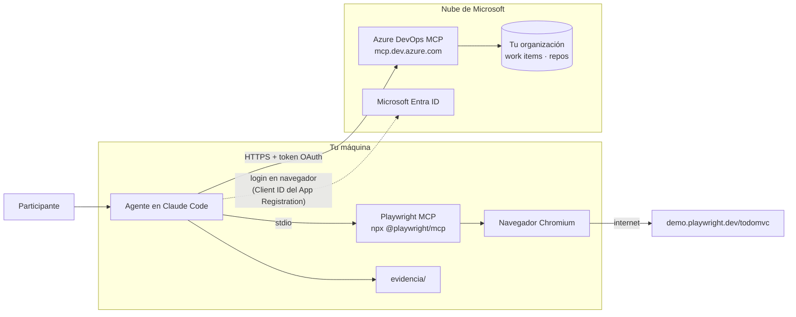

# Laboratorio 4C: Tipos de MCP — locales y remotos (ruta Claude Code)

> Esta es la **ruta Claude Code** del laboratorio. La ruta Kiro está en [README.kiro.md](./README.kiro.md). La ruta equivalente en Cursor está en [README.cursor.md](./README.cursor.md).

## Objetivo

Distinguir en la práctica los dos tipos de servidor MCP — **local (stdio)** y **remoto (HTTP + OAuth)** — instalando uno de cada tipo en **Claude Code**: el MCP de **Playwright** como ejemplo local y el MCP remoto de **Azure DevOps** como ejemplo remoto. Cada paso incluye su equivalente en **Kiro** y **Cursor**, para que la configuración sea portable entre clientes.

Al final del laboratorio podrás:

1. Explicar qué cambia entre un MCP local y uno remoto: dónde corre el proceso, cómo se autentica y qué datos cruzan la frontera de tu máquina.
2. Configurar un MCP local y uno remoto en Claude Code (`.mcp.json` y `claude mcp add --scope user`), y traducir esa configuración a `.kiro/settings/mcp.json` (Kiro) y `.cursor/mcp.json` (Cursor).
3. Aplicar mínimo privilegio en un MCP remoto: limitar toolsets, forzar solo lectura y controlar qué tools se aprueban automáticamente.

**Prerrequisitos:**

- [Laboratorio 4: MCP (fundamentos)](../fundamentos/README.md) — qué es MCP y cómo se configura un primer servidor.
- Opcional: [Laboratorio 6: Compatibilidad de configuración entre agentes](../../config/README.md) — equivalencias de archivos entre clientes.
- **Claude Code** instalado y el comando `claude` disponible en la terminal (ruta de este archivo). Opcional: **Kiro** y/o **Cursor** para las equivalencias.
- **Node.js** v20 o superior y **npm**.
- Para la Fase B remota: una **organización de Azure DevOps conectada a Microsoft Entra ID** (las organizaciones con cuenta personal MSA no son compatibles) y el **Client ID** de un *App Registration* que el instructor comparte (ver [Preparación del instructor](#preparación-del-instructor-fase-b)).
- Si la organización **no** tiene la aplicación **Azure DevOps MCP**, la Fase B se hace con la [alternativa con PAT](#alternativa-con-pat--mcp-local): un token de solo lectura en la variable de usuario `ADO_PAT`. No hace falta Client ID.

**Material técnico del laboratorio:** [`.mcp.json`](./.mcp.json) (Claude Code), [`.kiro/settings/mcp.json`](./.kiro/settings/mcp.json) (Kiro), [`.cursor/mcp.json`](./.cursor/mcp.json) (Cursor), [`snippets/`](./snippets/) (configuraciones de Azure DevOps por cliente) y [`evidencia/`](./evidencia/README.md) (salidas del ejercicio).

---

## Marco teórico

### Dos tipos de servidor MCP

El protocolo MCP define **cómo** cliente y servidor intercambian mensajes (JSON-RPC); el **transporte** define **por dónde** viajan. De ahí salen los dos tipos que verás en cualquier cliente:

| Aspecto | MCP local (stdio) | MCP remoto (Streamable HTTP) |
|---------|-------------------|------------------------------|
| Dónde corre | Proceso hijo que el CLI lanza en **tu máquina** | Servicio alojado por un **tercero** en la nube |
| Cómo se declara | `type: "stdio"` + `command` + `args` (p. ej. `npx ...`) | `type: "http"` + `url` (+ `headers` opcionales) |
| Instalación | Necesita el runtime (Node, Python, Docker…) | Ninguna; solo red saliente HTTPS |
| Autenticación | Hereda tu sesión local o variables de entorno | **OAuth 2.1** en el navegador (o token en `headers`) |
| Actualizaciones | Tú fijas la versión (`@0.0.83`) | Las publica el proveedor |
| Datos | Se quedan en tu máquina, salvo lo que el servidor envíe | Viajan al proveedor en cada llamada |
| Ejemplo del lab | **Playwright** controla un navegador local | **Azure DevOps** consulta work items y repos |

```
LOCAL   Agente ──tool call──► Claude Code ──stdin/stdout──► proceso npx (tu PC) ──► navegador
REMOTO  Agente ──tool call──► Claude Code ──HTTPS + token──► mcp.dev.azure.com ──► tu organización
```

En ambos casos el modelo **no ejecuta nada**: pide una tool, Claude Code la ejecuta contra el servidor y el resultado vuelve al contexto (ver [Laboratorio extra: Agent Loop](../../agent-loop/README.md)).

### OAuth en MCP remotos: por qué a veces hace falta un *Client ID*

Al conectarse a un MCP remoto protegido, el cliente necesita un **Client ID** para iniciar el flujo OAuth. Hay dos formas de obtenerlo:

| Mecanismo | Cómo funciona | Ejemplo |
|-----------|---------------|---------|
| **Dynamic Client Registration (DCR)** | El cliente se registra solo contra el servidor; tú no configuras nada | La mayoría de MCP remotos |
| **Client ID pre-registrado** | Un administrador crea un *App Registration* y tú pegas su Client ID en la configuración | **Azure DevOps** (Microsoft Entra no soporta DCR) |

Por eso el MCP de Azure DevOps funciona “sin configuración” en VS Code y Visual Studio (Microsoft ya registró esos clientes), mientras que **Claude Code, Cursor y Kiro** necesitan un App Registration propio en Entra. El protocolo es el mismo; lo que cambia es quién tiene un Client ID reconocido por el proveedor de identidad.

En Claude Code el Client ID va en `oauth.clientId` (o en `--client-id`) y el callback usa el puerto `3118`, es decir `http://localhost:3118/callback`. Esa URI tiene que estar registrada en el App Registration.

### Equivalencias entre clientes

| Concepto | Claude Code | Kiro | Cursor |
|----------|-------------|------|--------|
| Config de **proyecto** | `.mcp.json` (raíz) | `.kiro/settings/mcp.json` | `.cursor/mcp.json` |
| Config de **usuario** | `~/.claude.json` (`claude mcp add --scope user`) | `~/.kiro/settings/mcp.json` | `~/.cursor/mcp.json` |
| Precedencia | local > proyecto > usuario | Proyecto > usuario | Proyecto > usuario |
| Server local | `type: "stdio"`, `command`, `args`, `env` | `command`, `args`, `env` | `command`, `args`, `env` |
| Server remoto | `type: "http"`, `url`, `headers` | `url`, `headers` (sin `type`) | `url`, `type: "http"`, `headers` |
| Client ID OAuth | `oauth.clientId` + `oauth.callbackPort` | `oauth.clientId` + `oauth.redirectUri` | `auth.CLIENT_ID` |
| Desactivar server | `/mcp` → disable | `"disabled": true` | Toggle en *Settings → Tools & MCP* |
| Aprobar tools sin preguntar | `permissions.allow` en `.claude/settings.json` (`mcp__server__tool`) | `autoApprove: ["tool"]` | Allowlist en ajustes del agente |
| Ocultar tools | `permissions.deny` | `disabledTools: ["tool"]` | Toggle por tool |
| Variables de entorno | `${VAR}` | `${VAR}` (aprobadas en *Mcp Approved Env Vars*) | `${env:VAR}` |
| Ver estado | `/mcp` | Panel de Kiro → **MCP Servers** | *Settings → Tools & MCP* |

Referencias: **[Claude Code — MCP](https://code.claude.com/docs/en/mcp)**, **[Kiro — MCP configuration](https://kiro.dev/docs/mcp/configuration/)**, **[Cursor — MCP](https://cursor.com/docs/context/mcp)**.

---

## Componentes del laboratorio

Diagrama de componentes del laboratorio:



Estructura de archivos:

```
tipos/
├── README.kiro.md                     # Ruta Kiro
├── README.claude.md                   # Este archivo (ruta Claude Code)
├── README.cursor.md                   # Ruta Cursor
├── .mcp.json                          # Claude Code: Playwright (local)
├── .kiro/settings/mcp.json            # Kiro: Playwright (local)
├── .cursor/mcp.json                   # Cursor: Playwright (local)
├── snippets/
│   ├── ado-remoto.claude.json         # Azure DevOps remoto para Claude Code
│   ├── ado-remoto.kiro.json           # Azure DevOps remoto para Kiro
│   ├── ado-remoto.cursor.json         # Azure DevOps remoto para Cursor
│   ├── ado-local.plan-b.claude.json   # Plan B: Azure DevOps local (stdio) para Claude Code
│   ├── ado-local.plan-b.kiro.json     # Plan B para Kiro
│   ├── ado-local.plan-b.cursor.json   # Plan B para Cursor
│   ├── ado-local-pat.claude.json      # Alternativa: Azure DevOps local con PAT
│   ├── ado-local-pat.kiro.json        # PAT para Kiro
│   └── ado-local-pat.cursor.json      # PAT para Cursor
└── evidencia/                         # Salidas (gitignored salvo README)
```

---

## Pasos

### Preparación

1. Abre una terminal en la carpeta `etapa-1/laboratorios/mcp/tipos`. Claude Code lee `.mcp.json` del directorio de trabajo.
2. Comprueba Node, npm y el CLI:

   ```powershell
   node -v    # v20 o superior
   npm -v
   claude --version
   ```

3. Arranca una sesión con `claude`. La primera vez que el proyecto declara servidores MCP, Claude Code pide **aceptar** los del `.mcp.json`. Acepta `playwright`.
4. Dentro de la sesión, ejecuta `/mcp`. Ahí verás el estado de cada servidor durante el laboratorio. Sal con `Esc` o continúa en la misma sesión para los prompts de las fases.

#### Preparación del instructor (Fase B)

El MCP remoto de Azure DevOps exige un *App Registration* en Microsoft Entra. Lo crea **una sola vez el instructor** (o un administrador del tenant) y comparte el **Client ID** con el grupo:

1. Verifica que la aplicación empresarial **Azure DevOps MCP** esté aprovisionada en el tenant.
2. En **Microsoft Entra admin center → App registrations → New registration**, crea `taller-sdd-mcp`.
3. En **Authentication → Add redirect URI → Mobile and desktop applications**, agrega las tres URIs (una por cliente):

   | Cliente | Redirect URI |
   |---------|--------------|
   | **Claude Code** (esta ruta) | `http://localhost:3118/callback` |
   | Kiro | `http://localhost:3119/oauth/callback` |
   | Cursor | `http://localhost:8787/callback` |

4. En la pestaña **Settings** de Authentication, activa **Allow public client flows** (los clientes de este laboratorio usan PKCE, sin secreto).
5. En **API permissions → Add a permission → APIs my organization uses**, busca **Azure DevOps MCP** (`2a72489c-aab2-4b65-b93a-a91edccf33b8`) y agrega solo los permisos delegados de **lectura** que usará el taller.
6. Selecciona **Grant admin consent** y copia el **Application (client) ID**.

> El Client ID **no es un secreto**, pero sí es específico del tenant: no lo publiques en repositorios abiertos. Nunca uses *client secrets* en este laboratorio.

---

### Fase A — MCP local: Playwright

**Meta:** levantar un servidor MCP que corre como proceso en tu máquina y verificar que el agente controla un navegador local.

1. Revisa la configuración del proyecto en [`.mcp.json`](./.mcp.json):

   ```json
   {
     "mcpServers": {
       "playwright": {
         "type": "stdio",
         "command": "npx",
         "args": ["-y", "@playwright/mcp@0.0.83", "--isolated", "--viewport-size=1280x720"]
       }
     }
   }
   ```

   | Campo | Qué hace |
   |-------|----------|
   | `type: "stdio"` | Claude Code exige el transporte de forma explícita en un servidor local |
   | `command` / `args` | El CLI lanza `npx`, que descarga y ejecuta **una versión fija** del servidor |
   | `--isolated` | Perfil de navegador temporal: no usa tus cookies ni sesiones |

   La aprobación automática no vive en `.mcp.json`. Vive en `.claude/settings.json`, con el nombre `mcp__<servidor>__<tool>`. Crea el archivo (o agrega la entrada si ya existe, sin borrar el resto):

   ```json
   {
     "permissions": {
       "allow": ["mcp__playwright__browser_snapshot"]
     }
   }
   ```

   `browser_snapshot` (solo lectura) no pedirá confirmación; `browser_click` y `browser_type` sí.

2. Si prefieres registrarlo por CLI en lugar de editar el JSON:

   ```powershell
   claude mcp add playwright --scope project -- npx -y @playwright/mcp@0.0.83 --isolated --viewport-size=1280x720
   ```

   El archivo del repositorio ya incluye el servidor: este comando solo hace falta si partes de un `.mcp.json` vacío.

3. En la sesión, ejecuta `/mcp` y confirma que `playwright` aparece **conectado**. Despliega su lista de tools (`browser_navigate`, `browser_snapshot`, `browser_click`, `browser_type`, `browser_take_screenshot`…).

   > La primera vez `npx` descarga el paquete y el navegador puede tardar en instalarse. Si el servidor falla, `/mcp` muestra el error de conexión.

4. Comprueba que es un proceso **local** mientras el servidor está activo (con la sesión de `claude` abierta):

   ```powershell
   Get-CimInstance Win32_Process -Filter "Name='node.exe'" |
     Where-Object CommandLine -match 'playwright/mcp' |
     Select-Object ProcessId, CommandLine
   ```

5. En la misma sesión de Claude Code, ejecuta:

   ```prompt
   Usa el MCP de Playwright para:
   1. Abrir https://demo.playwright.dev/todomvc
   2. Agregar las tareas "Configurar MCP local" y "Configurar MCP remoto"
   3. Marcar como completada la primera
   4. Tomar una captura y guardarla en evidencia/playwright-todomvc.png
   5. Escribir en evidencia/playwright-resumen.md qué tools usaste y en qué orden
   ```

6. Observa las solicitudes de aprobación: `browser_snapshot` se ejecuta sin preguntar (está en `permissions.allow`); `browser_click` y `browser_type` piden confirmación.

#### Equivalencia en Kiro y Cursor

| Cliente | Cómo instalarlo | Cómo verificarlo |
|---------|-----------------|------------------|
| **Kiro** | Ya incluido en [`.kiro/settings/mcp.json`](./.kiro/settings/mcp.json); `autoApprove` incluye `browser_snapshot`. Kiro infiere stdio por `command` | Panel **MCP Servers** → `playwright` conectado |
| **Cursor** | Ya incluido en [`.cursor/mcp.json`](./.cursor/mcp.json); abre la carpeta en Cursor | *Settings → Tools & MCP* → `playwright` en verde |

> Los tres archivos describen el mismo comando. Claude Code declara `"type": "stdio"`; Kiro y Cursor lo infieren por la presencia de `command`.

---

### Fase B — MCP remoto: Azure DevOps

**Meta:** conectar un servidor que **no corre en tu máquina**, autenticarte con OAuth y restringir lo que el agente puede hacer.

> Si tu organización no tiene la aplicación **Azure DevOps MCP**, sáltate esta fase remota y sigue la [alternativa con PAT](#alternativa-con-pat--mcp-local).

1. Registra el servidor en la configuración **de usuario**, no en `.mcp.json` del repositorio.

   > La organización y el Client ID son **personales o del tenant**. Playwright vive en el proyecto porque todo el equipo lo usa igual. La precedencia es local > proyecto > usuario: el `playwright` de `.mcp.json` sigue activo y `azure-devops` se suma desde el alcance de usuario.

   Desde la carpeta del laboratorio, con `{organization}` y `{client-id}` ya sustituidos:

   ```powershell
   claude mcp add --transport http azure-devops https://mcp.dev.azure.com/{organization} --client-id {client-id} --callback-port 3118 --header "X-MCP-Readonly: true" --header "X-MCP-Toolsets: wit,repos" --scope user
   ```

   El resultado equivale a [`snippets/ado-remoto.claude.json`](./snippets/ado-remoto.claude.json), guardado en la config de usuario (`~/.claude.json`):

   ```json
   {
     "mcpServers": {
       "azure-devops": {
         "type": "http",
         "url": "https://mcp.dev.azure.com/{organization}",
         "headers": {
           "X-MCP-Toolsets": "wit,repos",
           "X-MCP-Readonly": "true"
         },
         "oauth": {
           "clientId": "{client-id}",
           "callbackPort": 3118
         }
       }
     }
   }
   ```

   | Campo | Qué hace |
   |-------|----------|
   | `type: "http"` + `url` | Endpoint alojado por Microsoft; el transporte es HTTP, no un proceso local |
   | `X-MCP-Toolsets` | Expone solo **work items** y **repos** (en lugar de todo el catálogo: pipelines, wiki, test plans…) |
   | `X-MCP-Readonly` | El servidor oculta todas las tools de escritura (crear, actualizar, votar…) |
   | `oauth.clientId` | Client ID del App Registration; Claude Code omite DCR y usa este |
   | `oauth.callbackPort` | Puerto `3118` → `http://localhost:3118/callback`; debe coincidir **exactamente** con el registrado en Entra |

2. Abre `claude` (o reinicia la sesión). Ejecuta `/mcp`, selecciona `azure-devops` y completa el login. Claude Code **abre el navegador** con el inicio de sesión de Microsoft. Entra con tu cuenta de la organización y acepta el consentimiento.
3. Vuelve a `/mcp`: `azure-devops` debe aparecer conectado. Compara su lista de tools con la tabla del [Marco teórico](#dos-tipos-de-servidor-mcp): solo verás tools de lectura (`wit_work_item`, `repo_pull_request`, `search_code`…), ninguna terminada en `_write`.
4. Comprueba que esta vez **no** hay proceso local nuevo (repite el comando del paso A.4: solo aparece Playwright).
5. En la sesión de Claude Code, ejecuta:

   ```prompt
   Usa el MCP de Azure DevOps para:
   1. Listar los proyectos de mi organización
   2. Mostrar los work items asignados a mí
   3. Listar los pull requests activos del proyecto <proyecto>
   Escribe un resumen en evidencia/ado-resumen.md indicando qué tools usaste.
   ```

   No agregues tools remotas a `permissions.allow`: cada llamada debe pedir confirmación. Si quisieras ocultar una tool concreta, iría en `permissions.deny` con el mismo patrón `mcp__azure-devops__<tool>`.

6. Prueba el límite de solo lectura:

   ```prompt
   Crea un work item de tipo Task llamado "Prueba MCP" en el proyecto <proyecto>.
   ```

   > El agente debería responder que no tiene una tool para hacerlo. El control no depende del modelo ni de un prompt: el **servidor** no expone la tool. Esa es la diferencia entre una restricción declarativa y una instrucción en `CLAUDE.md`.

7. **Opcional:** en `/mcp`, desactiva `azure-devops` y verifica que deja de ofrecer tools sin borrar la configuración de usuario. Vuelve a activarlo antes de la Fase C si quieres usarlo en la comparación.

#### Equivalencia en Kiro y Cursor

| Cliente | Configuración | Autenticación |
|---------|---------------|---------------|
| **Kiro** | Copia [`snippets/ado-remoto.kiro.json`](./snippets/ado-remoto.kiro.json) en `~/.kiro/settings/mcp.json` (`oauth.clientId` y `oauth.redirectUri`) | Kiro abre el navegador al guardar |
| **Cursor** | Copia [`snippets/ado-remoto.cursor.json`](./snippets/ado-remoto.cursor.json) en `~/.cursor/mcp.json` (Client ID en `auth.CLIENT_ID`) | *Settings → Tools & MCP* → `azure-devops` → **Authenticate** |

> Los tres clientes envían los mismos `headers` al mismo `url`. Solo cambia **dónde** se declara el Client ID y **qué puerto** usa el callback OAuth, por eso el App Registration tiene una redirect URI por cliente.

#### Plan B — MCP local de Azure DevOps

Si tu organización no está en Entra, o no es posible crear el App Registration, usa el **servidor local** oficial: el mismo catálogo de tools, pero corriendo con `npx` y autenticado con el inicio de sesión interactivo de Microsoft (por defecto).

1. Regístralo en el alcance de usuario (sustituye `{organization}`):

   ```powershell
   claude mcp add azure-devops-local --scope user -- npx -y @azure-devops/mcp@2.11.0 {organization} -d core work-items repositories
   ```

   La forma JSON equivalente está en [`snippets/ado-local.plan-b.claude.json`](./snippets/ado-local.plan-b.claude.json): `"type": "stdio"` y el mismo `command` / `args`.

2. El argumento `-d core work-items repositories` cumple el papel de `X-MCP-Toolsets`: limita los dominios cargados.
3. Repite los prompts del paso B.5. La primera llamada abre el login de Microsoft en el navegador.

> El Plan B convierte el ejemplo “remoto” en uno **local**: el tipo de MCP depende de **dónde corre el servidor**, no de qué servicio consulta. Un MCP local también puede hablar con la nube.

#### Alternativa con PAT — MCP local

Si la organización **no tiene aprovisionada la aplicación Azure DevOps MCP**, el servidor remoto `https://mcp.dev.azure.com` no está disponible. Usa el mismo servidor local, autenticado con un **Personal Access Token** en lugar del login interactivo. `npx` corre en tu máquina y cada llamada sale hacia Azure DevOps con ese token.

El PAT es un secreto. Vive en una variable de entorno de tu usuario y el JSON solo la **referencia**. No lo pegues en `.mcp.json`, en `~/.claude.json` ni en el chat. No uses `claude mcp add --env PERSONAL_ACCESS_TOKEN=<token>`: ese comando guardaría el secreto en la config de usuario.

1. En Azure DevOps abre **User settings → Personal access tokens → New Token**. Ámbito: solo tu organización. Expiración corta, la del taller. Scopes personalizados, únicamente de lectura:
   - **Work Items**: Read
   - **Code**: Read
   - **Project and Team**: Read
2. El servidor no acepta el PAT en claro. `PERSONAL_ACCESS_TOKEN` debe ser el **base64** de `correo:pat`. El correo puede ser cualquier valor no vacío; en este laboratorio usa `participante@contoso.com`.
3. Guarda ese valor en la variable de usuario `ADO_PAT`. En PowerShell el PAT no se muestra al pegarlo:

   ```powershell
   $correo = "participante@contoso.com"
   $pat = Read-Host "Pega el PAT" -AsSecureString
   $bstr = [Runtime.InteropServices.Marshal]::SecureStringToBSTR($pat)
   try {
     $plain = [Runtime.InteropServices.Marshal]::PtrToStringBSTR($bstr)
     $encoded = [Convert]::ToBase64String([Text.Encoding]::UTF8.GetBytes("${correo}:${plain}"))
     [Environment]::SetEnvironmentVariable("ADO_PAT", $encoded, "User")
   } finally {
     [Runtime.InteropServices.Marshal]::ZeroFreeBSTR($bstr)
     $plain = $null
   }
   ```

   Cierra la sesión de `claude` y abre una terminal nueva: el proceso solo hereda variables de usuario que ya existían al arrancar. Comprueba sin imprimir el valor:

   ```powershell
   if ([string]::IsNullOrEmpty([Environment]::GetEnvironmentVariable("ADO_PAT", "User"))) {
     "ADO_PAT no está definida"
   } else {
     "ADO_PAT está definida"
   }
   ```

4. En la configuración de **usuario** (`~/.claude.json`), añade el servidor dentro de `mcpServers` sin borrar el resto. La forma está en [`snippets/ado-local-pat.claude.json`](./snippets/ado-local-pat.claude.json). Reemplaza `{organization}` (el nombre de `https://dev.azure.com/{organization}`):

   ```json
   {
     "mcpServers": {
       "azure-devops": {
         "type": "stdio",
         "command": "npx",
         "args": [
           "-y",
           "@azure-devops/mcp",
           "{organization}",
           "--authentication", "pat",
           "-d", "core", "work-items", "repositories"
         ],
         "env": {
           "PERSONAL_ACCESS_TOKEN": "${ADO_PAT}"
         }
       }
     }
   }
   ```

   | Campo | Qué hace |
   |-------|----------|
   | `type: "stdio"` + `command` | Claude Code lanza el servidor local; no hay `url` |
   | `--authentication pat` | Lee el token de `PERSONAL_ACCESS_TOKEN` en lugar del login interactivo |
   | `${ADO_PAT}` | Claude Code interpola la variable de usuario. El JSON no contiene el token |
   | `-d core work-items repositories` | Equivale a `X-MCP-Toolsets`: solo esos dominios |

   Cuando conecte, fija en `args` la versión que resolvió npm (`npm view @azure-devops/mcp version`), del mismo modo que Playwright usa `@0.0.83`.

5. Abre `claude` desde una terminal que ya vea `ADO_PAT`. En `/mcp`, `azure-devops` debe aparecer conectado. Repite el comando del paso A.4 con el filtro `azure-devops/mcp`: tiene que aparecer un proceso `node` local.
6. Repite los prompts del paso B.5. No agregues tools de este servidor a `permissions.allow`.
7. Pide crear un work item, como en el paso B.6. Con el remoto y `X-MCP-Readonly` la tool de escritura no existe. Con un PAT de solo lectura la tool **puede aparecer**, y es la API de Azure DevOps la que rechaza la llamada. El control está en los scopes del token.

> En Cursor la misma variable se escribe `${env:ADO_PAT}`. En Kiro es `${ADO_PAT}` y, además, hay que aprobarla en *Mcp Approved Env Vars*. Los JSON están en `snippets/ado-local-pat.cursor.json` y `snippets/ado-local-pat.kiro.json`.

---

### Fase C — Comparación y reflexión

**Meta:** consolidar la diferencia entre ambos tipos con evidencia propia.

1. Pide al agente que redacte la comparación:

   ```prompt
   Con base en .mcp.json, tu configuración de usuario de MCP (claude mcp add --scope user) y lo que
   hicimos en este laboratorio, crea evidencia/comparacion.md con una tabla que compare
   Playwright y Azure DevOps en: dónde corre, transporte, autenticación, quién fija la
   versión, qué datos salen de mi máquina y cómo restringimos las tools.
   ```

2. Responde en el mismo archivo:
   - ¿Qué pasaría si el proveedor del MCP remoto cambia o agrega tools mañana? ¿Y con el local fijado en `@0.0.83`?
   - ¿Qué servidor podría filtrar código o datos del negocio fuera de tu red? ¿Qué control lo mitiga?
   - ¿Por qué `X-MCP-Readonly` es más confiable que pedirle al agente “no modifiques nada”?

3. Revisa `git status`: solo deberían aparecer cambios de configuración intencionales. Ni `evidencia/` ni `~/.claude.json` deben quedar en el repositorio. El Client ID no va en `.mcp.json` del proyecto. Si creaste `.claude/settings.json` solo con `mcp__playwright__browser_snapshot`, puedes versionarlo: no contiene secretos.

---

## Conclusiones del laboratorio

- **Local vs remoto es una cuestión de transporte y ubicación**, no del servicio: un MCP local (`type: "stdio"` + `command`) corre como proceso en tu máquina; uno remoto (`type: "http"` + `url`) es un servicio de terceros al que llegas por HTTPS.
- **Los MCP remotos trasladan la complejidad a la autenticación**: sin instalación ni versiones que mantener, pero con OAuth, Client IDs y dependencia del proveedor de identidad (Entra no soporta DCR, por eso Claude Code, Cursor y Kiro necesitan un App Registration). Si la organización no tiene la aplicación Azure DevOps MCP, el camino es el servidor local con PAT: el secreto queda en `ADO_PAT` y el JSON solo escribe `${ADO_PAT}`.
- **La configuración es portable entre clientes**: Claude Code, Kiro y Cursor comparten el formato `mcpServers`; cambian la ruta del archivo, la forma de declarar el tipo (`type`, obligatorio en Claude Code) y el campo del Client ID (`oauth.clientId` + `oauth.callbackPort`).
- **El mínimo privilegio se aplica en el servidor y en el cliente**: toolsets y solo lectura (servidor), `permissions.allow` / `permissions.deny` y `/mcp` → disable (Claude Code), y el alcance local vs proyecto vs usuario según quién debe compartir la configuración.

Tras el taller, revisa los MCP que usa tu equipo y clasifícalos en locales y remotos: para cada remoto, documenta qué datos envía, cómo se autentica y qué restricciones de tools aplican; para cada local, fija una versión concreta en `args`.

---

## Referencias

- [Claude Code — Connect to tools via MCP](https://code.claude.com/docs/en/mcp)
- [Kiro — MCP configuration](https://kiro.dev/docs/mcp/configuration/)
- [Cursor — Model Context Protocol](https://cursor.com/docs/context/mcp)
- [Playwright MCP (microsoft/playwright-mcp)](https://github.com/microsoft/playwright-mcp)
- [Set up the remote Azure DevOps MCP Server — Microsoft Learn](https://learn.microsoft.com/azure/devops/mcp-server/remote-mcp-server)
- [Azure DevOps Remote MCP Server GA — DevBlogs](https://devblogs.microsoft.com/devops/azure-devops-remote-mcp-server-ga/)
- [Azure DevOps MCP Server local (microsoft/azure-devops-mcp)](https://github.com/microsoft/azure-devops-mcp)
- [Azure DevOps MCP local — Personal Access Token](https://github.com/microsoft/azure-devops-mcp/blob/main/docs/GETTINGSTARTED.md#personal-access-token)
