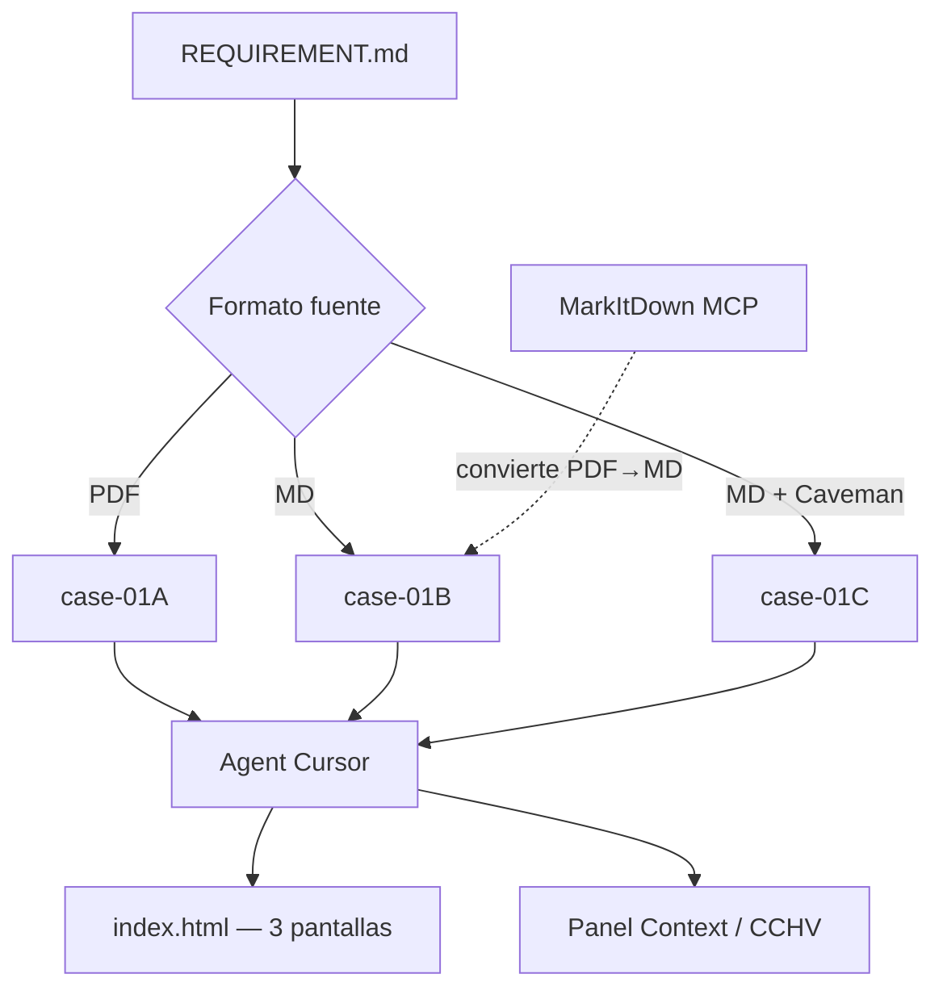

# Laboratorio complementario: Optimización de tokens con agentes

## Objetivo

Aplicar estrategias **medibles** para reducir el consumo de tokens cuando trabajas con agentes de IA: elegir formatos de entrada adecuados, convertir documentos pesados antes de leerlos, comprimir la salida del agente y auditar sesiones con herramientas de analítica.

Al final del laboratorio podrás:

1. Comparar el coste en tokens de la **misma tarea** con distintos formatos de documento (PDF vs Markdown).
2. Medir el impacto de **Caveman** en la salida del agente sin perder precisión técnica.
3. Configurar **MarkItDown** (nativo, Docker o MCP) para convertir binarios a texto antes de inyectarlos al contexto.
4. Instalar **Claude Code History Viewer** y **Langfuse** (Docker) para auditar tokens y trazas entre sesiones y experimentos.

**Prerrequisitos:**

- [Laboratorio 3: Ventana de contexto y atención](../context/general/README.md) — panel Context, categorías de coste fijo y variable.
- [Laboratorio 4: MCP (Model Context Protocol)](../mcp/README.md) — configuración de servidores en `.cursor/mcp.json`.
- Cursor con modo **Agent** y panel **Context** visible.
- **Node.js** v18+ (Caveman, MarkItDown MCP).
- **Python 3.10+** (instalación nativa de MarkItDown MCP).
- **Docker Desktop** (MarkItDown en contenedor y Langfuse self-hosted).

**Material técnico del laboratorio:** tres casos comparables en `case-01A-file-format/`, `case-01B-file-format/` y `case-01C-caveman/`. Cada uno incluye el mismo `REQUIREMENT.md`, un documento fuente en `docs/` y capturas de referencia en `stats/`.

---

## Marco teórico

### Dónde se van los tokens

Cada turno del agente paga un **coste fijo** (system prompt, esquemas de herramientas, reglas, skills, MCP, subagentes) y un **coste variable** (conversación, resultados de tools, archivos adjuntos). El [Laboratorio 3](../context/general/README.md) ya cubre el desglose en Cursor; aquí nos centramos en **palancas activas** para bajar el variable sin degradar la calidad del trabajo.

```
Coste fijo (cada turno)          Coste variable (crece con el uso)
─────────────────────────        ─────────────────────────────────
System · Tools · Rules           Conversation + tool outputs
Skills · MCP · Subagents         @ archivos · PDFs · logs largos
```

### Estrategias de optimización

| Estrategia | Qué reduce | Cuándo aplicarla |
|------------|------------|------------------|
| **Formato de entrada** | Tokens de lectura | Preferir Markdown/ texto plano frente a PDF, DOCX o binarios embebidos |
| **Conversión previa** (MarkItDown) | Tokens de tool Read + ruido binario | Antes de pedir al agente que “lea el documento” |
| **Salida concisa** (Caveman) | Tokens de respuesta del modelo | Sesiones largas, revisiones, explicaciones repetitivas |
| **Contexto acotado** | Historial + adjuntos | Hilos nuevos, `@` explícito, desactivar MCP no usados |
| **Auditoría** (CCHV / Langfuse) | — (observabilidad) | Comparar sesiones, trazas y costes; validar ahorro real |

> **Importante:** Caveman y formatos ligeros optimizan **output** y **lectura**; no eliminan el coste de razonamiento ni de herramientas. Mide siempre con el panel Context o con CCHV antes de asumir ahorros netos en una sesión completa.

### Por qué importa el formato del documento

Un PDF en disco no es “texto” para el agente: la herramienta Read puede devolver bytes codificados, metadatos o extracciones parciales que inflan el contexto sin aportar semántica útil. Un `.md` equivalente suele ser **10×–50× más barato** en tokens y más fácil de citar línea a línea.

Los tres casos del laboratorio repiten la misma instrucción (`REQUIREMENT.md`) cambiando solo la fuente y, en el caso C, el estilo de respuesta:

| Caso | Documento fuente | Modo agente | Hipótesis |
|------|------------------|-------------|-----------|
| **01A** | `docs/file10.pdf` | Normal | Mayor coste en lectura y conversación |
| **01B** | `docs/file10.md` | Normal | Menor coste; misma tarea completada |
| **01C** | `docs/file10.md` | Caveman (`/caveman`) | Menor coste de **salida** además del formato |

Referencia conceptual: [Cursor — Context](https://cursor.com/docs/context), [MarkItDown](https://github.com/microsoft/markitdown), [Caveman](https://github.com/JuliusBrussee/caveman).

---

## Componentes del laboratorio

Diagrama de flujo del experimento:



Estructura de archivos:

```
optimum/
├── README.md                         # Este archivo
├── tools/                            # Guías de instalación
│   ├── cchv.md
│   ├── caveman.md
│   ├── markitdown.md
│   └── langfuse.md
├── case-01A-file-format/             # Baseline: PDF
│   ├── REQUIREMENT.md
│   ├── docs/file10.pdf
│   ├── index.html                    # Salida esperada del agente
│   └── stats/                        # Capturas de referencia (tokens)
├── case-01B-file-format/             # Mismo doc en Markdown
│   ├── REQUIREMENT.md
│   ├── docs/file10.md
│   ├── index.html
│   └── stats/
└── case-01C-caveman/                 # Markdown + Caveman activo
    ├── REQUIREMENT.md
    ├── docs/file10.md
    ├── index.html
    └── stats/
```

---

## Pasos

### Preparación

1. Abre **`etapa-1/laboratorios/optimum`** como workspace en Cursor (recomendado: un caso a la vez para aislar mediciones).
2. Instala las herramientas complementarias según [Herramientas complementarias](#herramientas-complementarias) (puedes hacerlo antes o durante el taller).
3. Ten a mano una plantilla para registrar tokens:

   | Caso | Input (aprox.) | Output (aprox.) | Total Context | Notas |
   |------|----------------|-----------------|---------------|-------|
   | 01A PDF | | | | |
   | 01B MD | | | | |
   | 01C MD + Caveman | | | | |

---

### Fase A — Baseline con PDF (`case-01A-file-format`)

**Meta:** medir el coste de completar la tarea leyendo un PDF directamente.

1. Abre la carpeta `case-01A-file-format` como workspace (o trabaja desde `optimum` referenciando rutas relativas).
2. Abre un **chat nuevo** en modo Agent **sin** Caveman activo.
3. Envía un prompt equivalente a:

   ```prompt
   Lee REQUIREMENT.md y ejecútalo usando el documento en ./docs.
   Genera index.html con 3 pantallas que expliquen de qué trata el documento.
   Al terminar, indica el uso aproximado de tokens del panel Context.
   ```

4. Registra el desglose del panel **Context** al finalizar.
5. Compara con las capturas en `stats/` (referencia del taller; tus cifras pueden variar según modelo y MCP activos).

---

### Fase B — Mismo contenido en Markdown (`case-01B-file-format`)

**Meta:** repetir la tarea con `file10.md` y comparar tokens con la Fase A.

1. Cambia el workspace a `case-01B-file-format` (o usa chat nuevo con contexto limpio).
2. Repite el mismo prompt de la Fase A.
3. Anota la diferencia respecto a 01A, especialmente en **Conversation** y lecturas de archivo.

**Opcional — conversión con MarkItDown:** si partiste de PDF en un proyecto real, convierte primero:

```prompt
Convierte docs/informe.pdf a Markdown con MarkItDown MCP (convert_to_markdown)
y luego ejecuta REQUIREMENT.md sobre el .md generado.
```

---

### Fase C — Markdown + Caveman (`case-01C-caveman`)

**Meta:** medir el ahorro en tokens de **salida** con Caveman activo.

1. Asegúrate de tener Caveman instalado (ver [tools/caveman.md](./tools/caveman.md)).
2. Abre `case-01C-caveman` y un chat nuevo en Agent.
3. Activa Caveman:

   ```prompt
   /caveman full
   ```

   O escribe: *"talk like caveman"* / *"habla como caveman"*.

4. Ejecuta el mismo prompt de las fases A y B.
5. Compara **output tokens** y legibilidad del HTML generado. Caveman comprime prosa, no código ni rutas.

---

### Fase D — Reflexión y auditoría

**Meta:** validar hipótesis con datos agregados, no solo una sesión.

1. Abre [CCHV](./tools/cchv.md) y/o [Langfuse](./tools/langfuse.md) (`http://localhost:3000`) y localiza las tres sesiones o trazas del experimento.
2. Responde:
   - ¿Qué porcentaje del ahorro vino del **formato** vs del **modo Caveman**?
   - ¿En qué fase el agente hizo más tool calls innecesarias?
   - ¿Qué cambiarías en un repo real (CI, docs, reglas) para evitar PDFs en el camino crítico del agente?

---

## Herramientas complementarias

Instalación paso a paso en archivos separados bajo `tools/`. Ejecuta los comandos en una terminal fuera del agente salvo que se indique lo contrario.

| Herramienta | Guía | Rol en el laboratorio |
|-------------|------|------------------------|
| **Claude Code History Viewer** | [tools/cchv.md](./tools/cchv.md) | Historial offline y analítica de tokens (Cursor, Claude Code, etc.) |
| **Caveman** | [tools/caveman.md](./tools/caveman.md) | Reducir tokens de **salida** del agente |
| **MarkItDown** | [tools/markitdown.md](./tools/markitdown.md) | Convertir PDF/DOCX a Markdown (nativo, Docker, MCP) |
| **Langfuse** | [tools/langfuse.md](./tools/langfuse.md) | Observabilidad LLM self-hosted (Docker Compose) |

---

## Conclusiones del laboratorio

- El **formato de entrada** es la palanca más directa cuando el agente debe “leer un documento”: Markdown casi siempre gana a PDF en tokens y trazabilidad.
- **MarkItDown MCP** integra la conversión en el agent loop sin scripts ad hoc en el repo; nativo y Docker comparten el mismo contrato de herramienta.
- **Caveman** reduce tokens de **salida**; combínalo con entradas ligeras para sesiones largas, pero mide el coste fijo que añade la skill (~1–1.5k tokens/turno según upstream).
- **CCHV** y **Langfuse** cierran el ciclo de observabilidad: historial del IDE vs trazas centralizadas con tokens y costes por run.
- Las tres palancas (formato, conversión, estilo) se apoyan en el marco del [Laboratorio 3](../context/general/README.md) y en MCP del [Laboratorio 4](../mcp/README.md).

Tras el taller, vuelve a [Laboratorio 5: Hooks](../hooks/README.md) para ver cómo interceptar tool calls (p. ej. bloquear lecturas de rutas sensibles) o a [Laboratorio 7: Seguridad](../security/README.md) para gobernanza de MCP en entornos con datos reales.

---

## Referencias

| Tema | Fuente |
|------|--------|
| Ventana de contexto | [Laboratorio 3: Context](../context/general/README.md) |
| MCP en Cursor | [Cursor — MCP / mcp.json](https://cursor.com/docs/context/mcp) |
| MarkItDown | [tools/markitdown.md](./tools/markitdown.md) · [microsoft/markitdown](https://github.com/microsoft/markitdown) |
| Caveman | [tools/caveman.md](./tools/caveman.md) · [JuliusBrussee/caveman](https://github.com/JuliusBrussee/caveman) |
| Historial y tokens | [tools/cchv.md](./tools/cchv.md) · [Claude Code History Viewer](https://github.com/jhlee0409/claude-code-history-viewer) |
| Observabilidad LLM | [tools/langfuse.md](./tools/langfuse.md) · [Langfuse — Docker Compose](https://langfuse.com/self-hosting/deployment/docker-compose) |
| Agent loop | [Laboratorio extra: Agent Loop](../agent-loop/README.md) |
