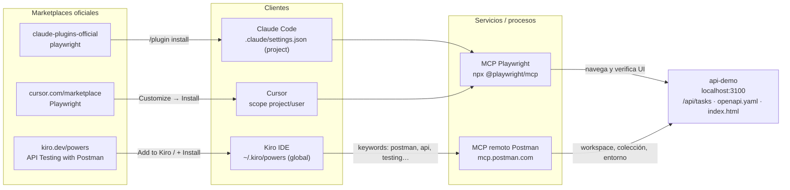

# Laboratorio 6B: Plugins y Powers (ruta Claude Code)

> Esta es la **ruta Claude Code**. La ruta Kiro está en [README.md](./README.md). La ruta Cursor está en [README.cursor.md](./README.cursor.md).

## Objetivo

Entender qué es un **plugin** de **Claude Code**, de qué piezas se compone y cómo se distribuye e instala desde un marketplace, usando **Kiro** (allí se llama **Power**) y **Cursor** como contraste. Cada afirmación del marco teórico enlaza a la documentación oficial del fabricante.

Al final del laboratorio podrás:

1. Explicar qué es un plugin de Claude Code, qué componentes puede empaquetar (skills, agentes, hooks, MCP, comandos…) y en qué se diferencia de instalar esas piezas por separado. Ubicar el equivalente en Kiro (Power) y en Cursor.
2. Leer `.claude-plugin/plugin.json` y `.mcp.json` de un plugin real e identificar qué aporta cada archivo, comparándolos con `POWER.md` / `plugin.json` de Kiro y con `.cursor-plugin/plugin.json` de Cursor.
3. Instalar **Playwright** desde el marketplace oficial `claude-plugins-official` en scope de proyecto, comprobar qué cambió en `.claude/settings.json` y usarlo contra la página de demo. Después, instalar el mismo plugin en Cursor y el Power **API Testing with Postman** en Kiro, y ver qué cambia el flujo.
4. Comparar fuentes de instalación, scopes y marketplaces custom, con `.claude-plugin/marketplace.json` como catálogo de referencia.

**Prerrequisitos:**

- [Laboratorio 2: Prompts y skills](../skills/README.md) — anatomía de una skill (`SKILL.md`).
- [Laboratorio 4: MCP](../mcp/fundamentos/README.md) — qué es un servidor MCP y cómo se configura.
- [Laboratorio 5: Hooks](../hooks/README.md) — hooks como middleware del agente.
- [Laboratorio 6: Compatibilidad de configuración entre agentes](../config/README.md) — equivalencias de configuración entre clientes.
- **Claude Code** instalado y autenticado (`claude --version`). Es el cliente de esta ruta.
- **Cursor 2.5+** y **Kiro IDE** con sesión iniciada, para la fase de contraste. Kiro: https://kiro.dev/downloads/ (metadatos del manifiesto en el panel de Powers: **1.4.26+** — [fuente](https://kiro.dev/docs/powers/installation/)). Cursor: los plugins llegan en 2.5 — [fuente](https://cursor.com/changelog/2-5). El paquete de Playwright en el marketplace de Cursor declara `minClientVersions.cursor` en `3.13.0`.
- **Node.js 22+** (la API de demo y el MCP de Playwright usan `node`/`npx`).
- Cuenta de **Postman** (gratuita) para la fase de contraste en Kiro. **Postman CLI** (`postman --version`) es opcional.

**Material técnico del laboratorio:** [`api-demo/`](./api-demo/) — API REST en memoria sin dependencias (`server.mjs`), su contrato [`openapi.yaml`](./api-demo/openapi.yaml) y una página web mínima ([`index.html`](./api-demo/index.html)) sobre la que trabajan Playwright y Postman.

---

## Marco teórico

### Qué es un plugin

Los tres fabricantes coinciden en la idea: un plugin es una **unidad de distribución** que agrupa varias capacidades del agente para instalarlas, versionarlas y desinstalarlas juntas.

| Cliente | Definición oficial (cita) | Fuente |
|---------|---------------------------|--------|
| **Claude Code** | "A Claude Code plugin is a directory of skills, agents, hooks, MCP servers, or other components that Claude Code installs and loads as one unit." | [Plugins overview](https://code.claude.com/docs/en/plugins/overview.md) |
| **Kiro** | "Kiro powers give your AI agent instant access to specialized knowledge for any technology." · "Powers are plugins that bundle MCP tools, skills, and knowledge into a single installable package." | [kiro.dev/docs/powers](https://kiro.dev/docs/powers/) |
| **Cursor** | "Plugins package rules, skills, agents, commands, MCP servers, and hooks into distributable bundles." | [cursor.com/docs/plugins](https://cursor.com/docs/plugins) |

Claude Code lo resume así: skills, agentes, hooks y MCP **funcionan sin plugin**; el plugin sirve para **empaquetarlos, distribuirlos y versionarlos** como una sola pieza ([fuente](https://code.claude.com/docs/en/plugins/overview.md#decide-whether-you-need-a-plugin)).

#### Un estándar común: Agent Plugins

Kiro y Cursor adoptan la especificación abierta **[Agent Plugins](https://agent-plugins.org/)**. Claude Code mantiene su propio manifiesto.

- Claude Code usa `.claude-plugin/plugin.json` ([fuente](https://code.claude.com/docs/en/plugins/manifest-reference.md)).
- Kiro: "Powers follow the Agent Plugins specification — an open, vendor-neutral format for packaging reusable components", y la recomienda para Powers nuevos ([fuente](https://kiro.dev/docs/powers/create/)).
- Cursor distingue **Agent Plugins** (estándar abierto, `plugin.json` en la raíz, solo skills y MCP) de **Cursor Plugins** (`.cursor-plugin/plugin.json`, que añade rules, agents, commands, hooks y variables) ([fuente](https://cursor.com/docs/plugins)).

### De qué está compuesto

| Componente | Claude Code plugin | Kiro Power | Cursor plugin |
|------------|--------------------|------------|---------------|
| Manifiesto | `.claude-plugin/plugin.json` (opcional) | `plugin.json` (Agent Plugins) o `POWER.md` (legacy) | `.cursor-plugin/plugin.json` o `plugin.json` (Agent Plugins) |
| Skills | `skills/<nombre>/SKILL.md` | `skills/<nombre>/SKILL.md` | `skills/<nombre>/SKILL.md` |
| Servidores MCP | `.mcp.json` | `mcp.json` | `mcp.json` |
| Hooks | `hooks/hooks.json` | Opcionales (en el formato legacy) | `hooks/hooks.json` |
| Conocimiento / instrucciones | — (se usan skills) | Steering y `POWER.md` (legacy) | `rules/` |
| Agentes / subagentes | `agents/` | — | `agents/` |
| Comandos | `commands/` (legacy, "Prefer skills/") | — | `commands/` |
| Otros | LSP (`.lsp.json`), `output-styles/`, `monitors/`, `bin/`, `settings.json` | — | `variables` |

Fuentes: [Claude — Manifest reference / Standard layout](https://code.claude.com/docs/en/plugins/manifest-reference.md#standard-layout), [Kiro — Create powers](https://kiro.dev/docs/powers/create/), [Kiro — blog de lanzamiento](https://kiro.dev/blog/introducing-powers/), [Cursor — Plugins reference](https://cursor.com/docs/reference/plugins).

#### Manifiestos: campos obligatorios

| Cliente | Archivo | Obligatorio | Opcionales relevantes |
|---------|---------|-------------|-----------------------|
| Claude Code | `.claude-plugin/plugin.json` | `name` (kebab-case; el archivo entero es opcional) | `version`, `description`, `author`, `displayName`, `dependencies`, `userConfig`, rutas a componentes… |
| Kiro (Agent Plugins) | `plugin.json` | `$schema`, `name` (kebab-case), `version` (semver), `description`, `author`, `keywords` | `homepage`, `repository`, `license` |
| Cursor | `.cursor-plugin/plugin.json` | `name` (kebab-case) | `description`, `version`, `author`, `logo`, `rules`, `agents`, `skills`, `commands`, `hooks`, `mcpServers`, `variables` |

Fuentes: [Claude](https://code.claude.com/docs/en/plugins/manifest-reference.md), [Kiro](https://kiro.dev/docs/powers/create/), [Cursor](https://cursor.com/docs/reference/plugins).

En Kiro, `keywords` no es decorativo: es lo que dispara la activación del Power. En Claude Code no hay un campo equivalente: un plugin habilitado entra en la sesión por estar habilitado, no porque el prompt contenga una palabra del manifiesto. En Kiro, además, "The `name` field is used internally by Kiro to identify the power"; si lo cambias tras instalar puede que tengas que reinstalar ([fuente](https://kiro.dev/docs/powers/create/)).

Ejemplo real de un repo que sirve a varios clientes: **SDD Devkit** (el plugin del taller) publica **dos manifiestos** en la misma raíz. `plugin.json` con `$schema` de Agent Plugins lo consumen Kiro y Cursor; `.claude-plugin/plugin.json` lo consume Claude Code. Ambos comparten `skills/` y `agents/`.

```text
sdd-devkit/
├── plugin.json                  # Agent Plugins ($schema agent-plugins.org) → Kiro / Cursor
├── .claude-plugin/
│   ├── plugin.json              # Manifiesto de Claude Code
│   └── marketplace.json         # El mismo repo actúa como marketplace de Claude
├── skills/                      # work-define/, test-define/, quality-check/ … (SKILL.md)
└── agents/                      # docs-specialist.md, quality-specialist.md, ui-specialist.md
```

```json
{
  "$schema": "https://agent-plugins.org/schemas/1.0.0/plugin.schema.json",
  "name": "sdd-devkit",
  "description": "Utilidades para el desarrollo de SDD ...",
  "version": "2.2.2",
  "author": { "name": "juanca202" },
  "repository": "https://github.com/juanca202/sdd-devkit",
  "license": "MIT",
  "keywords": ["adr", "user-stories", "traceability", "testing", "code-review"]
}
```

> El ejemplo detallado de instalación de **SDD Devkit** se revisará en una sesión posterior; aquí solo se usa como referencia de estructura.

### Activación y costo de contexto

Aquí está la diferencia conceptual más importante entre los tres clientes. En esta ruta, el punto de partida es Claude Code.

- **Claude Code — siempre presente, con costo visible.** Un plugin habilitado está en todas las sesiones: sus skills y agentes aportan nombre y descripción al contexto en cada turno, y sus hooks y MCP se ejecutan ([fuente](https://code.claude.com/docs/en/plugins/overview.md)). Para el marketplace oficial, el panel de detalles muestra el **Context cost** (*Every turn* / *When invoked*), y `claude plugin details <name>` muestra la línea `Always-on` ([fuente](https://code.claude.com/docs/en/plugins/install.md)).
- **Kiro — activación dinámica por keywords.** "Traditional MCP servers load all tools upfront." Un Power, en cambio, carga sus herramientas MCP y sus skills solo cuando las `keywords` del manifiesto aparecen en la conversación, y deja el contexto base cerca de cero ([docs](https://kiro.dev/docs/powers/), [create](https://kiro.dev/docs/powers/create/)). Según el anuncio de lanzamiento, el Power se desactiva cuando la conversación cambia de dominio ([blog](https://kiro.dev/blog/introducing-powers/)).
- **Cursor — por componente.** Cada componente sigue su propia regla de carga (rules, skills, MCP…). La documentación de plugins no describe un mecanismo de activación por plugin ([fuente](https://cursor.com/docs/plugins)).

### Cómo se instalan: fuentes y scopes

| | Claude Code | Kiro | Cursor |
|---|-------------|------|--------|
| **Marketplace oficial** | `claude-plugins-official` (se registra solo en la primera sesión interactiva) → `/plugin install <p>@claude-plugins-official` | Catálogo [kiro.dev/powers](https://kiro.dev/powers) → **Add to Kiro**, o panel **Powers** del IDE → **+ Install** | [cursor.com/marketplace](https://cursor.com/marketplace) → **Customize** → **Install** (también `/add-plugin`) |
| **Desde Git** | `/plugin marketplace add owner/repo` o URL git (el repo es un marketplace) | **Add Custom Power → Import power from GitHub** (repos privados: requiere acceso) | Team marketplace: **Dashboard → Plugins & MCPs → Import from Repo** |
| **Carpeta local** | `claude --plugin-dir ./mi-plugin` (una sesión) o `/plugin marketplace add ./ruta` | **Add Custom Power → Import power from a folder** | `~/.cursor/plugins/local/<nombre>` + **Developer: Reload Window** |
| **CLI** | `claude plugin install <p>@<mkt> --scope …` | `kiro-cli powers install <name\|path>` (solo sesiones V3, CLI 2.25+) | — |
| **Scopes** | `user` (`~/.claude/settings.json`), `project` (`.claude/settings.json`), `local` (`.claude/settings.local.json`) | **Solo global**: `~/.kiro/powers/`; no existe scope de proyecto (también por agente con `includePowers`) | `project` o `user`, elegido al instalar |

Fuentes: Claude — [install](https://code.claude.com/docs/en/plugins/install.md), [Anthropic marketplaces](https://code.claude.com/docs/en/plugins/anthropic-marketplaces.md), [create](https://code.claude.com/docs/en/plugins/create.md); Kiro — [installation](https://kiro.dev/docs/powers/installation/), [create](https://kiro.dev/docs/powers/create/), [configuration](https://kiro.dev/docs/configuration/), [CLI 2.25](https://kiro.dev/changelog/cli/2-25/); Cursor — [plugins](https://cursor.com/docs/plugins), [changelog 2.5](https://cursor.com/changelog/2-5), [changelog 2.6](https://cursor.com/changelog/2-6).

Con **project scope**, el nombre del plugin queda en `.claude/settings.json` (se puede commitear) y el equipo lo ve habilitado. Cada colaborador aún debe ejecutar la instalación una vez: `claude plugin install <p>@<mkt> --scope project` ([fuente](https://code.claude.com/docs/en/plugins/install.md#choose-an-install-scope)).

### Marketplaces custom (teoría)

Un **marketplace** es un catálogo que dice qué plugins existen y de dónde descargar cada uno. Claude Code lo define así: "It's a catalog, not a hosted store" ([fuente](https://code.claude.com/docs/en/plugins/overview.md#get-plugins-from-a-marketplace)).

| | Claude Code | Kiro | Cursor |
|---|-------------|------|--------|
| ¿Marketplace propio documentado? | **Sí.** Cualquier repo o carpeta con `.claude-plugin/marketplace.json` | **No.** El mecanismo para Powers propios o privados es importar desde un repo de GitHub (público o privado) o desde una carpeta. Un repo puede contener varios Powers, cada uno en su carpeta | **Sí**, en planes **Teams** (1 marketplace importado + Default) y **Enterprise** (ilimitados) |
| Archivo de catálogo | `.claude-plugin/marketplace.json`: `name`, `owner`, `plugins[]` (cada uno con `name` y `source`) | — | `.cursor-plugin/marketplace.json`: `name`, `owner`, `plugins[]` (máx. 10 MB) |
| Tipos de `source` | Ruta relativa, `github`, `git-subdir`, `url`, `archive`, `npm`, `command` | URL de GitHub / carpeta | Ruta de carpeta del repo importado |
| Distribución a un equipo | `extraKnownMarketplaces` + `enabledPlugins` en `.claude/settings.json` (se commitea); políticas con `strictKnownMarketplaces` | Compartir la URL del repo | Por grupos de la organización, con modo **Default Off / Default On / Required** |

El marketplace oficial de Claude Code es el repo [anthropics/claude-plugins-official](https://github.com/anthropics/claude-plugins-official): `plugins/` (mantenidos por Anthropic) y `external_plugins/` (terceros). El propio README del repo advierte que Anthropic no controla qué MCP, archivos u otro software incluye cada plugin.

Un catálogo mínimo, suficiente para repartir un plugin interno, tiene esta forma ([referencia](https://code.claude.com/docs/en/plugins/marketplace-reference.md)):

```json
{
  "name": "qa-interno",
  "owner": { "name": "Equipo QA" },
  "plugins": [
    { "name": "playwright", "source": "./playwright" }
  ]
}
```

Fuentes: Claude — [marketplace reference](https://code.claude.com/docs/en/plugins/marketplace-reference.md), [create marketplace](https://code.claude.com/docs/en/plugins/create-marketplace.md); Kiro — [create](https://kiro.dev/docs/powers/create/), [blog](https://kiro.dev/blog/introducing-powers/); Cursor — [plugins](https://cursor.com/docs/plugins), [reference](https://cursor.com/docs/reference/plugins).

> Kiro tiene un **registro empresarial**, pero es de **servidores MCP** ([fuente](https://kiro.dev/docs/mcp/registry/)), no de Powers. No se debe presentar como "marketplace privado de Powers".

### Seguridad y confianza

Los tres fabricantes insisten en lo mismo: un plugin **ejecuta código** (hooks, MCP locales) con tus permisos de usuario.

- Claude Code: los plugins se ejecutan con tus privilegios; antes de instalar, revisa en el panel de detalles qué hooks y MCP añade ([fuente](https://code.claude.com/docs/en/plugins/security.md)).
- Kiro: "Kiro powers are third-party tools that may be subject to separate terms" y "A local MCP server runs on your machine with your user's access unless you sandbox it" ([fuente](https://kiro.dev/docs/powers/installation/)).
- Cursor: el Marketplace oficial se revisa manualmente, y los plugins de la comunidad están en cursor.directory ([fuente](https://cursor.com/docs/plugins)).

> **Lo que la documentación oficial no confirma** (no lo afirmes en clase): que Cursor lea el formato `.claude-plugin/` de Claude Code (solo está documentado que expande `${CLAUDE_PLUGIN_ROOT}` en `mcp.json`); que exista un registro privado de Powers en Kiro; o que `kiro-cli` instale un Power desde una URL de GitHub.

---

## Componentes del laboratorio



La línea de trabajo de esta ruta es Claude Code → Playwright → `api-demo`. Cursor repite el mismo plugin; Kiro aporta el contraste de activación por keywords con otro paquete del catálogo (en kiro.dev/powers no hay un Power de Playwright).

---

## Pasos

### Preparación

1. Abre la carpeta `etapa-1/laboratorios/plugins` como directorio de trabajo de Claude Code. En la fase de contraste la abrirás también en Cursor y en Kiro.
2. En una terminal, levanta la API de demo y déjala corriendo durante todo el laboratorio:

   ```powershell
   # Desde etapa-1/laboratorios/plugins
   node api-demo/server.mjs
   # → api-demo escuchando en http://localhost:3100
   ```

3. Comprueba que responde:

   ```powershell
   curl http://localhost:3100/health
   curl http://localhost:3100/api/tasks
   ```

   Abre también `http://localhost:3100/` en el navegador: verás la página **Tareas QA**.
4. Crea una carpeta local `evidencia/` (está en `.gitignore`) donde guardarás capturas y notas de cada fase.

---

### Fase A — Anatomía del plugin Playwright en el marketplace de Claude

**Meta:** antes de instalar nada, leer qué trae un plugin real del marketplace oficial y qué ejecutará en tu máquina. Es el hábito de revisión que piden los tres fabricantes.

1. Abre el código del plugin en el directorio oficial: https://github.com/anthropics/claude-plugins-official/tree/main/external_plugins/playwright
2. Identifica los archivos y su rol. Este paquete es deliberadamente pequeño: solo manifiesto y un MCP.

   | Archivo | Qué es | Qué debes revisar |
   |---------|--------|-------------------|
   | `.claude-plugin/plugin.json` | Manifiesto de Claude Code | `name` (`playwright`), `description`, `author.name` (`Microsoft`). No declara `version`: en este formato es opcional, y el archivo entero también lo es |
   | `.mcp.json` | Servidor MCP que el plugin registra | Servidor local `playwright`: `command: "npx"`, `args: ["@playwright/mcp@latest"]`. Corre un proceso en tu máquina; no es una URL remota |

   ```json
   {
     "name": "playwright",
     "description": "Browser automation and end-to-end testing MCP server by Microsoft. Enables Claude to interact with web pages, take screenshots, fill forms, click elements, and perform automated browser testing workflows.",
     "author": { "name": "Microsoft" }
   }
   ```

   ```json
   {
     "playwright": {
       "command": "npx",
       "args": ["@playwright/mcp@latest"]
     }
   }
   ```

3. Anota lo que **no** hay: ni `skills/`, ni `agents/`, ni `hooks/hooks.json`, ni `commands/`. El plugin sigue siendo una unidad de distribución; aquí esa unidad contiene un solo componente. Compáralo con **SDD Devkit** (sección *Manifiestos*), que sí empaqueta skills y agentes, y publica además el `plugin.json` de Agent Plugins.
4. Abre, sin instalar, los otros dos formatos y responde en `evidencia/`:

   - Power legacy de Kiro: https://github.com/kirodotdev/powers/tree/main/postman (`POWER.md`, `mcp.json`, `steering/`).
   - Plugin de Cursor: https://github.com/cursor/plugins/tree/main/third_party/playwright (`.cursor-plugin/plugin.json`, `mcp.json`).

   - ¿Dónde está el manifiesto en cada formato y qué campo es obligatorio?
   - El MCP de Playwright es local (`npx`). El de Postman, en su `mcp.json`, es remoto (`https://mcp.postman.com/minimal`). ¿Qué implica eso para permisos y para `localhost`?
   - ¿Dónde viven las `keywords` en el Power de Postman y en el `plugin.json` de SDD Devkit? El `plugin.json` de Playwright en Claude no las tiene. ¿Qué mecanismo usa Claude en su lugar? (sección *Activación y costo de contexto*).
   - En Cursor, el `mcp.json` de Playwright envuelve los servidores en `mcpServers` y pasa `-y` a `npx`. En Claude, `.mcp.json` es un mapa `nombre → config` y el argumento es solo el paquete. Anota la diferencia de forma; la usarás al comparar la Fase C.

---

### Fase B — Instalar Playwright en Claude Code (marketplace oficial)

**Meta:** instalar un plugin desde `claude-plugins-official`, elegir scope de proyecto, leer el costo de contexto antes de aceptar y usar el MCP contra `api-demo`.

1. Abre una terminal en `etapa-1/laboratorios/plugins` e inicia `claude`.
2. Abre el detalle del plugin ([fuente](https://code.claude.com/docs/en/plugins/install.md)):

   ```text
   /plugin install playwright@claude-plugins-official
   ```

   En una sesión, este comando **no instala directamente**: abre el panel para que revises el plugin. Antes de elegir, anota en `evidencia/`:

   - **Will install:** el servidor MCP `playwright` (`npx @playwright/mcp@latest`). Tiene que coincidir con el `.mcp.json` que leíste en la Fase A.
   - **Context cost:** *Every turn* y *When invoked*.
   - Qué hooks añade (en este plugin, ninguno).

3. Elige **Install for all collaborators on this repository (project scope)** y comprueba qué archivo cambió:

   ```powershell
   Get-Content .claude/settings.json   # debe contener enabledPlugins con "playwright@claude-plugins-official"
   ```

   > Con project scope, el plugin queda habilitado para todo el equipo, pero cada colaborador aún debe ejecutar `claude plugin install playwright@claude-plugins-official --scope project` una vez ([fuente](https://code.claude.com/docs/en/plugins/install.md#choose-an-install-scope)). `.claude/settings.local.json` sería scope `local` (no se comparte). `~/.claude/settings.json` sería scope `user` (todas tus sesiones, fuera del repo).

4. Verifica: `/plugin` → pestaña **Installed**, o en tu shell `claude plugin list`. Opcional: `claude plugin details playwright` y anota la línea `Always-on`.
5. Úsalo contra la página de demo. El primer arranque de `npx` descarga el paquete y los binarios del navegador; puede tardar y necesita red.

   ```prompt
   Open http://localhost:3100 with Playwright. Add the task "Validar plugin" and verify it appears in
   the list. Then submit an empty title and verify the alert shows "El campo 'title' es obligatorio.".
   Report each step as PASS/FAIL.
   ```

6. En un chat nuevo, repite el objetivo **sin nombrar el plugin** ni la palabra "Playwright":

   ```prompt
   Abre http://localhost:3100 en un navegador controlado por herramientas. Agrega la tarea
   "Sin nombrar el plugin" y confirma que aparece en la lista. Informa PASS/FAIL.
   ```

   Anota si las herramientas del MCP estuvieron disponibles igual. En Claude un plugin habilitado no espera una keyword: entra en la sesión porque está en `enabledPlugins`.
7. (Opcional) Ciclo de vida: desinstalar y volver a instalar.

   ```powershell
   claude plugin uninstall playwright@claude-plugins-official --scope project
   ```

   Si lo desinstalas, reinstálalo antes de la Fase D: la tabla comparativa se llena con lo que observaste, y el cierre del laboratorio asume que sabes cómo retirarlo.

---

### Fase C — El mismo plugin en Cursor, y un Power en Kiro

**Meta:** repetir una instalación en los otros dos clientes y ver qué no se traslada: el panel de costo de contexto, el scope de proyecto y la activación por keywords. En el catálogo de Kiro no hay un Power de Playwright; el contraste usa **API Testing with Postman**.

#### C.1 — Cursor

1. Abre `etapa-1/laboratorios/plugins` como workspace en Cursor.
2. En la barra lateral, **Customize** → busca **Playwright** ([ficha](https://cursor.com/marketplace/cursor/playwright)) → **Install** → elige scope **project** ([fuente](https://cursor.com/docs/plugins)). Alternativa en el chat: `/add-plugin playwright` ([fuente](https://cursor.com/changelog/2-5)). El README del paquete también documenta **Cursor Settings → Plugins**.
3. Revisa en **Customize** qué componentes añadió. Contrástalo con la Fase A: un MCP local, `mcpServers.playwright`, lanzado con `npx -y @playwright/mcp@latest`.
4. Ejecuta el mismo prompt del paso B.5 en modo Agent.
5. Anota si Cursor te mostró un costo de contexto por turno (el panel de Claude sí) y si pudiste elegir scope `project`. No hace falta una keyword del manifiesto para que el MCP esté instalado: la documentación de Cursor no describe activación por plugin.

#### C.2 — Kiro (Power de Postman)

1. Abre el workspace en Kiro e instala el Power por **una** de las dos vías oficiales ([fuente](https://kiro.dev/docs/powers/installation/)):

   - **Web:** https://kiro.dev/powers → **API Testing with Postman** → **Add to Kiro**.
   - **IDE:** panel **Powers** → **Available Powers** → *Postman* → **+ Install**.

2. Verifica:

   - El Power aparece en el panel **Powers**.
   - Como usa el formato legacy (`POWER.md`), su MCP queda en `~/.kiro/settings/mcp.json`, en la sección de Powers, con un nombre con prefijo ([fuente](https://kiro.dev/docs/powers/installation/)):

     ```powershell
     Get-Content "$env:USERPROFILE\.kiro\settings\mcp.json"
     ```

   - Comprueba que **no** se creó nada en `.kiro/` del workspace: en Kiro los Powers son solo de **scope global** ([fuente](https://kiro.dev/docs/configuration/)). No hay un equivalente a `.claude/settings.json` de proyecto.

3. Pulsa **Try the power**. El primer uso del MCP remoto pide autenticarte con tu cuenta de Postman. Revisa cualquier hook que el onboarding proponga crear en `.kiro/hooks/` antes de aceptarlo.
4. Activa el Power **sin nombrarlo**, con keywords, en un chat nuevo (modo *Vibe*):

   ```prompt
   Using the API contract in api-demo/openapi.yaml, create a Postman workspace "lab-plugins",
   a collection that covers every endpoint (happy path + 400 and 404 cases) with test scripts,
   and an environment with baseUrl = http://localhost:3100. Save the IDs in .postman.json.
   ```

   Anota cuándo aparece el Power y qué herramientas `postman` invoca. Si la ejecución remota no alcanza `localhost`, el paso con **Postman CLI** está en la [ruta Kiro](./README.md) (Fase B, paso 5) y aquí es opcional.
5. En el mismo chat, cambia de tema ("explícame qué es un ADR") y observa si el agente sigue invocando herramientas de Postman. Ese corte por cambio de dominio no existe en el plugin de Claude que acabas de dejar habilitado.

---

### Fase D — Comparativa y marketplace custom

**Meta:** consolidar lo observado y razonar cómo distribuiría el equipo sus propios plugins. Esta fase es de análisis; no se instala nada nuevo.

1. Completa esta tabla en `evidencia/comparativa.md` con lo que **observaste** (no con lo que dice la teoría):

   | Pregunta | Claude Code (Playwright) | Cursor (Playwright) | Kiro (Postman) |
   |----------|--------------------------|---------------------|----------------|
   | ¿Dónde lo encontré? | | | |
   | ¿Qué revisé antes de instalar? | | | |
   | ¿Qué scope elegí / pude elegir? | | | |
   | ¿Qué archivo de configuración cambió? | | | |
   | ¿Cuándo se cargaron sus herramientas en el contexto? | | | |
   | ¿Cómo lo desinstalo? | | | |

2. Responde, apoyándote en la sección *Marketplaces custom*:

   - El equipo quiere distribuir un plugin interno de QA y que quede habilitado al clonar el repo. En Claude, ¿qué archivos commitearías (`.claude-plugin/marketplace.json`, `extraKnownMarketplaces`, `enabledPlugins`)? ¿Qué haría cada colaborador una sola vez?
   - ¿Qué harías en los otros dos clientes? (Kiro: repo GitHub privado + **Import power from GitHub**; Cursor: Team marketplace, plan Teams o Enterprise.)
   - ¿Por qué SDD Devkit publica dos manifiestos (`plugin.json` y `.claude-plugin/plugin.json`) en lugar de uno?
   - ¿Qué implica para un proyecto que el scope `project` de Claude viva en `.claude/settings.json`, frente a un Power de Kiro que solo existe en el perfil del usuario?

   > Siguiente paso del taller: se revisará en detalle la instalación de **SDD Devkit** como plugin propio, desde su repositorio y su marketplace.

---

## Conclusiones del laboratorio

- Un plugin no añade capacidades nuevas al agente: **empaqueta** skills, agentes, hooks, MCP y comandos para instalarlos, versionarlos y retirarlos como una sola unidad. En Claude Code el manifiesto es `.claude-plugin/plugin.json` (opcional). En Kiro esa unidad se llama **Power**.
- Skills, hooks y MCP funcionan sin plugin. El plugin importa cuando el equipo necesita distribuirlos y versionarlos juntos. Playwright en el marketplace oficial es el caso mínimo: un solo MCP local. SDD Devkit es el caso completo: skills, agentes y dos manifiestos.
- La diferencia operativa que se ve en esta ruta es el **costo de contexto**: un plugin habilitado está en la sesión, y el propio cliente lo mide (*Every turn* / *When invoked*, línea `Always-on`). Kiro, en cambio, carga el Power cuando aparecen sus keywords y lo suelta al cambiar de dominio. Cursor carga cada componente con su propia regla.
- El scope `project` deja `enabledPlugins` en `.claude/settings.json`, versionable con el repo. El scope `local` no se comparte; el `user` sigue al usuario fuera del proyecto. Kiro no tiene scope de proyecto: el Power queda en `~/.kiro/powers/`.
- Un marketplace de Claude es un catálogo (`.claude-plugin/marketplace.json`), no una tienda alojada. El repo oficial separa plugins de Anthropic y de terceros, y advierte que el contenido del plugin no está controlado por quien publica el catálogo.
- Instalar un plugin equivale a ejecutar código de terceros con tus permisos. En esta ruta el MCP de Playwright lanza `npx` en tu máquina: revisar el manifiesto y el panel de detalles antes de aceptar es parte del trabajo de QA.

Tras el taller, desinstala los plugins de prueba (`claude plugin uninstall playwright@claude-plugins-official --scope project`, **Uninstall** en el panel de Powers de Kiro, **Customize** en Cursor) o consérvalos si los vas a usar en tus proyectos.

---

## Referencias oficiales

- **Claude Code:** [Overview](https://code.claude.com/docs/en/plugins/overview.md) · [Install](https://code.claude.com/docs/en/plugins/install.md) · [Manifest reference](https://code.claude.com/docs/en/plugins/manifest-reference.md) · [Marketplace reference](https://code.claude.com/docs/en/plugins/marketplace-reference.md) · [Create a marketplace](https://code.claude.com/docs/en/plugins/create-marketplace.md) · [Anthropic marketplaces](https://code.claude.com/docs/en/plugins/anthropic-marketplaces.md) · [Security](https://code.claude.com/docs/en/plugins/security.md) · [Directorio oficial](https://github.com/anthropics/claude-plugins-official)
- **Kiro:** [Powers](https://kiro.dev/docs/powers/) · [Installation](https://kiro.dev/docs/powers/installation/) · [Create](https://kiro.dev/docs/powers/create/) · [Configuration (scopes)](https://kiro.dev/docs/configuration/) · [Catálogo](https://kiro.dev/powers) · [Repositorio oficial de Powers](https://github.com/kirodotdev/powers) · [Blog: Introducing Powers](https://kiro.dev/blog/introducing-powers/) · [CLI 2.25](https://kiro.dev/changelog/cli/2-25/)
- **Cursor:** [Plugins](https://cursor.com/docs/plugins) · [Plugins reference](https://cursor.com/docs/reference/plugins) · [Marketplace](https://cursor.com/marketplace) · [Changelog 2.5](https://cursor.com/changelog/2-5) · [Changelog 2.6](https://cursor.com/changelog/2-6)
- **Estándar:** [Agent Plugins](https://agent-plugins.org/)
