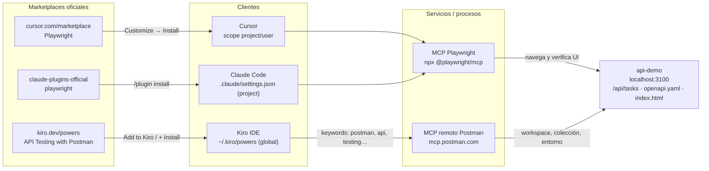

# Laboratorio 6B: Plugins y Powers (ruta Cursor)

> Esta es la **ruta Cursor**. La ruta Kiro está en [README.md](./README.md). La ruta Claude Code está en [README.claude.md](./README.claude.md).

## Objetivo

Entender qué es un **plugin** de **Cursor**, de qué piezas se compone y cómo se distribuye e instala desde el Marketplace, usando **Claude Code** y **Kiro** (allí se llama **Power**) como contraste. Cada afirmación del marco teórico enlaza a la documentación oficial del fabricante.

Al final del laboratorio podrás:

1. Explicar qué es un plugin de Cursor, qué componentes empaqueta (rules, skills, agents, commands, MCP, hooks) y en qué se diferencia de instalar esas piezas por separado. Ubicar el equivalente en Claude Code y en Kiro (Power).
2. Leer `.cursor-plugin/plugin.json` y `mcp.json` de un plugin real, y distinguir un **Cursor Plugin** de un **Agent Plugin** (`plugin.json` en la raíz, solo skills y MCP).
3. Instalar **Playwright** desde el Marketplace oficial en scope de proyecto, revisar qué componentes añadió y usarlo contra la página de demo. Después, instalar el mismo plugin en Claude Code y el Power **API Testing with Postman** en Kiro, y ver qué cambia el flujo.
4. Comparar fuentes de instalación, scopes y marketplaces custom. En Cursor el catálogo de equipo es un Team marketplace (planes Teams y Enterprise).

**Prerrequisitos:**

- [Laboratorio 2: Prompts y skills](../skills/README.md) — anatomía de una skill (`SKILL.md`).
- [Laboratorio 4: MCP](../mcp/fundamentos/README.md) — qué es un servidor MCP y cómo se configura.
- [Laboratorio 5: Hooks](../hooks/README.md) — hooks como middleware del agente.
- [Laboratorio 6: Compatibilidad de configuración entre agentes](../config/README.md) — equivalencias de configuración entre clientes.
- **Cursor** instalado. Los plugins y el Marketplace llegan en 2.5 ([fuente](https://cursor.com/changelog/2-5)). El paquete de Playwright del Marketplace declara en su manifiesto `minClientVersions.cursor` en **3.13.0**; comprueba la versión del IDE antes de la Fase B.
- **Claude Code** instalado y autenticado (`claude --version`) y **Kiro IDE** con sesión iniciada, para la fase de contraste. Kiro: https://kiro.dev/downloads/ (metadatos del manifiesto en el panel de Powers: **1.4.26+** — [fuente](https://kiro.dev/docs/powers/installation/)).
- **Node.js 22+** en el `PATH` (la API de demo y el MCP de Playwright usan `node`/`npx`).
- Cuenta de **Postman** (gratuita) para la fase de contraste en Kiro. **Postman CLI** (`postman --version`) es opcional.

**Material técnico del laboratorio:** [`api-demo/`](./api-demo/) — API REST en memoria sin dependencias (`server.mjs`), su contrato [`openapi.yaml`](./api-demo/openapi.yaml) y una página web mínima ([`index.html`](./api-demo/index.html)) sobre la que trabajan Playwright y Postman.

---

## Marco teórico

### Qué es un plugin

Los tres fabricantes coinciden en la idea: un plugin es una **unidad de distribución** que agrupa varias capacidades del agente para instalarlas, versionarlas y desinstalarlas juntas.

| Cliente | Definición oficial (cita) | Fuente |
|---------|---------------------------|--------|
| **Cursor** | "Plugins package rules, skills, agents, commands, MCP servers, and hooks into distributable bundles." | [cursor.com/docs/plugins](https://cursor.com/docs/plugins) |
| **Claude Code** | "A Claude Code plugin is a directory of skills, agents, hooks, MCP servers, or other components that Claude Code installs and loads as one unit." | [Plugins overview](https://code.claude.com/docs/en/plugins/overview.md) |
| **Kiro** | "Kiro powers give your AI agent instant access to specialized knowledge for any technology." · "Powers are plugins that bundle MCP tools, skills, and knowledge into a single installable package." | [kiro.dev/docs/powers](https://kiro.dev/docs/powers/) |

Claude Code lo formula de un modo que también vale para leer un plugin de Cursor: skills, agentes, hooks y MCP **funcionan sin plugin**; el plugin sirve para **empaquetarlos, distribuirlos y versionarlos** como una sola pieza ([fuente](https://code.claude.com/docs/en/plugins/overview.md#decide-whether-you-need-a-plugin)).

#### Dos formatos en el mismo cliente

Cursor acepta dos manifiestos ([fuente](https://cursor.com/docs/plugins)):

| Formato | Manifiesto | Qué puede incluir |
|---------|------------|-------------------|
| **Agent Plugins** (estándar abierto) | `plugin.json` en la raíz del paquete | Skills y servidores MCP |
| **Cursor Plugins** | `.cursor-plugin/plugin.json` | Rules, skills, agents, commands, MCP, hooks y variables |

Kiro recomienda el mismo estándar abierto para Powers nuevos: "Powers follow the Agent Plugins specification — an open, vendor-neutral format for packaging reusable components" ([fuente](https://kiro.dev/docs/powers/create/)). Claude Code no usa ese manifiesto: el suyo es `.claude-plugin/plugin.json` ([fuente](https://code.claude.com/docs/en/plugins/manifest-reference.md)). Especificación: [agent-plugins.org](https://agent-plugins.org/).

### De qué está compuesto

| Componente | Cursor plugin | Claude Code plugin | Kiro Power |
|------------|---------------|--------------------|------------|
| Manifiesto | `.cursor-plugin/plugin.json` o `plugin.json` (Agent Plugins) | `.claude-plugin/plugin.json` (opcional) | `plugin.json` (Agent Plugins) o `POWER.md` (legacy) |
| Skills | `skills/<nombre>/SKILL.md` | `skills/<nombre>/SKILL.md` | `skills/<nombre>/SKILL.md` |
| Servidores MCP | `mcp.json` | `.mcp.json` | `mcp.json` |
| Hooks | `hooks/hooks.json` | `hooks/hooks.json` | Opcionales (en el formato legacy) |
| Conocimiento / instrucciones | `rules/` | — (se usan skills) | Steering y `POWER.md` (legacy) |
| Agentes / subagentes | `agents/` | `agents/` | — |
| Comandos | `commands/` | `commands/` (legacy, "Prefer skills/") | — |
| Otros | `variables` | LSP (`.lsp.json`), `output-styles/`, `monitors/`, `bin/`, `settings.json` | — |

Fuentes: [Cursor — Plugins reference](https://cursor.com/docs/reference/plugins), [Claude — Manifest reference / Standard layout](https://code.claude.com/docs/en/plugins/manifest-reference.md#standard-layout), [Kiro — Create powers](https://kiro.dev/docs/powers/create/), [Kiro — blog de lanzamiento](https://kiro.dev/blog/introducing-powers/).

#### Manifiestos: campos obligatorios

| Cliente | Archivo | Obligatorio | Opcionales relevantes |
|---------|---------|-------------|-----------------------|
| Cursor | `.cursor-plugin/plugin.json` | `name` (kebab-case) | `description`, `version`, `author`, `logo`, `rules`, `agents`, `skills`, `commands`, `hooks`, `mcpServers`, `variables` |
| Claude Code | `.claude-plugin/plugin.json` | `name` (kebab-case; el archivo entero es opcional) | `version`, `description`, `author`, `displayName`, `dependencies`, `userConfig`, rutas a componentes… |
| Kiro (Agent Plugins) | `plugin.json` | `$schema`, `name` (kebab-case), `version` (semver), `description`, `author`, `keywords` | `homepage`, `repository`, `license` |

Fuentes: [Cursor](https://cursor.com/docs/reference/plugins), [Claude](https://code.claude.com/docs/en/plugins/manifest-reference.md), [Kiro](https://kiro.dev/docs/powers/create/).

En Kiro, `keywords` dispara la activación del Power. La documentación de plugins de Cursor no describe ese mecanismo: cada componente sigue su propia regla de carga. Un `plugin.json` de Cursor puede incluir un arreglo `keywords` (el de Playwright lo trae); no lo interpretes como el interruptor de Kiro. En Kiro, además, "The `name` field is used internally by Kiro to identify the power"; si lo cambias tras instalar puede que tengas que reinstalar ([fuente](https://kiro.dev/docs/powers/create/)).

Ejemplo real de un repo que sirve a varios clientes: **SDD Devkit** (el plugin del taller) publica **dos manifiestos** en la misma raíz. `plugin.json` con `$schema` de Agent Plugins lo consumen Kiro y Cursor; `.claude-plugin/plugin.json` lo consume Claude Code. Ambos comparten `skills/` y `agents/`.

```text
sdd-devkit/
├── plugin.json                  # Agent Plugins ($schema agent-plugins.org) → Kiro / Cursor
├── .claude-plugin/
│   ├── plugin.json              # Manifiesto de Claude Code
│   └── marketplace.json         # El mismo repo actúa como marketplace de Claude
├── skills/                      # work-define/, test-define/, quality-check/ … (SKILL.md)
└── agents/                      # docs-specialist.md, quality-specialist.md, ui-specialist.md
```

```json
{
  "$schema": "https://agent-plugins.org/schemas/1.0.0/plugin.schema.json",
  "name": "sdd-devkit",
  "description": "Utilidades para el desarrollo de SDD ...",
  "version": "2.2.2",
  "author": { "name": "juanca202" },
  "repository": "https://github.com/juanca202/sdd-devkit",
  "license": "MIT",
  "keywords": ["adr", "user-stories", "traceability", "testing", "code-review"]
}
```

> El ejemplo detallado de instalación de **SDD Devkit** se revisará en una sesión posterior; aquí solo se usa como referencia de estructura. Fíjate en que el manifiesto de la raíz es un **Agent Plugin** (skills y MCP), no un Cursor Plugin con `rules/` o `hooks/`.

### Activación y costo de contexto

Aquí está la diferencia conceptual más importante entre los tres clientes. En esta ruta, el punto de partida es Cursor.

- **Cursor — por componente.** Cada componente sigue su propia regla de carga (rules, skills, MCP…). La documentación de plugins no describe un mecanismo de activación por plugin ni un costo de contexto agregado del paquete ([fuente](https://cursor.com/docs/plugins)).
- **Claude Code — siempre presente, con costo visible.** Un plugin habilitado está en todas las sesiones: sus skills y agentes aportan nombre y descripción al contexto en cada turno, y sus hooks y MCP se ejecutan ([fuente](https://code.claude.com/docs/en/plugins/overview.md)). El panel de detalles del marketplace oficial muestra el **Context cost** (*Every turn* / *When invoked*), y `claude plugin details <name>` muestra la línea `Always-on` ([fuente](https://code.claude.com/docs/en/plugins/install.md)).
- **Kiro — activación dinámica por keywords.** "Traditional MCP servers load all tools upfront." Un Power carga sus herramientas MCP y sus skills solo cuando las `keywords` del manifiesto aparecen en la conversación, y deja el contexto base cerca de cero ([docs](https://kiro.dev/docs/powers/), [create](https://kiro.dev/docs/powers/create/)). Según el anuncio de lanzamiento, el Power se desactiva cuando la conversación cambia de dominio ([blog](https://kiro.dev/blog/introducing-powers/)).

### Cómo se instalan: fuentes y scopes

| | Cursor | Claude Code | Kiro |
|---|--------|-------------|------|
| **Marketplace oficial** | [cursor.com/marketplace](https://cursor.com/marketplace) → **Customize** → **Install** (también `/add-plugin`) | `claude-plugins-official` (se registra solo en la primera sesión interactiva) → `/plugin install <p>@claude-plugins-official` | Catálogo [kiro.dev/powers](https://kiro.dev/powers) → **Add to Kiro**, o panel **Powers** del IDE → **+ Install** |
| **Desde Git** | Team marketplace: **Dashboard → Plugins & MCPs → Import from Repo** | `/plugin marketplace add owner/repo` o URL git (el repo es un marketplace) | **Add Custom Power → Import power from GitHub** (repos privados: requiere acceso) |
| **Carpeta local** | `~/.cursor/plugins/local/<nombre>` + **Developer: Reload Window** | `claude --plugin-dir ./mi-plugin` (una sesión) o `/plugin marketplace add ./ruta` | **Add Custom Power → Import power from a folder** |
| **CLI** | — | `claude plugin install <p>@<mkt> --scope …` | `kiro-cli powers install <name\|path>` (solo sesiones V3, CLI 2.25+) |
| **Scopes** | `project` o `user`, elegido al instalar | `user` (`~/.claude/settings.json`), `project` (`.claude/settings.json`), `local` (`.claude/settings.local.json`) | **Solo global**: `~/.kiro/powers/`; no existe scope de proyecto (también por agente con `includePowers`) |

Fuentes: Cursor — [plugins](https://cursor.com/docs/plugins), [changelog 2.5](https://cursor.com/changelog/2-5), [changelog 2.6](https://cursor.com/changelog/2-6); Claude — [install](https://code.claude.com/docs/en/plugins/install.md), [Anthropic marketplaces](https://code.claude.com/docs/en/plugins/anthropic-marketplaces.md), [create](https://code.claude.com/docs/en/plugins/create.md); Kiro — [installation](https://kiro.dev/docs/powers/installation/), [create](https://kiro.dev/docs/powers/create/), [configuration](https://kiro.dev/docs/configuration/), [CLI 2.25](https://kiro.dev/changelog/cli/2-25/).

El Marketplace oficial se revisa de forma manual. Los plugins de la comunidad que no pasan por ese canal están en cursor.directory ([fuente](https://cursor.com/docs/plugins)).

### Marketplaces custom (teoría)

Un **marketplace** es un catálogo que dice qué plugins existen y de dónde descargar cada uno. Claude Code lo define así: "It's a catalog, not a hosted store" ([fuente](https://code.claude.com/docs/en/plugins/overview.md#get-plugins-from-a-marketplace)). En Cursor el equivalente de equipo es un **Team marketplace**.

| | Cursor | Claude Code | Kiro |
|---|--------|-------------|------|
| ¿Marketplace propio documentado? | **Sí**, en planes **Teams** (1 marketplace importado + Default) y **Enterprise** (ilimitados) | **Sí.** Cualquier repo o carpeta con `.claude-plugin/marketplace.json` | **No.** El mecanismo para Powers propios o privados es importar desde un repo de GitHub (público o privado) o desde una carpeta. Un repo puede contener varios Powers, cada uno en su carpeta |
| Archivo de catálogo | `.cursor-plugin/marketplace.json`: `name`, `owner`, `plugins[]` (máx. 10 MB) | `.claude-plugin/marketplace.json`: `name`, `owner`, `plugins[]` (cada uno con `name` y `source`) | — |
| Tipos de `source` | Ruta de carpeta del repo importado | Ruta relativa, `github`, `git-subdir`, `url`, `archive`, `npm`, `command` | URL de GitHub / carpeta |
| Distribución a un equipo | Por grupos de la organización, con modo **Default Off / Default On / Required** | `extraKnownMarketplaces` + `enabledPlugins` en `.claude/settings.json` (se commitea); políticas con `strictKnownMarketplaces` | Compartir la URL del repo |

El marketplace oficial de Cursor es el repo [cursor/plugins](https://github.com/cursor/plugins). Su catálogo (`.cursor-plugin/marketplace.json`) apunta al plugin de esta ruta con `"name": "playwright"` y `"source": "third_party/playwright"`. Importar un repo de equipo sigue el mismo esquema: cada entrada de `plugins[]` nombra una carpeta del repo.

Fuentes: Cursor — [plugins](https://cursor.com/docs/plugins), [reference](https://cursor.com/docs/reference/plugins); Claude — [marketplace reference](https://code.claude.com/docs/en/plugins/marketplace-reference.md), [create marketplace](https://code.claude.com/docs/en/plugins/create-marketplace.md); Kiro — [create](https://kiro.dev/docs/powers/create/), [blog](https://kiro.dev/blog/introducing-powers/).

> Kiro tiene un **registro empresarial**, pero es de **servidores MCP** ([fuente](https://kiro.dev/docs/mcp/registry/)), no de Powers. No se debe presentar como "marketplace privado de Powers".

### Seguridad y confianza

Los tres fabricantes insisten en lo mismo: un plugin **ejecuta código** (hooks, MCP locales) con tus permisos de usuario.

- Cursor: el Marketplace oficial se revisa manualmente, y los plugins de la comunidad están en cursor.directory ([fuente](https://cursor.com/docs/plugins)). Aun así, un MCP local arranca un proceso en tu máquina: lee el `mcp.json` antes de instalar.
- Claude Code: los plugins se ejecutan con tus privilegios; antes de instalar, revisa en el panel de detalles qué hooks y MCP añade ([fuente](https://code.claude.com/docs/en/plugins/security.md)).
- Kiro: "Kiro powers are third-party tools that may be subject to separate terms" y "A local MCP server runs on your machine with your user's access unless you sandbox it" ([fuente](https://kiro.dev/docs/powers/installation/)).

> **Lo que la documentación oficial no confirma** (no lo afirmes en clase): que Cursor lea el formato `.claude-plugin/` de Claude Code (solo está documentado que expande `${CLAUDE_PLUGIN_ROOT}` en `mcp.json`); que exista un registro privado de Powers en Kiro; o que `kiro-cli` instale un Power desde una URL de GitHub.

---

## Componentes del laboratorio



La línea de trabajo de esta ruta es Cursor → Playwright → `api-demo`. Claude Code repite el mismo plugin y muestra el costo de contexto que Cursor no agrega por paquete. Kiro aporta el contraste de activación por keywords con otro paquete del catálogo (en kiro.dev/powers no hay un Power de Playwright).

---

## Pasos

### Preparación

1. Abre la carpeta `etapa-1/laboratorios/plugins` como **workspace** en Cursor. En la fase de contraste la abrirás también en Claude Code y en Kiro.
2. En una terminal, levanta la API de demo y déjala corriendo durante todo el laboratorio:

   ```powershell
   # Desde etapa-1/laboratorios/plugins
   node api-demo/server.mjs
   # → api-demo escuchando en http://localhost:3100
   ```

3. Comprueba que responde:

   ```powershell
   curl http://localhost:3100/health
   curl http://localhost:3100/api/tasks
   ```

   Abre también `http://localhost:3100/` en el navegador: verás la página **Tareas QA**.
4. Crea una carpeta local `evidencia/` (está en `.gitignore`) donde guardarás capturas y notas de cada fase.

---

### Fase A — Anatomía del plugin Playwright en el Marketplace de Cursor

**Meta:** antes de instalar nada, leer qué trae un plugin real del Marketplace y qué proceso va a lanzar en tu máquina. Es el hábito de revisión que piden los tres fabricantes.

1. Abre la ficha y el código fuente:

   - Ficha: https://cursor.com/marketplace/cursor/playwright
   - Código: https://github.com/cursor/plugins/tree/main/third_party/playwright

2. Identifica los archivos y su rol. Este paquete es un **Cursor Plugin** (manifiesto bajo `.cursor-plugin/`), no un Agent Plugin de raíz.

   | Archivo | Qué es | Qué debes revisar |
   |---------|--------|-------------------|
   | `.cursor-plugin/plugin.json` | Manifiesto de Cursor | `name`, `displayName`, `version`, `description`, `author`, `mcpServers` (apunta a `./mcp.json`). También trae `keywords`, `category` y `tags`: son metadatos del paquete |
   | `mcp.json` | Servidor MCP que el plugin registra | `mcpServers.playwright`: `command: "npx"`, `args: ["-y", "@playwright/mcp@latest"]`. Proceso local. `-y` evita que `npx` se quede esperando una confirmación interactiva sobre stdio |
   | `README.md` | Notas del paquete | Requisitos: Node en el `PATH`; la primera ejecución descarga los binarios del navegador |
   | `assets/logo.svg` | Logo declarado en el manifiesto | No ejecuta nada |

   El campo `minClientVersions.cursor` de este manifiesto vale `3.13.0`. Si tu IDE es anterior, el Marketplace puede negarse a instalarlo aunque la función de plugins exista desde 2.5.

   ```json
   {
     "name": "playwright",
     "displayName": "Playwright",
     "version": "1.0.0",
     "minClientVersions": { "cursor": "3.13.0" },
     "description": "Navigate, click, screenshot, and test in a real browser.",
     "author": { "name": "Cursor", "email": "plugins@cursor.com" },
     "license": "MIT",
     "keywords": ["playwright", "browser", "automation", "testing", "e2e", "mcp"],
     "mcpServers": "./mcp.json"
   }
   ```

   ```json
   {
     "mcpServers": {
       "playwright": {
         "command": "npx",
         "args": ["-y", "@playwright/mcp@latest"]
       }
     }
   }
   ```

3. Anota lo que **no** hay: ni `rules/`, ni `skills/`, ni `agents/`, ni `commands/`, ni `hooks/`. El formato Cursor Plugin admite todo eso; este paquete solo empaqueta un MCP. Compáralo con **SDD Devkit** (sección *Manifiestos*): su `plugin.json` de raíz es un Agent Plugin y el peso está en `skills/` y `agents/`.
4. Abre, sin instalar, los otros dos formatos y responde en `evidencia/`:

   - Plugin de Claude Code: https://github.com/anthropics/claude-plugins-official/tree/main/external_plugins/playwright (`.claude-plugin/plugin.json`, `.mcp.json`).
   - Power legacy de Kiro: https://github.com/kirodotdev/powers/tree/main/postman (`POWER.md`, `mcp.json`, `steering/`).

   - ¿Qué archivo tiene que existir para que el paquete sea un Cursor Plugin y no un Agent Plugin?
   - El `mcp.json` de Cursor envuelve los servidores en `mcpServers`. El `.mcp.json` de Claude es un mapa `nombre → config` y no pasa `-y`. Anota la diferencia.
   - El MCP de Playwright es local. El de Postman, en su `mcp.json`, es remoto (`https://mcp.postman.com/minimal`). ¿Cuál de los dos puede abrir `http://localhost:3100` sin salir de tu máquina?
   - El Power de Postman y el `plugin.json` de SDD Devkit usan `keywords` para activarse en Kiro. Este plugin de Cursor también lista `keywords`. ¿La documentación de Cursor dice que esas palabras encienden el plugin? (sección *Activación y costo de contexto*).

---

### Fase B — Instalar Playwright en Cursor (Marketplace oficial)

**Meta:** instalar el plugin desde el Marketplace, elegir scope de proyecto, comprobar qué componente quedó disponible y usarlo contra `api-demo`.

1. En la barra lateral, **Customize** → busca **Playwright** ([ficha](https://cursor.com/marketplace/cursor/playwright)) → **Install** → elige scope **project** ([fuente](https://cursor.com/docs/plugins)).

   Alternativas equivalentes, según la versión del cliente:

   - En el chat: `/add-plugin playwright` ([fuente](https://cursor.com/changelog/2-5)).
   - **Cursor Settings → Plugins**, que es la ruta que documenta el README del propio paquete.

2. Antes de dar por cerrada la instalación, anota en `evidencia/` qué te mostró el cliente:

   - Componentes listados en **Customize**. Tiene que coincidir con la Fase A: un servidor MCP `playwright`, no rules ni skills.
   - Si pudiste elegir `project` frente a `user`, y cuál elegiste.
   - Si apareció algún indicador de costo de contexto del paquete. La documentación no lo describe; si la interfaz tampoco lo muestra, escríbelo así.

3. Mira si el workspace ganó algún archivo (por ejemplo bajo `.cursor/`) o si el cambio quedó solo en el perfil de usuario. La ruta exacta depende de la versión: regístrala como observación, no la copies de otro cliente. En Claude el equivalente de proyecto es `.claude/settings.json`; en Kiro no existe scope de proyecto.
4. Úsalo en modo Agent contra la página de demo. La primera ejecución descarga `@playwright/mcp` y los binarios del navegador; puede tardar y necesita red. No hace falta nombrar las keywords del manifiesto.

   ```prompt
   Open http://localhost:3100 with Playwright. Add the task "Validar plugin" and verify it appears in
   the list. Then submit an empty title and verify the alert shows "El campo 'title' es obligatorio.".
   Report each step as PASS/FAIL.
   ```

5. En un chat nuevo, repite el objetivo sin nombrar el producto:

   ```prompt
   Abre http://localhost:3100 en un navegador controlado por herramientas. Agrega la tarea
   "Sin nombrar el plugin" y confirma que aparece en la lista. Informa PASS/FAIL.
   ```

   Anota si el MCP respondió. En Cursor el plugin instalado aporta sus componentes según la regla de cada uno; no hay un paso de "keywords que encienden el paquete" como en Kiro, ni un panel de *Context cost* como en Claude Code.
6. (Opcional) Desinstálalo desde **Customize** y vuelve a instalarlo en scope **user**. Anota qué dejó de verse al cambiar de workspace y reinstala en scope **project** antes de seguir: la Fase C compara contra esta instalación.

---

### Fase C — El mismo plugin en Claude Code, y un Power en Kiro

**Meta:** ver las dos cosas que esta ruta no muestra en el Marketplace de Cursor: un costo de contexto medido por el cliente, y una activación por keywords con scope solo global. En el catálogo de Kiro no hay un Power de Playwright; el contraste usa **API Testing with Postman**.

#### C.1 — Claude Code

1. Abre una terminal en `etapa-1/laboratorios/plugins` e inicia `claude`.
2. Abre el detalle del plugin ([fuente](https://code.claude.com/docs/en/plugins/install.md)):

   ```text
   /plugin install playwright@claude-plugins-official
   ```

   El comando abre el panel de revisión. Anota, antes de instalar:

   - **Will install:** el servidor MCP `playwright` (`npx @playwright/mcp@latest`). Compara los argumentos con el `mcp.json` de Cursor (`-y` no está en el `.mcp.json` de Claude).
   - **Context cost:** *Every turn* y *When invoked*. Este dato no te lo dio el Marketplace de Cursor.

3. Elige **Install for all collaborators on this repository (project scope)** y comprueba el archivo:

   ```powershell
   Get-Content .claude/settings.json   # enabledPlugins incluye "playwright@claude-plugins-official"
   ```

   > Cada colaborador aún debe ejecutar `claude plugin install playwright@claude-plugins-official --scope project` una vez ([fuente](https://code.claude.com/docs/en/plugins/install.md#choose-an-install-scope)).

4. Verifica con `/plugin` → **Installed**, o `claude plugin list`.
5. Ejecuta el mismo prompt del paso B.4 y compara el resultado con el de Cursor.

#### C.2 — Kiro (Power de Postman)

1. Abre el workspace en Kiro e instala el Power por **una** de las dos vías oficiales ([fuente](https://kiro.dev/docs/powers/installation/)):

   - **Web:** https://kiro.dev/powers → **API Testing with Postman** → **Add to Kiro**.
   - **IDE:** panel **Powers** → **Available Powers** → *Postman* → **+ Install**.

2. Verifica:

   - El Power aparece en el panel **Powers**.
   - Como usa el formato legacy (`POWER.md`), su MCP queda en `~/.kiro/settings/mcp.json`, en la sección de Powers, con un nombre con prefijo ([fuente](https://kiro.dev/docs/powers/installation/)):

     ```powershell
     Get-Content "$env:USERPROFILE\.kiro\settings\mcp.json"
     ```

   - Comprueba que **no** se creó nada en `.kiro/` del workspace: en Kiro los Powers son solo de **scope global** ([fuente](https://kiro.dev/docs/configuration/)). En Cursor sí pudiste elegir `project`.

3. Pulsa **Try the power**. El primer uso del MCP remoto pide autenticarte con tu cuenta de Postman. Revisa cualquier hook que el onboarding proponga crear en `.kiro/hooks/` antes de aceptarlo.
4. Activa el Power **sin nombrarlo**, con keywords, en un chat nuevo (modo *Vibe*):

   ```prompt
   Using the API contract in api-demo/openapi.yaml, create a Postman workspace "lab-plugins",
   a collection that covers every endpoint (happy path + 400 and 404 cases) with test scripts,
   and an environment with baseUrl = http://localhost:3100. Save the IDs in .postman.json.
   ```

   Anota cuándo aparece el Power y qué herramientas `postman` invoca. Esas palabras (`postman`, `api`, `testing`, `collections`…) salen del frontmatter de `POWER.md`. El arreglo `keywords` del plugin de Cursor no cumple ese papel. Si la ejecución remota no alcanza `localhost`, el paso con **Postman CLI** está en la [ruta Kiro](./README.md) (Fase B, paso 5) y aquí es opcional.
5. En el mismo chat, cambia de tema ("explícame qué es un ADR") y observa si el agente sigue invocando herramientas de Postman.

---

### Fase D — Comparativa y marketplace custom

**Meta:** consolidar lo observado y razonar cómo distribuiría el equipo sus propios plugins. Esta fase es de análisis; no se instala nada nuevo.

1. Completa esta tabla en `evidencia/comparativa.md` con lo que **observaste** (no con lo que dice la teoría):

   | Pregunta | Cursor (Playwright) | Claude Code (Playwright) | Kiro (Postman) |
   |----------|---------------------|--------------------------|----------------|
   | ¿Dónde lo encontré? | | | |
   | ¿Qué revisé antes de instalar? | | | |
   | ¿Qué scope elegí / pude elegir? | | | |
   | ¿Qué archivo de configuración cambió? | | | |
   | ¿Cuándo se cargaron sus herramientas en el contexto? | | | |
   | ¿Cómo lo desinstalo? | | | |

2. Responde, apoyándote en la sección *Marketplaces custom*:

   - El equipo quiere un plugin interno de QA, disponible para un grupo y encendido por defecto. En Cursor, ¿qué plan hace falta (Teams o Enterprise), qué archivo vive en el repo (`.cursor-plugin/marketplace.json`) y qué modos de grupo existen (Default Off / Default On / Required)?
   - ¿Qué harías en los otros dos clientes? (Claude: repo con `.claude-plugin/marketplace.json` + `extraKnownMarketplaces` y `enabledPlugins`; Kiro: repo GitHub privado + **Import power from GitHub**.)
   - ¿Por qué SDD Devkit publica `plugin.json` en la raíz además de `.claude-plugin/plugin.json`? ¿Ese `plugin.json` es un Cursor Plugin o un Agent Plugin?
   - ¿Qué implica elegir scope `project` en Cursor frente a un Power de Kiro que solo existe en el perfil del usuario, y frente al `enabledPlugins` que Claude deja dentro del repo?

   > Siguiente paso del taller: se revisará en detalle la instalación de **SDD Devkit** como plugin propio, desde su repositorio y su marketplace.

---

## Conclusiones del laboratorio

- Un plugin no añade capacidades nuevas al agente: **empaqueta** rules, skills, agents, commands, MCP y hooks para instalarlos, versionarlos y retirarlos como una sola unidad. Cursor tiene dos envoltorios: **Cursor Plugin** (`.cursor-plugin/plugin.json`) y **Agent Plugin** (`plugin.json` en la raíz, solo skills y MCP).
- Playwright en el Marketplace es el caso mínimo de un Cursor Plugin: un `mcp.json` local y un manifiesto que lo apunta con `mcpServers`. SDD Devkit es el otro formato: Agent Plugin de raíz, con skills y agentes, más un segundo manifiesto para Claude Code.
- Cursor no documenta una activación del paquete entero ni un costo de contexto agregado. Cada componente se carga con su propia regla. Claude Code mide ese costo (*Every turn* / *When invoked*). Kiro enciende el Power cuando aparecen sus keywords y lo suelta al cambiar de dominio. Un arreglo `keywords` dentro de `.cursor-plugin/plugin.json` no es ese interruptor.
- Al instalar se elige scope `project` o `user`. Kiro no ofrece esa elección: el Power queda en `~/.kiro/powers/`. Claude añade un tercer scope, `local`, y el de proyecto se commitea en `.claude/settings.json`.
- Repartir plugins a un equipo en Cursor pasa por un Team marketplace (Teams: uno importado además del Default; Enterprise: ilimitados), con políticas por grupo. El archivo de catálogo es `.cursor-plugin/marketplace.json` y cada `source` es una carpeta del repo.
- Instalar un plugin equivale a ejecutar código de terceros con tus permisos. En esta ruta el MCP lanza `npx -y @playwright/mcp@latest` en tu máquina: leer el manifiesto y el `mcp.json` antes de pulsar **Install** es parte del trabajo de QA. El Marketplace oficial está revisado a mano; eso no sustituye la lectura del paquete.

Tras el taller, desinstala los plugins de prueba (**Customize** en Cursor, `claude plugin uninstall playwright@claude-plugins-official --scope project`, **Uninstall** en el panel de Powers de Kiro) o consérvalos si los vas a usar en tus proyectos.

---

## Referencias oficiales

- **Cursor:** [Plugins](https://cursor.com/docs/plugins) · [Plugins reference](https://cursor.com/docs/reference/plugins) · [Marketplace](https://cursor.com/marketplace) · [Playwright en el Marketplace](https://cursor.com/marketplace/cursor/playwright) · [Repo oficial de plugins](https://github.com/cursor/plugins) · [Changelog 2.5](https://cursor.com/changelog/2-5) · [Changelog 2.6](https://cursor.com/changelog/2-6)
- **Claude Code:** [Overview](https://code.claude.com/docs/en/plugins/overview.md) · [Install](https://code.claude.com/docs/en/plugins/install.md) · [Manifest reference](https://code.claude.com/docs/en/plugins/manifest-reference.md) · [Marketplace reference](https://code.claude.com/docs/en/plugins/marketplace-reference.md) · [Create a marketplace](https://code.claude.com/docs/en/plugins/create-marketplace.md) · [Anthropic marketplaces](https://code.claude.com/docs/en/plugins/anthropic-marketplaces.md) · [Security](https://code.claude.com/docs/en/plugins/security.md)
- **Kiro:** [Powers](https://kiro.dev/docs/powers/) · [Installation](https://kiro.dev/docs/powers/installation/) · [Create](https://kiro.dev/docs/powers/create/) · [Configuration (scopes)](https://kiro.dev/docs/configuration/) · [Catálogo](https://kiro.dev/powers) · [Repositorio oficial de Powers](https://github.com/kirodotdev/powers) · [Blog: Introducing Powers](https://kiro.dev/blog/introducing-powers/) · [CLI 2.25](https://kiro.dev/changelog/cli/2-25/)
- **Estándar:** [Agent Plugins](https://agent-plugins.org/)
