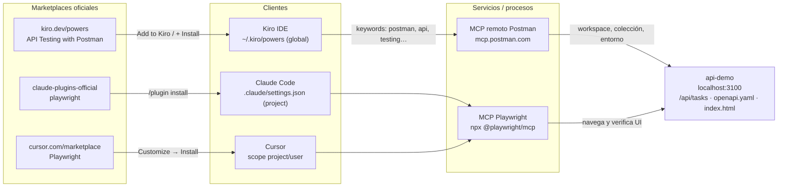

# Laboratorio 6B: Plugins y Powers (Kiro, Claude Code y Cursor)

## Objetivo

Entender qué es un **plugin** de agente —en Kiro se llama **Power**—, de qué piezas se compone y cómo se distribuye e instala desde marketplaces oficiales, comparando cómo lo resuelven **Kiro**, **Claude Code** y **Cursor**. El laboratorio se centra en Kiro y usa los otros dos clientes como contraste. Cada afirmación del marco teórico enlaza a la documentación oficial del fabricante.

Al final del laboratorio podrás:

1. Explicar qué es un plugin/Power, qué componentes empaqueta (skills, MCP, hooks, steering, agentes…) y en qué se diferencia de instalar esas piezas por separado.
2. Leer el manifiesto de un plugin en los tres formatos (`plugin.json` de Agent Plugins, `POWER.md` legacy de Kiro, `.claude-plugin/plugin.json`, `.cursor-plugin/plugin.json`) e identificar qué aporta cada archivo.
3. Instalar un Power desde el catálogo oficial de Kiro (**API Testing with Postman**) y un plugin desde los marketplaces oficiales de Claude Code y Cursor (**Playwright**), y verificar qué cambió en el entorno.
4. Comparar fuentes de instalación, scopes y marketplaces custom en los tres clientes.

**Prerrequisitos:**

- [Laboratorio 2: Prompts y skills](../skills/README.md) — anatomía de una skill (`SKILL.md`).
- [Laboratorio 4: MCP](../mcp/fundamentos/README.md) — qué es un servidor MCP y cómo se configura.
- [Laboratorio 5: Hooks](../hooks/README.md) — hooks como middleware del agente.
- [Laboratorio 6: Compatibilidad de configuración entre agentes](../config/README.md) — equivalencias de configuración entre clientes.
- **Kiro IDE** instalado y con sesión iniciada: https://kiro.dev/downloads/ (se recomienda la última versión; los metadatos del manifiesto en el panel de Powers requieren **1.4.26+** — [fuente](https://kiro.dev/docs/powers/installation/)).
- **Claude Code** instalado y autenticado (`claude --version`).
- **Cursor 2.5+** (los plugins y el Marketplace llegan en 2.5 — [fuente](https://cursor.com/changelog/2-5)).
- **Node.js 22+** (la API de demo y el MCP de Playwright usan `node`/`npx`).
- Cuenta de **Postman** (gratuita) y, opcional, **Postman CLI** (`postman --version`).

**Material técnico del laboratorio:** [`api-demo/`](./api-demo/) — API REST en memoria sin dependencias (`server.mjs`), su contrato [`openapi.yaml`](./api-demo/openapi.yaml) y una página web mínima ([`index.html`](./api-demo/index.html)) sobre la que trabajan Postman y Playwright.

---

## Marco teórico

### Qué es un plugin

Los tres fabricantes coinciden en la idea: un plugin es una **unidad de distribución** que agrupa varias capacidades del agente para instalarlas, versionarlas y desinstalarlas juntas.

| Cliente | Definición oficial (cita) | Fuente |
|---------|---------------------------|--------|
| **Kiro** | "Kiro powers give your AI agent instant access to specialized knowledge for any technology." · "Powers are plugins that bundle MCP tools, skills, and knowledge into a single installable package." | [kiro.dev/docs/powers](https://kiro.dev/docs/powers/) |
| **Claude Code** | "A Claude Code plugin is a directory of skills, agents, hooks, MCP servers, or other components that Claude Code installs and loads as one unit." | [Plugins overview](https://code.claude.com/docs/en/plugins/overview.md) |
| **Cursor** | "Plugins package rules, skills, agents, commands, MCP servers, and hooks into distributable bundles." | [cursor.com/docs/plugins](https://cursor.com/docs/plugins) |

Claude Code lo resume así: skills, agentes, hooks y MCP **funcionan sin plugin**; el plugin sirve para **empaquetarlos, distribuirlos y versionarlos** como una sola pieza ([fuente](https://code.claude.com/docs/en/plugins/overview.md#decide-whether-you-need-a-plugin)).

#### Un estándar común: Agent Plugins

Kiro y Cursor adoptan la especificación abierta **[Agent Plugins](https://agent-plugins.org/)**:

- Kiro: "Powers follow the Agent Plugins specification — an open, vendor-neutral format for packaging reusable components", y la recomienda para Powers nuevos ([fuente](https://kiro.dev/docs/powers/create/)).
- Cursor distingue **Agent Plugins** (estándar abierto, `plugin.json` en la raíz, solo skills y MCP) de **Cursor Plugins** (`.cursor-plugin/plugin.json`, que añade rules, agents, commands, hooks y variables) ([fuente](https://cursor.com/docs/plugins)).
- Claude Code usa su propio manifiesto `.claude-plugin/plugin.json` ([fuente](https://code.claude.com/docs/en/plugins/manifest-reference.md)).

### De qué está compuesto

| Componente | Kiro Power | Claude Code plugin | Cursor plugin |
|------------|-----------|--------------------|---------------|
| Manifiesto | `plugin.json` (Agent Plugins) o `POWER.md` (legacy) | `.claude-plugin/plugin.json` (opcional) | `.cursor-plugin/plugin.json` o `plugin.json` (Agent Plugins) |
| Skills | `skills/<nombre>/SKILL.md` | `skills/<nombre>/SKILL.md` | `skills/<nombre>/SKILL.md` |
| Servidores MCP | `mcp.json` | `.mcp.json` | `mcp.json` |
| Hooks | Opcionales (en el formato legacy) | `hooks/hooks.json` | `hooks/hooks.json` |
| Conocimiento / instrucciones | Steering y `POWER.md` (legacy) | — (se usan skills) | `rules/` |
| Agentes / subagentes | — | `agents/` | `agents/` |
| Comandos | — | `commands/` (legacy, "Prefer skills/") | `commands/` |
| Otros | — | LSP (`.lsp.json`), `output-styles/`, `monitors/`, `bin/`, `settings.json` | `variables` |

Fuentes: [Kiro — Create powers](https://kiro.dev/docs/powers/create/), [Kiro — blog de lanzamiento](https://kiro.dev/blog/introducing-powers/), [Claude — Manifest reference / Standard layout](https://code.claude.com/docs/en/plugins/manifest-reference.md#standard-layout), [Cursor — Plugins reference](https://cursor.com/docs/reference/plugins).

#### Manifiestos: campos obligatorios

| Cliente | Archivo | Obligatorio | Opcionales relevantes |
|---------|---------|-------------|-----------------------|
| Kiro (Agent Plugins) | `plugin.json` | `$schema`, `name` (kebab-case), `version` (semver), `description`, `author`, `keywords` | `homepage`, `repository`, `license` |
| Claude Code | `.claude-plugin/plugin.json` | `name` (kebab-case; el archivo entero es opcional) | `version`, `description`, `author`, `displayName`, `dependencies`, `userConfig`, rutas a componentes… |
| Cursor | `.cursor-plugin/plugin.json` | `name` (kebab-case) | `description`, `version`, `author`, `logo`, `rules`, `agents`, `skills`, `commands`, `hooks`, `mcpServers`, `variables` |

Fuentes: [Kiro](https://kiro.dev/docs/powers/create/), [Claude](https://code.claude.com/docs/en/plugins/manifest-reference.md), [Cursor](https://cursor.com/docs/reference/plugins).

En Kiro, `keywords` no es decorativo: es lo que dispara la activación del Power (ver más abajo). En Kiro, además, "The `name` field is used internally by Kiro to identify the power"; si lo cambias tras instalar puede que tengas que reinstalar ([fuente](https://kiro.dev/docs/powers/create/)).

Ejemplo real: **SDD Devkit** (el plugin del taller) publica **dos manifiestos** en la misma raíz para servir a varios clientes: `plugin.json` con `$schema` de Agent Plugins (Kiro/Cursor) y `.claude-plugin/plugin.json` (Claude Code). Ambos comparten `skills/` y `agents/`.

```text
sdd-devkit/
├── plugin.json                  # Agent Plugins ($schema agent-plugins.org) → Kiro / Cursor
├── .claude-plugin/
│   ├── plugin.json              # Manifiesto de Claude Code
│   └── marketplace.json         # El mismo repo actúa como marketplace de Claude
├── skills/                      # work-define/, test-define/, quality-check/ … (SKILL.md)
└── agents/                      # docs-specialist.md, quality-specialist.md, ui-specialist.md
```

```json
{
  "$schema": "https://agent-plugins.org/schemas/1.0.0/plugin.schema.json",
  "name": "sdd-devkit",
  "description": "Utilidades para el desarrollo de SDD ...",
  "version": "2.2.2",
  "author": { "name": "juanca202" },
  "repository": "https://github.com/juanca202/sdd-devkit",
  "license": "MIT",
  "keywords": ["adr", "user-stories", "traceability", "testing", "code-review"]
}
```

> El ejemplo detallado de instalación de **SDD Devkit como Power propio** se revisará en una sesión posterior; aquí solo se usa como referencia de estructura.

### Activación y costo de contexto

Aquí está la diferencia conceptual más importante entre los tres clientes.

- **Kiro — activación dinámica por keywords.** "Traditional MCP servers load all tools upfront." Un Power, en cambio, carga sus herramientas MCP y sus skills solo cuando las `keywords` del manifiesto aparecen en la conversación, y deja el contexto base cerca de cero ([docs](https://kiro.dev/docs/powers/), [create](https://kiro.dev/docs/powers/create/)). Según el anuncio de lanzamiento, el Power se desactiva cuando la conversación cambia de dominio ([blog](https://kiro.dev/blog/introducing-powers/)).
- **Claude Code — siempre presente, con costo visible.** Un plugin habilitado está en todas las sesiones: sus skills y agentes aportan nombre y descripción al contexto en cada turno, y sus hooks y MCP se ejecutan ([fuente](https://code.claude.com/docs/en/plugins/overview.md)). Para el marketplace oficial, el panel de detalles muestra el **Context cost** (*Every turn* / *When invoked*), y `claude plugin details <name>` muestra la línea `Always-on` ([fuente](https://code.claude.com/docs/en/plugins/install.md)).
- **Cursor — por componente.** Cada componente sigue su propia regla de carga (rules, skills, MCP…). La documentación de plugins no describe un mecanismo de activación por plugin ([fuente](https://cursor.com/docs/plugins)).

### Cómo se instalan: fuentes y scopes

| | Kiro | Claude Code | Cursor |
|---|------|-------------|--------|
| **Marketplace oficial** | Catálogo [kiro.dev/powers](https://kiro.dev/powers) → **Add to Kiro**, o panel **Powers** del IDE → **+ Install** | `claude-plugins-official` (se registra solo en la primera sesión interactiva) → `/plugin install <p>@claude-plugins-official` | [cursor.com/marketplace](https://cursor.com/marketplace) → **Customize** → **Install** (también `/add-plugin`) |
| **Desde Git** | **Add Custom Power → Import power from GitHub** (repos privados: requiere acceso) | `/plugin marketplace add owner/repo` o URL git (el repo es un marketplace) | Team marketplace: **Dashboard → Plugins & MCPs → Import from Repo** |
| **Carpeta local** | **Add Custom Power → Import power from a folder** | `claude --plugin-dir ./mi-plugin` (una sesión) o `/plugin marketplace add ./ruta` | `~/.cursor/plugins/local/<nombre>` + **Developer: Reload Window** |
| **CLI** | `kiro-cli powers install <name\|path>` (solo sesiones V3, CLI 2.25+) | `claude plugin install <p>@<mkt> --scope …` | — |
| **Scopes** | **Solo global**: `~/.kiro/powers/`; no existe scope de proyecto (también por agente con `includePowers`) | `user` (`~/.claude/settings.json`), `project` (`.claude/settings.json`), `local` (`.claude/settings.local.json`) | `project` o `user`, elegido al instalar |

Fuentes: Kiro — [installation](https://kiro.dev/docs/powers/installation/), [create](https://kiro.dev/docs/powers/create/), [configuration](https://kiro.dev/docs/configuration/), [CLI 2.25](https://kiro.dev/changelog/cli/2-25/); Claude — [install](https://code.claude.com/docs/en/plugins/install.md), [Anthropic marketplaces](https://code.claude.com/docs/en/plugins/anthropic-marketplaces.md), [create](https://code.claude.com/docs/en/plugins/create.md); Cursor — [plugins](https://cursor.com/docs/plugins), [changelog 2.5](https://cursor.com/changelog/2-5), [changelog 2.6](https://cursor.com/changelog/2-6).

### Marketplaces custom (teoría)

Un **marketplace** es un catálogo que dice qué plugins existen y de dónde descargar cada uno. Claude Code lo define así: "It's a catalog, not a hosted store" ([fuente](https://code.claude.com/docs/en/plugins/overview.md#get-plugins-from-a-marketplace)).

| | Kiro | Claude Code | Cursor |
|---|------|-------------|--------|
| ¿Marketplace propio documentado? | **No.** El mecanismo para Powers propios o privados es importar desde un repo de GitHub (público o privado) o desde una carpeta. Un repo puede contener varios Powers, cada uno en su carpeta | **Sí.** Cualquier repo o carpeta con `.claude-plugin/marketplace.json` | **Sí**, en planes **Teams** (1 marketplace importado + Default) y **Enterprise** (ilimitados) |
| Archivo de catálogo | — | `.claude-plugin/marketplace.json`: `name`, `owner`, `plugins[]` (cada uno con `name` y `source`) | `.cursor-plugin/marketplace.json`: `name`, `owner`, `plugins[]` (máx. 10 MB) |
| Tipos de `source` | URL de GitHub / carpeta | Ruta relativa, `github`, `git-subdir`, `url`, `archive`, `npm`, `command` | Ruta de carpeta del repo importado |
| Distribución a un equipo | Compartir la URL del repo | `extraKnownMarketplaces` + `enabledPlugins` en `.claude/settings.json` (se commitea); políticas con `strictKnownMarketplaces` | Por grupos de la organización, con modo **Default Off / Default On / Required** |

Fuentes: Kiro — [create](https://kiro.dev/docs/powers/create/), [blog](https://kiro.dev/blog/introducing-powers/); Claude — [marketplace reference](https://code.claude.com/docs/en/plugins/marketplace-reference.md), [create marketplace](https://code.claude.com/docs/en/plugins/create-marketplace.md); Cursor — [plugins](https://cursor.com/docs/plugins), [reference](https://cursor.com/docs/reference/plugins).

> Kiro tiene un **registro empresarial**, pero es de **servidores MCP** ([fuente](https://kiro.dev/docs/mcp/registry/)), no de Powers. No se debe presentar como "marketplace privado de Powers".

### Seguridad y confianza

Los tres fabricantes insisten en lo mismo: un plugin **ejecuta código** (hooks, MCP locales) con tus permisos de usuario.

- Kiro: "Kiro powers are third-party tools that may be subject to separate terms" y "A local MCP server runs on your machine with your user's access unless you sandbox it" ([fuente](https://kiro.dev/docs/powers/installation/)).
- Claude Code: los plugins se ejecutan con tus privilegios; antes de instalar, revisa en el panel de detalles qué hooks y MCP añade ([fuente](https://code.claude.com/docs/en/plugins/security.md)).
- Cursor: el Marketplace oficial se revisa manualmente, y los plugins de la comunidad están en cursor.directory ([fuente](https://cursor.com/docs/plugins)).

> **Lo que la documentación oficial no confirma** (no lo afirmes en clase): que Cursor lea el formato `.claude-plugin/` de Claude Code (solo está documentado que expande `${CLAUDE_PLUGIN_ROOT}` en `mcp.json`); que exista un registro privado de Powers en Kiro; o que `kiro-cli` instale un Power desde una URL de GitHub.

---

## Componentes del laboratorio

Diagrama de componentes del laboratorio:



---

## Pasos

### Preparación

1. Abre la carpeta `etapa-1/laboratorios/plugins` como **workspace** en Kiro. Más adelante la abrirás también en Claude Code y en Cursor.
2. En una terminal, levanta la API de demo y déjala corriendo durante todo el laboratorio:

   ```powershell
   # Desde etapa-1/laboratorios/plugins
   node api-demo/server.mjs
   # → api-demo escuchando en http://localhost:3100
   ```
3. Comprueba que responde:

   ```powershell
   curl http://localhost:3100/health
   curl http://localhost:3100/api/tasks
   ```

   Abre también `http://localhost:3100/` en el navegador: verás la página **Tareas QA**.
4. Crea una carpeta local `evidencia/` (está en `.gitignore`) donde guardarás capturas y notas de cada fase.

---

### Fase A — Anatomía de un Power del catálogo

**Meta:** antes de instalar nada, leer qué trae un Power real y qué ejecutará en tu máquina. Es el hábito de revisión que piden los tres fabricantes.

1. Abre el Power de Postman en el catálogo: https://kiro.dev/powers → **API Testing with Postman**. Pulsa el enlace a su código fuente en el repositorio oficial: https://github.com/kirodotdev/powers/tree/main/postman
2. Identifica los archivos y su rol:

   | Archivo | Qué es | Qué debes revisar |
   |---------|--------|-------------------|
   | `POWER.md` | Manifiesto **legacy** + instrucciones (frontmatter YAML + cuerpo Markdown) | `name`, `displayName`, `description`, `keywords` |
   | `mcp.json` | Servidor MCP que el Power registra | Servidor `postman` remoto en `https://mcp.postman.com/minimal`: no ejecuta un proceso local |
   | `steering/` | Conocimiento adicional que Kiro carga bajo demanda | Flujos de trabajo que el agente seguirá |

3. Anota en `evidencia/` las `keywords` del frontmatter (`postman`, `api`, `testing`, `collections`, `rest`, `http`, `automation`). Son las palabras que activarán el Power en la Fase B.
4. Compara con un Power en formato **Agent Plugins**: el `plugin.json` de SDD Devkit (sección *Manifiestos* del marco teórico). Responde:

   - ¿Dónde están las `keywords` en cada formato?
   - ¿Qué archivo debe estar en la raíz para que Kiro acepte la importación? ("Each power must have a valid `plugin.json` or `POWER.md` file at its package root" — [fuente](https://kiro.dev/docs/powers/installation/))
   - Si un Power tiene ambos archivos, ¿cuál gana? (Desde IDE 1.4.26 los metadatos del manifiesto `plugin.json` tienen prioridad — [fuente](https://kiro.dev/docs/powers/installation/))

   > El Power de Postman usa el formato legacy; los Powers nuevos se recomiendan en Agent Plugins. Ver los dos formatos en el catálogo oficial es justo el escenario de migración que describe la documentación: "Powers built with the legacy POWER.md format continue to work."

---

### Fase B — Instalar el Power de Postman en Kiro (marketplace oficial)

**Meta:** instalar un Power desde el catálogo oficial, comprobar su activación por keywords y usarlo para generar y ejecutar pruebas de API contra `api-demo`.

1. Instálalo por **una** de las dos vías oficiales ([fuente](https://kiro.dev/docs/powers/installation/)):

   - **Web:** en https://kiro.dev/powers → **API Testing with Postman** → **Add to Kiro**. Se abre Kiro y confirmas la instalación.
   - **IDE:** abre el panel **Powers** (icono de Ghosty con el rayo) → **Available Powers** → busca *Postman* → abre el detalle → **+ Install**.

2. Verifica la instalación:

   - El Power aparece en la lista de instalados del panel **Powers**.
   - Como este Power usa el formato legacy (`POWER.md`), su servidor MCP queda registrado en `~/.kiro/settings/mcp.json`, en la sección de Powers, con un nombre con prefijo ([fuente](https://kiro.dev/docs/powers/installation/)):

     ```powershell
     # Windows
     Get-Content "$env:USERPROFILE\.kiro\settings\mcp.json"
     ```
     ```bash
     # macOS / Linux
     cat ~/.kiro/settings/mcp.json
     ```

   - Comprueba que **no** se creó nada en `.kiro/` del workspace: en Kiro los Powers son solo de **scope global** ([fuente](https://kiro.dev/docs/configuration/)).

3. Pulsa **Try the power** en el detalle del Power para lanzar el onboarding ([fuente](https://kiro.dev/docs/powers/installation/)). El primer uso del MCP remoto de Postman te pedirá autenticarte con tu cuenta de Postman en el navegador.

   > El onboarding del `POWER.md` propone crear un **hook** en `.kiro/hooks/` (evento `fileEdited` sobre archivos como `*.js` u `openapi.yaml`, acción `askAgent`) que vuelve a ejecutar la colección cuando cambias la API, y guarda los IDs de workspace, colección y entorno en `.postman.json`. Revisa el hook antes de aceptarlo. Así un Power combina MCP + conocimiento + automatización.

4. Activa el Power **sin nombrarlo**, usando sus keywords en un chat nuevo (modo *Vibe*):

   ```prompt
   Using the API contract in api-demo/openapi.yaml, create a Postman workspace "lab-plugins",
   a collection that covers every endpoint (happy path + 400 and 404 cases) with test scripts,
   and an environment with baseUrl = http://localhost:3100. Save the IDs in .postman.json.
   ```

   Observa en el chat cuándo Kiro activa el Power y qué herramientas `postman` invoca. Anótalo en `evidencia/`.

5. Ejecuta la colección. Si la ejecución remota no alcanza `localhost` (los servidores de Postman no ven tu máquina), ejecútala en local con **Postman CLI** ([docs Postman CLI](https://learning.postman.com/docs/postman-cli/postman-cli-overview/)):

   ```powershell
   postman login                       # usa tu API key de Postman; no la guardes en el repo
   postman collection run <collection-id> -e <environment-id>
   ```

   Los IDs están en `.postman.json`. Resultado esperado: pasan los casos 200/201/204 y los negativos devuelven 400 (`title` vacío) y 404 (id inexistente).

6. Prueba la **desactivación por contexto**: en el mismo chat, cambia a un tema ajeno ("explícame qué es un ADR") y observa si el agente sigue invocando herramientas de Postman.
7. (Opcional) Gestión del ciclo de vida desde el panel: **Check for updates** → **Install updates**, y **Uninstall** ([fuente](https://kiro.dev/docs/powers/installation/)). En CLI V3: `kiro-cli powers uninstall postman` ([fuente](https://kiro.dev/changelog/cli/2-25/)).

---

### Fase C — Playwright en Claude Code y en Cursor (marketplaces oficiales)

**Meta:** instalar el mismo plugin (**Playwright**, de Microsoft) en los otros dos clientes y comparar el flujo con Kiro. En el catálogo de Kiro no hay un Power de Playwright: es el primer contraste entre catálogos.

#### C.1 — Claude Code

1. Abre una terminal en `etapa-1/laboratorios/plugins` e inicia `claude`.
2. Abre el detalle del plugin desde el marketplace oficial ([fuente](https://code.claude.com/docs/en/plugins/install.md)):

   ```text
   /plugin install playwright@claude-plugins-official
   ```

   En una sesión, este comando **no instala directamente**: abre el panel para que revises el plugin. Antes de elegir, anota:

   - **Will install:** el servidor MCP `playwright` (`npx @playwright/mcp@latest`).
   - **Context cost:** *Every turn* y *When invoked*.

3. Elige **Install for all collaborators on this repository (project scope)** y comprueba qué archivo cambió:

   ```powershell
   Get-Content .claude/settings.json   # debe contener enabledPlugins con "playwright@claude-plugins-official"
   ```

   > Con project scope, el plugin queda habilitado para todo el equipo, pero cada colaborador aún debe ejecutar `claude plugin install playwright@claude-plugins-official --scope project` una vez ([fuente](https://code.claude.com/docs/en/plugins/install.md#choose-an-install-scope)).

4. Verifica: `/plugin` → pestaña **Installed**, o en tu shell `claude plugin list`.
5. Úsalo contra la página de demo:

   ```prompt
   Open http://localhost:3100 with Playwright. Add the task "Validar plugin" and verify it appears in
   the list. Then submit an empty title and verify the alert shows "El campo 'title' es obligatorio.".
   Report each step as PASS/FAIL.
   ```

#### C.2 — Cursor

1. Abre `etapa-1/laboratorios/plugins` como workspace en Cursor.
2. En la barra lateral, **Customize** → busca **Playwright** ([ficha](https://cursor.com/marketplace/cursor/playwright)) → **Install** → elige scope **project** ([fuente](https://cursor.com/docs/plugins)). Alternativa en el chat: `/add-plugin` ([fuente](https://cursor.com/changelog/2-5)).
3. Revisa en **Customize** qué componentes añadió el plugin.
4. Ejecuta el mismo prompt del paso C.1.5 en modo Agent y compara el resultado con el de Claude Code.

---

### Fase D — Comparativa y marketplace custom

**Meta:** consolidar lo observado y razonar cómo distribuiría el equipo sus propios plugins en cada cliente. Esta fase es de análisis; no se instala nada.

1. Completa esta tabla en `evidencia/comparativa.md` con lo que **observaste** (no con lo que dice la teoría):

   | Pregunta | Kiro (Postman) | Claude Code (Playwright) | Cursor (Playwright) |
   |----------|----------------|--------------------------|---------------------|
   | ¿Dónde lo encontré? | | | |
   | ¿Qué revisé antes de instalar? | | | |
   | ¿Qué scope elegí / pude elegir? | | | |
   | ¿Qué archivo de configuración cambió? | | | |
   | ¿Cuándo se cargaron sus herramientas en el contexto? | | | |
   | ¿Cómo lo desinstalo? | | | |

2. Responde, apoyándote en la sección *Marketplaces custom*:

   - El equipo quiere distribuir un plugin interno de QA. ¿Qué haría en cada cliente? (Kiro: repo GitHub privado + **Import power from GitHub**; Claude: repo con `.claude-plugin/marketplace.json` + `extraKnownMarketplaces`; Cursor: Team marketplace, plan Teams o Enterprise.)
   - ¿Por qué SDD Devkit publica dos manifiestos (`plugin.json` y `.claude-plugin/plugin.json`) en lugar de uno?
   - ¿Qué implica para un proyecto que en Kiro los Powers sean solo globales, frente al `project` scope de Claude y Cursor?

   > Siguiente paso del taller: se revisará en detalle la instalación de **SDD Devkit** como Power/plugin propio, desde su propio repositorio y marketplace.

---

## Conclusiones del laboratorio

- Un plugin no añade capacidades nuevas al agente: **empaqueta** skills, MCP, hooks, reglas, agentes y conocimiento para instalarlos, versionarlos y retirarlos como una sola unidad. En Kiro esa unidad se llama **Power**.
- El estándar abierto **Agent Plugins** (`plugin.json` + `mcp.json` + `skills/`) acerca Kiro y Cursor. Claude Code mantiene su manifiesto `.claude-plugin/`, y un mismo repo puede servir a los tres con varios manifiestos.
- La gran diferencia operativa es **cuándo entra el plugin al contexto**: en Kiro, por keywords y bajo demanda; en Claude Code, siempre, con un costo por turno que el propio cliente mide.
- Los scopes no son equivalentes: en Kiro los Powers son solo globales; Claude ofrece `user`/`project`/`local` y Cursor `user`/`project`. Esto condiciona cómo se versiona la configuración en el repositorio.
- Los marketplaces custom están documentados en Claude Code (`marketplace.json`) y en Cursor (Team marketplaces). En Kiro el camino oficial es importar desde GitHub o desde una carpeta.
- Instalar un plugin equivale a ejecutar código de terceros con tus permisos: revisar el manifiesto, los hooks y los MCP antes de instalar es parte del trabajo de QA.

Tras el taller, desinstala los plugins de prueba (`Uninstall` en el panel de Powers de Kiro, `claude plugin uninstall playwright@claude-plugins-official --scope project`, **Customize** en Cursor) o consérvalos si los vas a usar en tus proyectos.

---

## Referencias oficiales

- **Kiro:** [Powers](https://kiro.dev/docs/powers/) · [Installation](https://kiro.dev/docs/powers/installation/) · [Create](https://kiro.dev/docs/powers/create/) · [Configuration (scopes)](https://kiro.dev/docs/configuration/) · [Catálogo](https://kiro.dev/powers) · [Repositorio oficial de Powers](https://github.com/kirodotdev/powers) · [Blog: Introducing Powers](https://kiro.dev/blog/introducing-powers/) · [CLI 2.25](https://kiro.dev/changelog/cli/2-25/)
- **Claude Code:** [Overview](https://code.claude.com/docs/en/plugins/overview.md) · [Install](https://code.claude.com/docs/en/plugins/install.md) · [Manifest reference](https://code.claude.com/docs/en/plugins/manifest-reference.md) · [Marketplace reference](https://code.claude.com/docs/en/plugins/marketplace-reference.md) · [Create a marketplace](https://code.claude.com/docs/en/plugins/create-marketplace.md) · [Anthropic marketplaces](https://code.claude.com/docs/en/plugins/anthropic-marketplaces.md) · [Security](https://code.claude.com/docs/en/plugins/security.md)
- **Cursor:** [Plugins](https://cursor.com/docs/plugins) · [Plugins reference](https://cursor.com/docs/reference/plugins) · [Marketplace](https://cursor.com/marketplace) · [Changelog 2.5](https://cursor.com/changelog/2-5) · [Changelog 2.6](https://cursor.com/changelog/2-6)
- **Estándar:** [Agent Plugins](https://agent-plugins.org/)
