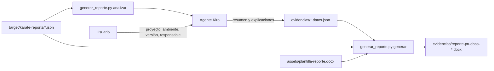

# Laboratorio 2C: Skills con recursos — reporte de pruebas en Word

## Objetivo

Usar en **Kiro** una skill que empaqueta instrucciones, un **script** y una **plantilla Word** para convertir los resultados de pruebas automatizadas de **Karate** (un JSON técnico, poco legible para usuarios de negocio) en un **reporte de evidencia** que se puede adjuntar a un ticket, a un acta de pase a producción o a una auditoría.

Al final de esta parte podrás:

1. Explicar por qué una skill puede incluir `scripts/` y `assets/` además del `SKILL.md`.
2. Separar qué hace mejor un script (cálculos exactos y repetibles) y qué hace mejor el agente (redactar para personas).
3. Generar un reporte `.docx` a partir de un reporte de Karate con una sola invocación.
4. Personalizar la plantilla Word sin tocar el código.

**Prerrequisitos:**

- [Parte 1: Fundamentos de skills](../fundamentos/README.md) — anatomía de una skill y uso en Kiro.
- Kiro (IDE o CLI) instalado y autenticado.
- Python 3.10 o superior en el `PATH` (`python --version`).
- Microsoft Word, LibreOffice u otro editor de `.docx` para abrir el resultado.
- Esta carpeta (`reportes/`) abierta como **workspace** en Kiro.

**Material técnico del laboratorio:**

| Archivo | Qué es |
|---------|--------|
| [`target/karate-reports/features.pedidos.pedidos.json`](./target/karate-reports/features.pedidos.pedidos.json) | Resultado de una ejecución de Karate sobre una API de pedidos (formato Cucumber JSON) |
| [`.kiro/skills/reporte-pruebas/SKILL.md`](./.kiro/skills/reporte-pruebas/SKILL.md) | Instrucciones de la skill |
| [`.kiro/skills/reporte-pruebas/scripts/generar_reporte.py`](./.kiro/skills/reporte-pruebas/scripts/generar_reporte.py) | Script que analiza el JSON y llena la plantilla |
| [`.kiro/skills/reporte-pruebas/assets/plantilla-reporte.docx`](./.kiro/skills/reporte-pruebas/assets/plantilla-reporte.docx) | Plantilla Word del reporte |

---

## Marco teórico

### El problema: evidencia que nadie fuera de QA puede leer

Karate deja sus resultados en `target/karate-reports/`. Además del reporte HTML, genera un archivo **Cucumber JSON** por cada `.feature`, que es el que consumen los pipelines y herramientas de CI. Ese archivo trae todo lo necesario para una evidencia, pero no en una forma presentable:

| Lo que trae el JSON | Por qué no sirve tal cual como evidencia |
|---------------------|------------------------------------------|
| Un `Background` repetido antes de cada escenario | Parecen más pruebas de las que hay |
| Duraciones en **nanosegundos** (`"duration": 312600000`) | Nadie lee 312 600 000 como "0,3 segundos" |
| Errores como `match failed: EQUALS $ \| not equal (STRING:STRING)` | Jerga de la herramienta, no del negocio |
| Logs HTTP completos en `doc_string`, con cabeceras `Authorization: Bearer …` | Exponen credenciales si se copian a un documento |

### La solución: una skill con recursos

Una skill no tiene que ser solo un `SKILL.md`. El formato [Agent Skills](https://agentskills.io) admite carpetas opcionales que el agente usa cuando las instrucciones se lo piden:

```
.kiro/skills/reporte-pruebas/
├── SKILL.md                    # Qué hacer y en qué orden
├── scripts/
│   ├── generar_reporte.py      # Cómo calcular y llenar el Word (determinista)
│   └── requirements.txt
└── assets/
    └── plantilla-reporte.docx  # Cómo se ve el resultado
```

La clave es repartir el trabajo según lo que cada parte hace bien:

| Responsable | Tarea | Por qué ahí |
|-------------|-------|-------------|
| **Script** | Contar escenarios, calcular el % de éxito, convertir duraciones, descartar los logs HTTP, llenar la plantilla | Debe dar exactamente el mismo resultado cada vez. Un modelo puede equivocarse al contar |
| **Agente** | Pedir los datos del proyecto, redactar el resumen ejecutivo, traducir cada fallo a lenguaje de negocio | Requiere entender el contexto y escribir para personas |
| **Plantilla** | Diseño, logo, secciones, colores | La puede mantener alguien que no programa, directamente en Word |

### La plantilla Word

La plantilla es un `.docx` normal con marcadores que llena la librería [docxtpl](https://docxtpl.readthedocs.io/):

| Marcador | Efecto |
|----------|--------|
| `{{ proyecto }}` | Inserta un valor |
| `` … `` | Repite una fila de la tabla por cada escenario |
| `` … `` | Repite un bloque de párrafos por cada fallo |
| `` … `` … `` | Muestra un bloque u otro según haya o no fallos |
| `` | Pinta el fondo de la celda (verde = aprobado, rojo = fallido) |

---

## Componentes del laboratorio



Estructura de archivos:

```
reportes/
├── README.md                                   # Este archivo
├── .gitignore                                  # Ignora evidencias/ y .venv/
├── target/
│   └── karate-reports/
│       └── features.pedidos.pedidos.json       # Entrada: resultado de Karate
├── evidencias/                                 # Salida: se crea al generar el reporte
└── .kiro/
    └── skills/
        └── reporte-pruebas/
            ├── SKILL.md
            ├── scripts/
            │   ├── generar_reporte.py
            │   └── requirements.txt
            └── assets/
                └── plantilla-reporte.docx
```

---

## Pasos

### Preparación

1. Abre la carpeta `etapa-1/laboratorios/skills/reportes` como workspace en Kiro (IDE) o ejecuta `kiro-cli chat` dentro de ella.
2. *(Opcional, recomendado)* Crea un entorno virtual para no instalar paquetes en tu Python global:

   ```powershell
   python -m venv .venv
   .venv\Scripts\Activate.ps1        # Windows
   # source .venv/bin/activate       # macOS / Linux
   python -m pip install -r .kiro/skills/reporte-pruebas/scripts/requirements.txt
   ```

   Si te saltas este paso, la skill detecta que falta `docxtpl` y te pide permiso para instalarlo.

---

### Fase A — Leer el archivo de Karate como lo leería un usuario de negocio

**Meta:** sentir el problema antes de ver la solución.

1. Abre [`features.pedidos.pedidos.json`](./target/karate-reports/features.pedidos.pedidos.json) en el editor.
2. Sin usar el agente, intenta responder en 3 minutos:
   - ¿Cuántas pruebas se ejecutaron? ¿Cuántas fallaron?
   - ¿Qué funcionalidad del negocio falló y qué significa para un cliente de la tienda?
   - ¿Cuánto tardó la ejecución completa?
3. Busca `Authorization` en el archivo. ¿Qué pasaría si alguien pegara este JSON en un ticket o en un acta?

> Pista: hay más bloques `"type": "background"` que escenarios reales, y las duraciones están en nanosegundos.

---

### Fase B — Anatomía de una skill con recursos

**Meta:** entender cómo se reparten el trabajo instrucciones, script y plantilla.

1. Lee [`SKILL.md`](./.kiro/skills/reporte-pruebas/SKILL.md) y ubica:
   - Qué pasos ejecutan el script y cuáles hace el agente.
   - La regla que prohíbe al agente recalcular los conteos. ¿Por qué existe?
   - Qué hace la skill si falta un dato del proyecto.
2. Abre [`plantilla-reporte.docx`](./.kiro/skills/reporte-pruebas/assets/plantilla-reporte.docx) en Word. Identifica los marcadores `{{ }}` y `` y relaciónalos con la tabla de la sección **La plantilla Word**.
3. Ejecuta tú mismo la primera parte del script para ver lo que recibe el agente:

   ```powershell
   python .kiro/skills/reporte-pruebas/scripts/generar_reporte.py analizar target/karate-reports
   ```

   Compara la salida con tus respuestas de la Fase A.

---

### Fase C — Generar el reporte con la skill

**Meta:** obtener el documento de evidencia con una sola invocación.

1. En el chat de Kiro, invoca la skill:

   ```prompt
   /reporte-pruebas
   ```

   O pídelo en lenguaje natural para comprobar que se activa sola por su `description`:

   ```prompt
   Necesito la evidencia en Word de la última ejecución de pruebas de Karate
   ```

2. Responde los datos que pide el agente, por ejemplo: proyecto `Tienda Demo — API de pedidos`, ambiente `QA`, versión `2.4.0`, responsable con tu nombre.
3. Abre el `.docx` generado en `evidencias/` y verifica:

   | Verificación | Esperado |
   |--------------|----------|
   | Escenarios / aprobados / fallidos | 8 / 6 / 2 |
   | Resultado general | **NO APROBADO**, en rojo |
   | Explicación de cada fallo | En términos de pedidos y stock, sin "status code" ni "match failed" |
   | Detalle técnico | Presente, para que QA pueda reproducir el fallo |
   | Credenciales | Busca `Bearer` en el documento: no debe aparecer |

4. Revisa también el archivo `evidencias/*.datos.json`: es lo único que redactó el agente. Todo lo demás salió del script.

---

### Fase D — Personalizar la plantilla

**Meta:** comprobar que el formato del reporte se cambia en Word, sin tocar código.

1. Haz una copia de respaldo de `assets/plantilla-reporte.docx` y abre el original en Word. Haz cambios visuales: agrega el logo de tu organización en el encabezado, cambia colores o añade un párrafo fijo (por ejemplo, el alcance de las pruebas).
2. Agrega un dato nuevo: en la tabla **Datos generales**, inserta una fila `Ticket` con el marcador `{{ ticket }}`.

   > Escribe cada marcador de una sola vez, sin pausas ni cambios de formato a la mitad. Si Word lo divide internamente (por ejemplo, al autocorregir), el script no lo reconoce. Si eso pasa, borra el marcador y vuelve a escribirlo.

3. Actualiza el paso 4 de [`SKILL.md`](./.kiro/skills/reporte-pruebas/SKILL.md) para que el agente también pida el número de ticket y lo guarde como `"ticket"` en el JSON de datos. El script ya pasa cualquier campo adicional a la plantilla.
4. Vuelve a generar el reporte y verifica que aparecen tus cambios y el ticket.
5. Reflexión breve:
   - ¿Qué cambios pudo hacer alguien sin conocimientos de programación?
   - ¿Qué parte del reporte sería arriesgado dejarle al modelo sin script? ¿Por qué?

---

## Conclusiones de esta parte

- Una skill puede empaquetar **instrucciones, código y archivos**: `scripts/` para lo que debe ser exacto y `assets/` para plantillas y recursos.
- El **script** garantiza números correctos y repetibles; el **agente** aporta lo que un script no puede hacer: entender el contexto y redactar para personas no técnicas.
- La **plantilla Word** separa el diseño del código. El formato institucional del reporte lo puede mantener alguien que no programa.
- Las reglas de la skill (no recalcular, no inventar causas, no copiar credenciales) son tan importantes como los pasos: convierten un resultado técnico en evidencia confiable.

---

## Referencias

| Tema | Fuente |
|------|--------|
| Skills en Kiro | [Kiro — Skills](https://kiro.dev/docs/skills/) |
| Formato abierto de skills | [Agent Skills](https://agentskills.io) |
| Reportes de Karate | [Karate — Test reports](https://github.com/karatelabs/karate#test-reports) |
| Plantillas Word con Python | [docxtpl](https://docxtpl.readthedocs.io/) |
