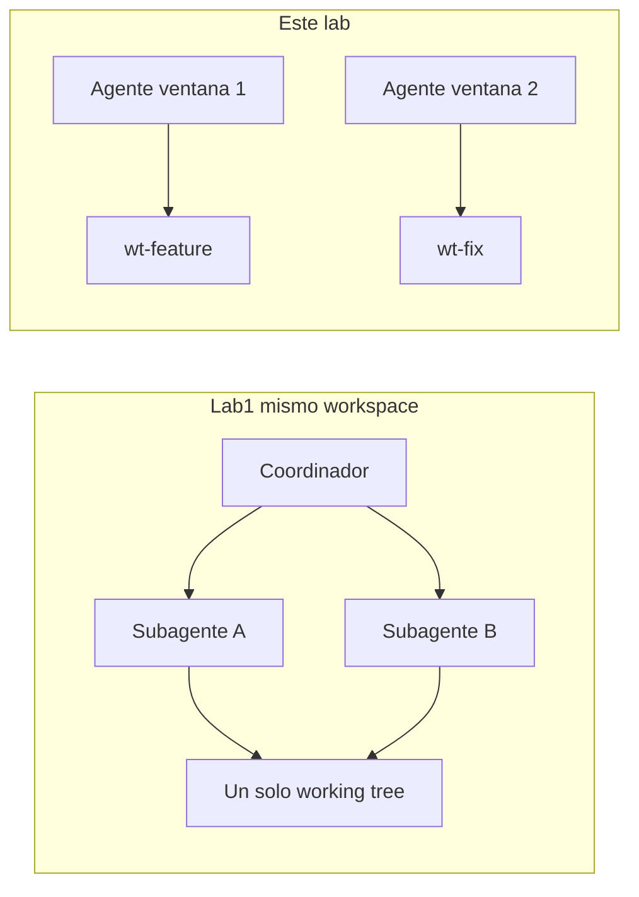
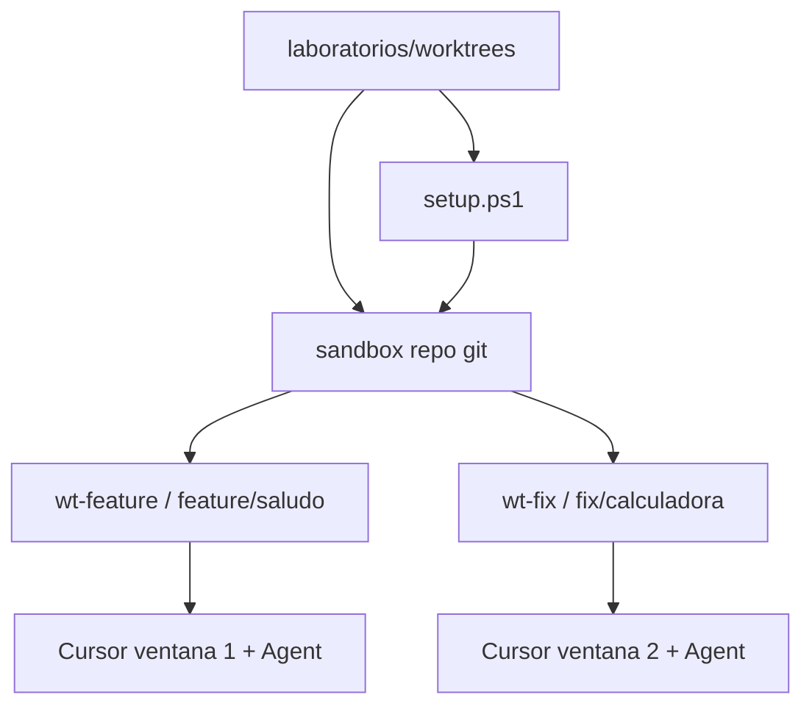

# Laboratorio complementario: Git worktrees y agentes en paralelo

## Objetivo

Entender **git worktrees** como forma de aislar working trees y practicar **trabajo en paralelo con agentes**: dos ventanas de Cursor, dos ramas, dos checkouts — sin que un agente pise el código del otro.

Al final del laboratorio podrás:

1. Explicar qué es un worktree y cómo se diferencia de “cambiar de rama” en un solo checkout.
2. Contrastar el paralelo del [Laboratorio 1](../agents/README.md) (varios subagentes, **un** working tree) con paralelo por worktrees (**un** agente por checkout).
3. Crear dos worktrees, lanzar tareas de agente distintas y **verificar el aislamiento** con `git status` / `git diff`.

**Prerrequisitos:**

- [Laboratorio 1: Agentes y subagentes](../agents/README.md) — idea de trabajo en paralelo *dentro* del mismo workspace.
- **Git** instalado y disponible en la terminal (`git --version`).
- **Node.js** (opcional pero útil) para probar `node src/greeter.js` y `node src/calculator.js`.
- Carpeta `etapa-1/laboratorios/worktrees` abierta como **workspace** en Cursor (o al menos accesible para ejecutar `setup.ps1`).
- Modo **Agent** en Cursor y permiso para abrir una **segunda ventana** del IDE.

**Material técnico del laboratorio:** código demo en [`sandbox/`](./sandbox/), políticas en [`sandbox/AGENTS.md`](./sandbox/AGENTS.md) y script de preparación [`setup.ps1`](./setup.ps1).

> Duración orientativa: **30–40 minutos**.

---

## Marco teórico

### Working tree, rama y worktree

| Concepto | Qué es |
|----------|--------|
| **Rama** | Puntero a un commit (`feature/saludo`, `fix/calculadora`, `main`). |
| **Working tree** | Los archivos en disco que estás editando ahora. |
| **Worktree** | Un **segundo (o N-ésimo) working tree** del **mismo** repositorio, normalmente en otra carpeta y otra rama. |

Con un solo checkout, `git switch otra-rama` cambia los archivos de la carpeta actual: no puedes tener dos ramas “activas” a la vez en el mismo directorio. Con worktrees, Git te deja **varias carpetas** compartiendo el mismo `.git`, cada una en su rama.

Comandos que usarás:

| Comando | Para qué |
|---------|----------|
| `git worktree add <ruta> -b <rama>` | Crear carpeta + rama nueva |
| `git worktree list` | Ver checkouts activos |
| `git worktree remove <ruta>` | Quitar un worktree limpio |
| `git worktree prune` | Limpiar referencias huérfanas |

Referencia: **[git-worktree](https://git-scm.com/docs/git-worktree)** (documentación oficial).

### Lab 1 vs este laboratorio

En el Lab 1, un coordinador lanza **subagentes en paralelo** sobre el **mismo** working tree (riesgo de colisión si escriben los mismos archivos). Aquí el aislamiento lo da **Git + carpetas**:

| Laboratorio 1 | Este laboratorio |
|---------------|------------------|
| Varios subagentes, un checkout | Un agente por checkout |
| Orquestación vía `Task` | Orquestación vía `git worktree` + ventanas Cursor |
| Ideal para dividir una tarea en el mismo árbol | Ideal para features/fixes concurrentes sin pisarse |



---

## Componentes del laboratorio



Árbol tras ejecutar `setup.ps1`:

```
worktrees/
├── README.md          ← este laboratorio
├── setup.ps1
├── .gitignore
├── sandbox/           ← repo principal (rama main)
│   ├── AGENTS.md
│   ├── README.md
│   └── src/
│       ├── greeter.js      ← saludo incompleto
│       └── calculator.js   ← bug en la suma
├── wt-feature/        ← worktree (feature/saludo)
└── wt-fix/            ← worktree (fix/calculadora)
```

`wt-feature/` y `wt-fix/` están en `.gitignore`: se generan en tu máquina y no se versionan en el monorepo del taller.

---

## Pasos

### Preparación

1. Abre la carpeta `etapa-1/laboratorios/worktrees` (menú [`open.ps1`](../open.ps1) o *File → Open Folder*).
2. En PowerShell, desde esa carpeta, ejecuta:

   ```powershell
   .\setup.ps1
   ```

3. Confirma la salida de `git worktree list` (el script ya la imprime). Debes ver tres rutas: `sandbox` (`main`), `wt-feature` (`feature/saludo`) y `wt-fix` (`fix/calculadora`).

> Si vuelves a ejecutar `setup.ps1`, limpia worktrees previos y reinicia el sandbox: es **idempotente**.

---

### Fase A — Mapa de carpetas y ramas

**Meta:** ubicar qué carpeta corresponde a qué rama y qué módulo tocará cada agente.

1. Desde `sandbox/`, inspecciona:

   ```powershell
   cd sandbox
   git worktree list
   git branch -a
   ```

2. Abre `sandbox/src/greeter.js` y `sandbox/src/calculator.js` en solo lectura (o en el repo principal) y anota:
   - `greeter`: el saludo está incompleto (`return name`).
   - `calculator`: `add` resta en lugar de sumar.

3. Lee [`sandbox/AGENTS.md`](./sandbox/AGENTS.md): cada worktree tiene un módulo permitido.

---

### Fase B — Agente en `wt-feature` (feature)

**Meta:** completar el saludo **solo** en el worktree de `feature/saludo`, sin tocar la calculadora.

1. Abre `wt-feature` como **workspace** en una ventana de Cursor (`cursor -n wt-feature` o *File → Open Folder*).
2. En modo **Agent**, pega este prompt:

   ```prompt
   Lee AGENTS.md y respeta su alcance.

   Completa src/greeter.js para que greet(name) devuelva un saludo en español
   del estilo "Hola, {name}". No modifiques src/calculator.js.
   No hagas git commit.

   Al terminar: muestra git status y git diff, y ejecuta
   node src/greeter.js Ana
   para verificar la salida.
   ```

3. Comprueba que la salida sea algo como `Hola, Ana` y que el diff no incluya `calculator.js`.

---

### Fase C — Agente en `wt-fix` (fix), en paralelo

**Meta:** corregir el bug de la suma en **otra** ventana, a la vez que (o justo después de) la Fase B, sin contaminar el worktree de la feature.

1. Abre `wt-fix` como workspace en una **segunda** ventana de Cursor.
2. En modo **Agent**, pega:

   ```prompt
   Lee AGENTS.md y respeta su alcance.

   Corrige el bug en src/calculator.js: la función add debe sumar, no restar.
   No modifiques src/greeter.js.
   No hagas git commit.

   Al terminar: muestra git status y git diff, y ejecuta
   node src/calculator.js 2 3
   (debe imprimir 5).
   ```

3. Confirma que `2 + 3` imprime `5` y que el diff no incluye `greeter.js`.

> Lo importante no es el código en sí, sino observar que **dos agentes** pueden editar el mismo “proyecto lógico” en carpetas distintas sin colisionar.

---

### Fase D — Verificar aislamiento y limpiar

**Meta:** demostrar que los cambios viven en ramas/worktrees separados y dejar el lab ordenado.

1. En **cada** ventana (`wt-feature` y `wt-fix`):

   ```powershell
   git status
   git diff
   git branch --show-current
   ```

2. Comprueba:
   - En `wt-feature` solo cambió (o debería) `src/greeter.js`; rama `feature/saludo`.
   - En `wt-fix` solo cambió `src/calculator.js`; rama `fix/calculadora`.
   - En `sandbox` (rama `main`), si no hiciste checkout ahí, el working tree principal sigue en el estado base (los cambios están en los otros worktrees).

3. Limpieza (desde `sandbox/`, con los worktrees sin cambios sin commitear que quieras conservar — si quieres descartar todo, puedes volver a `.\setup.ps1`):

   ```powershell
   cd ..\sandbox
   git worktree remove ..\wt-feature
   git worktree remove ..\wt-fix
   git worktree list
   ```

   Si un worktree tiene cambios sin commitear, Git pedirá `--force` o que descartes/stashes primero. Para reiniciar el lab completo: vuelve a `.\setup.ps1` desde `worktrees/`.

---

## Conclusiones del laboratorio

- Un **worktree** es otro working tree del mismo repo: varias carpetas, varias ramas, un solo historial Git.
- El paralelo del **Lab 1** reparte trabajo entre subagentes en **un** árbol; los worktrees reparte trabajo entre **checkouts** — mejor cuando las tareas tocan archivos distintos o ramas distintas.
- Verificar aislamiento es parte del flujo: `git status`, `git diff` y la rama actual en cada ventana.
- Limpiar con `git worktree remove` (o re-ejecutar `setup.ps1`) evita carpetas huérfanas.

Tras el taller, cuando tengas dos iniciativas concurrentes (feature + hotfix) y quieras un agente por cada una, considera worktrees antes de abrir dos clones completos del repo.

---

## Referencias

- [git-worktree — Git](https://git-scm.com/docs/git-worktree)
- [Laboratorio 1: Agentes y subagentes](../agents/README.md) — paralelo en el mismo workspace
- [Laboratorio extra: Agent Loop](../agent-loop/README.md) — bucle agente–herramientas en Cursor
