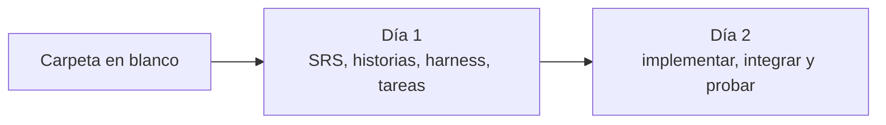

# Laboratorio 5: Transferencia de archivos por QR

Este laboratorio usa [SDD Devkit](https://github.com/juanca202/sdd-devkit) en un flujo real de implementación. El requerimiento ya viene escrito. El trabajo es colocarlo en un proyecto en blanco y recorrerlo con los skills del framework: reconocerlo, partirlo en historias, inicializar el harness, planificar las tareas, implementarlas e integrar el resultado en `main`.

El producto es **QRTransfer**, una aplicación web responsiva. Un dispositivo muestra un archivo como una secuencia de códigos QR; el otro lo lee con la cámara, reconstruye el archivo y verifica su integridad. El historial queda en el dispositivo, sin servidor ni red entre los dos equipos. El proyecto parte del scaffold [angular-base](https://github.com/juanca202/angular-base).

Cuando el agente pregunte por casos de prueba documentados (`/test-define`), el ejercicio sigue sin ellos. Las pruebas de este flujo son las que escribe `/work-implement` junto al código: unitarias y E2E.

## Objetivo

Practicar el ciclo de SDD Devkit cuando el requerimiento ya está cerrado:

1. Reconocer un SRS en estado Ready sin reescribirlo (`/requirement-refine`).
2. Partirlo en historias de usuario (`/work-define`).
3. Inicializar el harness sobre un proyecto base (`/arch-init`).
4. Planificar las tareas técnicas (`/work-plan`).
5. Implementarlas (`/work-implement`), cerrarlas en `main` (`/work-integrate`) y probar la transmisión con un teléfono.

En cada paso el agente pregunta antes de crear archivos. Las respuestas de este laboratorio fijan las mismas decisiones para todo el grupo.

## Pre-requisitos

- Cursor, Node.js 22+ y Git.
- SDD Devkit instalado. Instala el plugin completo, no skills sueltos. Es compatible con cualquier agente que soporte el estándar abierto Agent Plugins, entre ellos:

**Cursor**

```text
/add-plugin https://github.com/juanca202/sdd-devkit
```

**Kiro**

Panel de Powers → Add Custom Power → Import power from GitHub → pega `https://github.com/juanca202/sdd-devkit`

**Claude Code** (tiene su propio sistema de plugins, no usa el estándar Agent Plugins):

```text
/plugin marketplace add juanca202/sdd-devkit
/plugin install sdd-devkit@juanca202
```

- El zip del requerimiento: [SRS-001-transferencia-qr.zip](./assets/SRS-001-transferencia-qr.zip).
- El script del túnel: [tunnel-qr.js](./assets/tunnel-qr.js).

## Cómo leer los ejemplos

Cada paso trae tres bloques:

- **Llamado:** lo que escribes en el chat, dentro de la carpeta del ejercicio.
- **Ejemplo de respuesta:** una respuesta real del agente ante ese llamado. La redacción puede variar; compara la decisión y los artefactos, no la frase exacta.
- **Qué respondes:** la respuesta que mantiene el ejercicio alineado.

Abre el chat en la carpeta `exercise-qrtransfer`, no en el repositorio del taller. Puedes seguir en el mismo chat o abrir uno nuevo al día siguiente. Si abres uno nuevo, incluye la ruta o el identificador, como en los ejemplos.




| Día | Tiempo | Skills                                                            | Al cerrar el día                                          |
| --- | ------ | ----------------------------------------------------------------- | --------------------------------------------------------- |
| 1   | 2 h    | `/requirement-refine`, `/work-define`, `/arch-init`, `/work-plan` | Tareas en Ready, sobre el harness                         |
| 2   | 2 h    | `/work-implement`, `/work-integrate`                              | Historias en `main` y transmisión probada con el teléfono |


---

# Día 1 — Del requerimiento al plan (2 horas)

## Paso 1. Carpeta en blanco (10 min)

El ejercicio no clona un repositorio. Fuera de este repositorio, crea una carpeta vacía llamada `exercise-qrtransfer` y ábrela. A partir del paso siguiente, todo ocurre en el chat del agente, dentro de esa carpeta.

## Paso 2. Reconocer el SRS (15 min)

`/requirement-refine` estructura un requerimiento en bruto. En el chat, llama al skill y pásale el zip ([SRS-001-transferencia-qr.zip](./assets/SRS-001-transferencia-qr.zip)): el agente lo procesa. El archivo ya es un SRS-001 completo en estado Ready, con el README, los wireframes y los cuatro informes de spike. El skill debe reconocerlo y preguntar antes de tocarlo.

### Llamado

```text
/requirement-refine
```

Adjunta en ese mensaje el archivo `SRS-001-transferencia-qr.zip`.

### Ejemplo de respuesta

> Descomprimí el zip y ya es un SRS-001 completo en estado Ready, con wireframes y 4 informes de spike. Antes de importarlo o modificarlo necesito saber qué quieres hacer.
>
> El zip ya contiene un SRS-001 «Transferencia de archivos mediante secuencia de QR» en estado Ready (con 5 wireframes y 4 informes de spike). ¿Qué quieres hacer con él?
>
> - Importarlo tal cual al proyecto (`docs/specs/changes/requirements/SRS-001-…`) y conservar el zip original en `references/`.

Sin `.sdd-devkit/settings.json` el kit usa la ruta por defecto `docs/specs/changes/`. Por eso propone importar el SRS a esa carpeta.

### Qué respondes

```text
Impórtalo tal cual a docs/specs/changes/requirements/ y conserva el zip original en references/. No modifiques el contenido del SRS.
```

### Ejemplo de cierre

> El SRS-001 quedó importado tal cual, sin modificar su contenido.
>
> Ubicación: `docs/specs/changes/requirements/SRS-001-transferencia-archivos-qr/`
>
> - `README.md`: SRS en estado Ready.
> - `wireframes/`: WF-001, WF-002, WF-004 y WF-005, cada uno con su `.md` y sus SVG (escritorio y móvil).
> - Informes de spike WI-001, WI-002, WI-003 y WI-004.
> - `references/`: el zip original, conservado.
>
> A tener en cuenta: el SRS dice que el repositorio `exercise-qrtransfer` ya existe, pero esta carpeta todavía no es ese repo.
>
> Siguiente paso: `/work-define`.

Comprueba que el `README.md` importado sigue en Ready y que no aparecieron requisitos nuevos. Con ese README puedes juzgar si la propuesta del agente respeta el alcance:

- Propósito: pasar un archivo de un dispositivo a otro solo con pantalla y cámara.
- Fuera de alcance: cifrado, varios archivos a la vez, cuentas, servidor, Bluetooth o Wi-Fi Direct, y navegadores distintos de Chrome en Android.
- Cuatro pantallas: inicio e historial (WF-001), envío (WF-002), recepción (WF-004) y resultado (WF-005).
- El protocolo ya está descrito en la sección 2.6, respaldado por los spikes WI-001 a WI-004.

La única edición permitida del SRS llega en el paso siguiente: la sección de historias derivadas.

## Paso 3. Historias de usuario (35 min)

`/work-define` descompone el SRS en historias. Primero propone el corte y espera confirmación. No crea carpetas hasta que respondas.

### Llamado

```text
/work-define SRS-001-transferencia-archivos-qr
```

### Ejemplo de respuesta

> He leído el SRS-001 completo (FR-001…FR-036 sin FR-035, NFR-001…NFR-013, BR-01…BR-03, 4 wireframes aprobados, repositorio exercise-qrtransfer). Propongo descomponerlo en 6 historias, en este orden de dependencias:
>
> 1. Enviar un archivo como secuencia de QR (WF-002).
> 2. Ajustar velocidad y densidad de emisión (WF-002, menú ⋮). Depende de 1.
> 3. Recibir un archivo escaneando (WF-004). Depende de 1.
> 4. Resultado, verificación, guardado y previsualización (WF-005). Depende de 3.
> 5. Historial: listar, filtrar, exportar y eliminar (WF-001). Depende de 1 y 4.
> 6. Funcionamiento sin conexión e instalable (PWA). Transversal.
>
> ¿Cómo procedo?

La propuesta de seis historias es válida. En este laboratorio el corte es otro: tres historias, una por flujo de la persona que usa la app.

### Qué respondes

```text
Podemos separar en enviar, recibir e historial?
```

### Ejemplo de cierre

> Creé las tres historias del SRS-001, las tres en Ready.


| Historia                                                     | Cubre                                                            | Criterios       | Puntos |
| ------------------------------------------------------------ | ---------------------------------------------------------------- | --------------- | ------ |
| US-001: Enviar un archivo como secuencia de QR               | La emisión y sus ajustes de velocidad y densidad                 | AC-001 a AC-024 | 13     |
| US-002: Recibir un archivo escaneando una secuencia de QR    | La recepción, la verificación, el guardado y la previsualización | AC-001 a AC-024 | 13     |
| US-003: Consultar y gestionar el historial de transferencias | El inicio y el historial: listar, filtrar, exportar y eliminar   | AC-001 a AC-007 | 5      |


Detalles que el agente debe dejar explícitos y que conviene contrastar con tus carpetas:

- La PWA no quedó como historia propia. NFR-001, NFR-002, NFR-010 y NFR-011 fueron a US-001; NFR-013 a US-002; NFR-004 a US-003.
- US-002 depende del formato de fragmento de US-001. US-003 depende de las dos. Por eso Independiente queda en Partial en esas dos.
- US-001 y US-002 tienen 24 criterios: la dimensión Pequeña queda en Partial. Se dividen en tareas en el paso 5, en este mismo día.
- Los wireframes se enlazan desde la carpeta del SRS. No se copian.
- El SRS no tenía sección 15. El agente la agrega con la tabla de historias derivadas. Es lo único que escribe fuera de las carpetas de las historias.
- No hace falta `/design-define`: el protocolo ya está en la sección 2.6 del SRS.
- FR-035 no existe en el SRS. Es un salto de numeración.

Abre las tres historias y el SRS. Cada una debe estar en Ready, y la sección 15 del SRS debe apuntar a US-001, US-002 y US-003.

El agente puede ofrecer casos de prueba, planificación o el harness. Hoy sigue el harness, en el mismo chat. `/test-define` queda fuera.

## Paso 4. Inicializar el harness (30 min)

La carpeta tiene `docs/` y todavía no es el repositorio de la aplicación. `/arch-init` prepara el proyecto para los agentes: git, instrucciones persistentes, configuración del kit y el código base.

El SRS define un solo repositorio, `exercise-qrtransfer`, a partir del proyecto base `angular-base`.

### Llamado

```text
/arch-init
```

Si el chat es nuevo:

```text
/arch-init
El SRS-001 está en docs/specs/changes/requirements/SRS-001-transferencia-archivos-qr.
El repositorio del producto es exercise-qrtransfer y el proyecto base es https://github.com/juanca202/angular-base.
```

El agente pregunta en tandas. Responde cada una antes de que cree el repo.

### Ejemplo de respuesta y qué respondes

**Pregunta.** Esta carpeta no es un repo git y solo contiene `docs/`. ¿Cómo inicializo el repo?

**Respuesta.**

```text
Monorepo: traer angular-base a esta carpeta como upstream y conservar docs/.
```

**Pregunta.** ¿`angular-base` es un proyecto base (queda como upstream) o el repositorio existente del proyecto?

**Respuesta.**

```text
Proyecto base (queda como upstream).
```

**Pregunta.** `AGENTS.md`, los índices de ADR y estándares, y `CLAUDE.md` no coinciden con el formato vigente. ¿Los normalizo con `/plugin-migrate`?

**Respuesta.**

```text
Sí, delegar en /plugin-migrate. Conserva todo el contenido de angular-base.
```

**Pregunta.** El README es el de angular-base. ¿Inserto tras el título, renombrado a «QRTransfer», esta descripción?

> QRTransfer es una aplicación web responsiva e instalable (PWA) para pasar un archivo de un dispositivo a otro sin red: el emisor lo muestra como una secuencia de códigos QR y el receptor la lee con la cámara, reconstruye el archivo y verifica su integridad. Guarda un historial local de lo enviado y recibido, con exportación y eliminación.

**Respuesta.**

```text
Sí, insertarla.
```

### Ejemplo de cierre

> El harness quedó inicializado. Nada está commiteado.
>
> - Repositorio: `git init` en esta carpeta, `angular-base` (`upstream/main`) como remoto `upstream`, `docs/` conservado. La rama es `main`.
> - Punto de partida: código base, sin funcionalidades propias. Por eso no hay descubrimiento de ADR ni cambios en la compuerta de calidad. El proyecto base ya trae sus ADR, sus estándares y la compuerta (`npm run arch`). No se ejecutan pruebas en este paso.
> - `.agents/MEMORY.md` creado.
> - `.sdd-devkit/settings.json` con las claves obligatorias.
> - `.sdd-devkit/.env` añadido al `.gitignore`.
> - `README.md` titulado QRTransfer, con la descripción del proyecto tras el título.
> - Normalizados con `/plugin-migrate`, sin perder contenido: `AGENTS.md`, `docs/adr/README.md`, `docs/standards/README.md`. `CLAUDE.md` se elimina si solo era un puntero a `AGENTS.md`.

Revisa que `docs/specs/` sigue en su sitio después de traer el scaffold, que el título del README es QRTransfer y que `git remote -v` muestra `upstream` apuntando a `angular-base`. No hagas commit: el ejercicio termina con el árbol de trabajo listo para revisión.

## Paso 5. Planificar las tareas (30 min)

`/work-plan` descompone cada historia en tareas técnicas. No escribe código ni pruebas. Primero muestra el corte y, si confirmas los planes completos, pregunta lo que el SRS deja abierto.

### Llamado

```text
/work-plan US-001 US-002 US-003
```

### Ejemplo de respuesta

El agente propone el corte en tareas y no crea archivos hasta que elijas cómo materializarlas. El número y el alcance de cada tarea pueden cambiar de una corrida a otra.

Léelas. Revisa que ninguna se desvíe del propósito del proyecto por haber malentendido el requerimiento: pasar un archivo de un dispositivo a otro solo con pantalla y cámara, reconstruirlo, verificar su integridad y conservar el historial en el dispositivo.

### Qué respondes

```text
Crear los planes (TK completas).
```

A partir de aquí el agente pregunta las decisiones que el SRS no cierra. Responde con esta tabla, aunque las agrupe en otro orden.


| Tema                                                 | Respuesta                                                                                                       |
| ---------------------------------------------------- | --------------------------------------------------------------------------------------------------------------- |
| Almacenamiento privado de archivos                   | OPFS para los archivos + IndexedDB para el registro (dirección y fecha)                                         |
| Dónde vive el protocolo, separado de la UI           | `features/transfer/protocol/`, sin dependencias de UI                                                           |
| Hoja inferior (diálogo en escritorio, hoja en móvil) | Angular Material (MatBottomSheet en móvil / MatDialog en escritorio)                                            |
| Actualización del service worker                     | Detectar versión nueva (SwUpdate) y avisar con la acción «Actualizar», que recarga                              |
| Cámara y QR en las pruebas E2E                       | Stub de `getUserMedia` que sirve un canvas con los QR generados en la prueba (emisor y receptor en dos páginas) |
| Clave de velocidad y densidad                        | Una clave JSON: `qrtransfer.emission = {speed, density}`                                                        |


### Ejemplo de cierre

> Los planes de tareas están escritos y quedaron en Ready. Ya no queda nada abierto de la planificación.

Vuelve a leer las tareas escritas. Confirma que siguen dentro del propósito del proyecto y que el estado es Ready.

Con eso cierra el día 1. Mañana se implementan las tres historias de un tirón, se integran en `main` y se prueba la transmisión con un teléfono. Si el agente ofrece `/test-define`, la respuesta es seguir sin casos de prueba documentados.

---

# Día 2 — Implementar, integrar y probar (2 horas)

`/work-implement` escribe el código y las pruebas de las tareas en Ready. En estas dos horas las tres historias corren seguidas, en ramas apiladas, y al terminar se integran en `main`. No confirmes tarea por tarea: si el agente se detiene a preguntar si sigue, la respuesta es avanzar hasta el final. Después de integrar, se prueba la transmisión entre el computador y un teléfono.

## Paso 6. Implementar las tres historias (90 min)

### Llamado

En un chat nuevo, dentro de `exercise-qrtransfer`:

```text
/work-implement US-001 US-002 US-003
```

### Ejemplo de respuesta

> Las tareas están en Ready. Preparé la cola de US-001 y no toqué nada del repositorio. Antes de empezar necesito saber cómo resolver los cambios sin commitear, si defines casos de prueba, si trabajo en un worktree y cómo organizo las ramas. US-002 necesita el protocolo y el almacenamiento de US-001: con ramas independientes desde `main`, ninguna vería el código de la otra.

### Qué respondes

Responde con esta tabla en cuanto pregunte.


| Pregunta                                       | Respuesta                                                                                  |
| ---------------------------------------------- | ------------------------------------------------------------------------------------------ |
| Cambios sin commitear (harness, `docs/specs/`) | Commitearlos ahora con `/git-commit`: 2 commits, en `main`                                 |
| Casos de prueba                                | Continuar sin casos de prueba                                                              |
| Dónde implementar                              | En un worktree (`.worktrees/`)                                                             |
| Ramas                                          | Apiladas: US-002 desde US-001, US-003 desde US-002. Los E2E al final, en la rama de US-003 |
| ¿Arranco ya?                                   | Sí. Avanza hasta el final y commitea al cerrar cada historia                               |


### Ejemplo de cierre

> Las tareas de US-001, US-002 y US-003 están en Done y commiteadas. Todo el trabajo está apilado en `feature/US-003-historial-transferencias`, que contiene las ramas de US-001 y US-002.

En la corrida de referencia el agente entregó, entre otros, el protocolo y el almacenamiento, la hoja de envío, el lector `zxing-wasm`, la reconstrucción, la pantalla de recepción, el resultado y el historial. Los E2E de envío, recepción e historial quedaron en verde en la misma pasada (22 de Playwright, recepción de punta a punta incluida), junto con las unitarias, eslint, tsc y `npm run arch`.

Dos correcciones del proyecto base pueden aparecer al arrancar la app, y entran en el mismo trabajo:

- `$localize is not defined`.
- `No provider found for AuthProvider`. La app no tiene cuentas: salen `AuthProvider` y la sesión. Las pruebas del base que cubrían logout dejan de aplicar.

Si otro servicio ocupa el puerto 4200, `playwright.config.ts` admite `E2E_PORT`. El build puede avisar de que el bundle inicial supera los 500 kB: es un aviso.

Comprueba que los tres `progress.md` marcan sus tareas en Done antes de integrar. Una tarea en Pending bloquea el merge.

## Paso 7. Integrar en main (30 min)

### Llamado

Desde el worktree de US-003, donde está la pila completa:

```text
/work-integrate
```

### Ejemplo de respuesta

> Antes de lanzar las puertas necesito dos decisiones: contra qué rama base integro (`main` o `feature/US-002`) y si las ejecuto ahora.

### Qué respondes

```text
main: integrar las tres historias de una vez (merge de feature/US-003, que ya contiene US-001 y US-002).
Sí, ejecutar las tres puertas.
```

Las puertas son `quality-check`, `code-review` y `coverage-verify`. Si `quality-check` sale rechazado por el linter del proyecto base o por la cobertura bajo el 80 %:

```text
Corregir ambos: alias de capa en los archivos del base y más pruebas unitarias para superar el 80 %. Delégalo en /work-implement. Luego re-ejecuta las puertas y haz el merge a main.
```

Si `code-review` marca que la cámara queda encendida al cerrar la hoja de recepción mientras arranca (`reader.load()` y `openCamera()` terminan después de `dispose()`), más los tres menores (el `Set` de `Reassembler.progress()`, las excepciones al guardar convertidas en «no reconstruible», y el `ResizeObserver` de `QrCanvas`):

```text
Corregir el bloqueante y los tres menores, con pruebas. Luego re-ejecutar quality-check y code-review.
```

### Ejemplo de cierre

> Integración completada en `main`. US-001, US-002 y US-003 quedaron integradas con `--no-ff` desde `feature/US-003-historial-transferencias`.


| Puerta          | Veredicto de la corrida de referencia                                       |
| --------------- | --------------------------------------------------------------------------- |
| quality-check   | Aprobado. 383 tests unitarios, cobertura de líneas 88,6 %, 31 E2E           |
| code-review     | Aprobado, con el hallazgo de la cámara y los tres menores corregidos        |
| coverage-verify | Aprobado con observaciones. Ningún criterio sin cubrir. No bloquea el merge |


Las ramas `feature/US-00X` y los worktrees pueden seguir: este laboratorio no los borra ni hace push.

## Paso 8. Probar la transmisión

La prueba usa la app ya integrada en `main`. El computador la sirve y el teléfono la abre por un túnel, para enviar un archivo de una pantalla a la cámara del otro.

En `exercise-qrtransfer`, sobre `main`, arranca el servidor de desarrollo escuchando en todas las interfaces y aceptando cualquier host:

```bash
npm start -- --host 0.0.0.0 --allowed-hosts
```

`--host 0.0.0.0` publica el servidor más allá de localhost. `--allowed-hosts` deja pasar el nombre del túnel; si falta, el teléfono ve el host bloqueado.

Cuando la app responda en `http://localhost:4200`, descarga [tunnel-qr.js](./assets/tunnel-qr.js), abre otra consola en la carpeta donde lo guardaste y lanza el túnel:

```bash
node tunnel-qr.js http://localhost:4200
```

El script abre un túnel de Cloudflare hacia esa dirección. Al quedar listo imprime en la consola un QR y la URL pública. Ese QR abre la app en el teléfono. La transmisión es la de la aplicación: en el computador, en `http://localhost:4200`, envía un archivo; en el teléfono, escanea el QR del túnel, abre la app y lo recibe con la cámara. El archivo pasa de la pantalla a la cámara. El túnel solo carga la app en el teléfono.

Deja las dos consolas abiertas durante la prueba. Ctrl+C en la del túnel lo cierra.

Si Node no encuentra el paquete `qrcode`, instálalo en la raíz de este repositorio (`npm install qrcode`) y vuelve a lanzar el túnel.

---

# Cierre

Al terminar, `main` contiene el SRS conservado, las tres historias implementadas con sus tareas en Done y el harness de `angular-base`, y la transmisión quedó probada entre el computador y un teléfono.

## Conclusión

El requerimiento ya traía el qué. En el día 1 el grupo decide el corte de las historias, el origen del repositorio y las decisiones técnicas que el SRS deja abiertas. En el día 2 el agente implementa esa cola de un tirón, en ramas apiladas, y la integración no cierra mientras una puerta falle: el linter, la cobertura y la cámara que no se apaga se corrigen antes del merge. La prueba final abre la app en el computador y, por el túnel, en el teléfono, y pasa un archivo de la pantalla a la cámara.