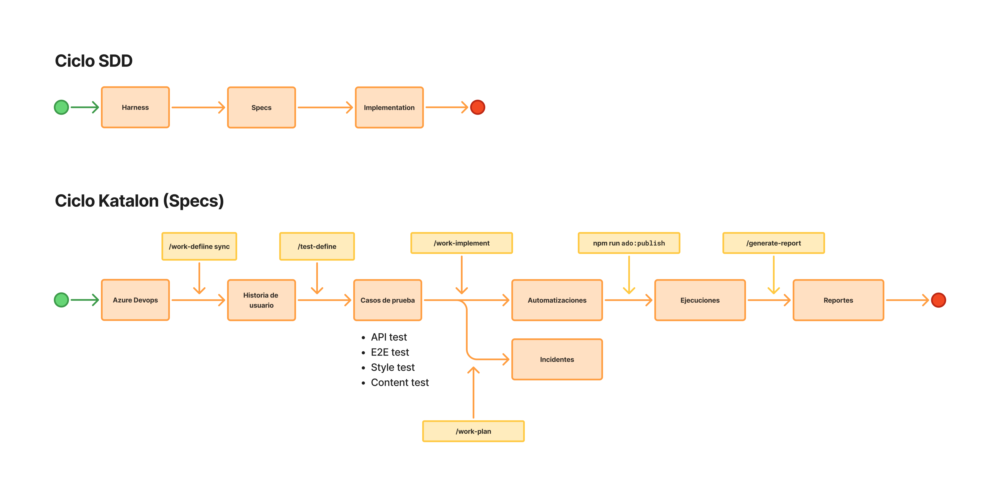

# Laboratorio 7: Automatización de pruebas

Este laboratorio recorre con [SDD Devkit](https://github.com/juanca202/sdd-devkit) el camino de una historia de usuario ya cerrada a sus pruebas automatizadas: casos de prueba documentados, automatización 1:1 en Katalon Studio, ejecución de la suite, reporte de los defectos encontrados y publicación de la corrida en Azure DevOps.

**US-34266 (Azure DevOps #34266): Acceso demo de la aplicación.** Es un modo de solo lectura que toma sus datos de los JSON de `public/data/demos`. Cuando el usuario intenta modificar algo, la acción se bloquea y se le envía al flujo de autenticación.

## Objetivo

Cubrir cada criterio de US-34266 con un caso de prueba automatizado en Katalon, ejecutado y con el resultado publicado en Azure DevOps.

**Duración:** 1 hora 40 minutos.

## Pre-requisitos

- [Kiro](https://kiro.dev), Node.js 22+ y Git.
- [Katalon Studio](https://katalon.com/download).
- Una cuenta de Figma.
- Acceso al proyecto de Azure DevOps [Bayteq IA](https://dev.azure.com/BayteqDev/Bayteq%20IA) y al proyecto base [katalon-base](https://github.com/juanca202/katalon-base.git).
- Permiso de lectura sobre la historia 34266 y de escritura sobre work items (para crear los bugs) en Azure DevOps.
- Un Personal Access Token de Azure DevOps con permiso *Test Management (Read & write)* y el ID del Test Plan donde están los Test Cases de la historia.

## Definition of Done

- Cada criterio de US-34266 tiene al menos un caso de prueba documentado.
- Cada caso automatizado o asistido tiene un caso de Katalon que se ejecuta en su Test Suite.
- Cada fallo de la ejecución quedó clasificado: los falsos positivos, corregidos; los defectos, reportados como bug en Azure DevOps.
- La corrida está publicada en el Test Plan de Azure DevOps con sus evidencias.
- `/quality-check` termina en verde.
- `criteria-coverage.md` muestra AC-001 a AC-011 en `COVERED` o con la brecha escrita.

## Flujo



## Paso 0. Preparación del entorno (5 min)

### Plugins

Instalen en Kiro [SDD Devkit](https://github.com/juanca202/sdd-devkit) y [SDD Utils](https://github.com/juanca202/sdd-utils). Para cada uno: panel de Powers → *Add Custom Power* → *Import power from GitHub* → peguen la URL del repositorio.

### Katalon Studio

En Katalon Studio, entren en *Katalon Store*, busquen **Chrome DevTools Protocol Integration** y pulsen *Install*.

### Servidores MCP

Los servidores MCP vienen declarados en el proyecto base (`.kiro/settings/mcp.json` y `.mcp.json`): `ado-bayteq` (Azure DevOps), `katalon-studio` y `figma`. No hay que agregarlos; solo configurar el acceso a Azure DevOps y a Figma:

- **Azure DevOps.** `ado-bayteq` se autentica con el Personal Access Token de la variable de entorno `ADO_PAT_BAYTEQ`. El token necesita permiso de *Work Items (Read & write)* y *Test Management (Read & write)*. Exporten la variable antes de abrir Kiro; si Kiro ya estaba abierto, reinícienlo.

  ```bash
  export ADO_PAT_BAYTEQ="<su-token>"
  ```

- **Figma.** `figma` se autentica con su cuenta de Figma por OAuth. La primera vez que se conecte, Kiro abre el navegador para que inicien sesión y autoricen el acceso.

`katalon-studio` no requiere configuración, pero responde solo con Katalon Studio abierto.

### Antes de seguir

- SDD Devkit y SDD Utils aparecen en el panel de Powers.
- Chrome DevTools Protocol Integration aparece instalado en Katalon Studio.
- `echo $ADO_PAT_BAYTEQ` muestra el token en la terminal desde la que abren Kiro.

## Paso 1. Creación del proyecto (10 min)

`/arch-init` crea el proyecto de pruebas a partir del proyecto base e inicializa su harness, con el sistema bajo prueba alojado en Azure DevOps.

### Llamado

```text
/arch-init proyecto de pruebas para un sistema externo azure devops: https://dev.azure.com/BayteqDev/Bayteq%20IA, proyecto base https://github.com/juanca202/katalon-base.git
```

### Antes de seguir

- El repositorio tiene `AGENTS.md`, `.agents/MEMORY.md` y `.sdd-devkit/settings.json`.
- El stack de pruebas quedó declarado (Katalon Studio) y la compuerta de calidad corre sobre el proyecto base.
- `.env` existe a partir de `.env.example`, con las credenciales de prueba. No se versiona. `ADO_PAT` y `ADO_TEST_PLAN_ID` se completan en el Paso 5.
- `npm install` terminó sin errores.
- En el panel *MCP Servers* de Kiro, `ado-bayteq`, `figma` y `katalon-studio` aparecen conectados (este último, con Katalon Studio abierto).

## Paso 2. Obtener la historia (5 min)

La historia describe una feature de [Tripot](https://factor.ec/tripot), una aplicación de finanzas personales para web y web móvil. Las pruebas se ejecutan contra la aplicación desplegada en `https://factor.ec/tripot`; su código no vive en el proyecto de pruebas.

`/work-define` con el modificador `sync` trae la historia desde Azure DevOps y crea la US local en la carpeta de cambios del proyecto.

### Llamado

```text
/work-define sync [PEGAR ID DE LA HISTORIA DE USUARIO]
```

### Antes de seguir

- La historia existe en la carpeta de cambios, con sus criterios de aceptación y reglas de negocio.
- El contenido coincide con el del tracker. [user-story-sample.md](./assets/user-story-sample.md) sirve de referencia.

## Paso 3. Lectura de la historia (5 min)

Lean la historia US-34266 en grupo antes de llamar a un skill. Identifiquen qué criterios son de interfaz (AC-001, AC-004, AC-005, AC-008, AC-009), cuáles de datos (AC-002, AC-010) y cuáles de comportamiento transversal (AC-003, AC-007, AC-011). Esa clasificación orienta el nivel de prueba: unitaria, integración o e2e.

## Paso 4. Casos de prueba (10 min)

`/test-define` deriva los casos de los criterios según IEEE 29119-4: camino feliz, error y límite.

### Llamado

```text
/test-define [RUTA DE LA HISTORIA DE USUARIO LOCAL]
```

Además de los casos de interfaz, pidan dos casos específicos:

- **Prueba de API** (AC-002, AC-010): una petición `GET` a `https://factor.ec/tripot/data/demos/demo-user-us.json` responde `200` con un JSON que trae las ocho entidades de BR-03.
- **Prueba visual de fidelidad** (AC-001, AC-004, AC-008, AC-009): las pantallas de `/auth`, el indicador de modo demo y el modal de autenticación coinciden con su diseño en [Figma](https://www.figma.com/design/gqc8Qb6Zh5oGdR5Ds08k4m/Untitled). Antes, activen el MCP `figma` en el panel *MCP Servers* de Kiro.

```text
/test-define agrega a US-34266 un caso de prueba de API que valide el JSON de demo-user-us.json (AC-002, AC-010)
/test-define agrega a US-34266 un caso de prueba visual que compare /auth, el indicador demo y el modal de autenticación con su diseño en https://www.figma.com/design/gqc8Qb6Zh5oGdR5Ds08k4m/Untitled
```

### Antes de seguir

- Existe `test-cases/` con los casos generados.
- Hay un caso de API y un caso visual; este último cita el frame de Figma de cada pantalla que compara.
- Cada AC de la historia enlaza sus casos de prueba.
- Cada caso declara precondiciones, pasos, datos y resultado esperado verificable.
- Cada caso tiene su Test Case en Azure DevOps (`TC-<id>`), dentro del Test Suite de la historia en el Test Plan del proyecto. Ese es el plan que va en `ADO_TEST_PLAN_ID`.

### Tipos de ejecución de un caso

Cada caso de prueba se ejecuta de una de tres formas:

| Tipo | Qué es | En Katalon |
| --- | --- | --- |
| 🤖 **Automatizado** | Corre de principio a fin sin intervención de una persona | Caso en la Test Suite desatendida de la historia |
| 👤 **Asistido** (*Human-in-the-Loop*) | Corre automatizado, pero pide a una persona un dato que no se puede obtener de forma fiable: un OTP, un CAPTCHA, una aprobación en otro dispositivo | Usa el Custom Keyword `askHuman()`, lleva la etiqueta `human` (y `visible` si la persona interactúa con la página) y vive en su propia Test Suite ([ADR-005 de katalon-base](https://github.com/juanca202/katalon-base/blob/main/docs/adr/ADR-005-katalon-human-in-the-loop.md)) |
| ✋ **Manual** | Lo ejecuta una persona, paso a paso, fuera del runner | No tiene caso en Katalon; queda documentado con su motivo |

**Los casos manuales, en lo posible, no deben existir.** Antes de dejar un caso como manual, busquen cómo automatizarlo y, si un paso depende de una persona, conviértanlo en asistido. Un caso queda manual solo cuando ninguna de las dos opciones es viable, y el motivo queda escrito.

## Paso 5. Automatización (20 min)

`/work-implement` traduce cada caso documentado a un caso de Katalon, 1:1, en una rama `test/`.

### Antes de implementar

Envíen al agente estos dos mensajes, uno a la vez.

Primero, la URL de la aplicación bajo prueba como variable de la automatización. La misma URL sirve para los casos de interfaz y para la prueba de API:

```text
Establece como variable para la automatización la URL de la app a probar: https://factor.ec/tripot. Esa misma URL es la base para la validación de API.
```

Después, las variables de Azure DevOps en `.env`, para publicar la corrida en el Paso 9:

```text
Para ADO_TEST_PLAN_ID, consulta en Azure DevOps el ID del Test Plan donde se crearon los Test Cases.
```

Comprueben que:

- La URL `https://factor.ec/tripot` quedó en el Execution Profile, no escrita en los scripts.
- `.env` tiene `ADO_PAT` y `ADO_TEST_PLAN_ID` con valor, y sigue fuera del control de versiones.

### Llamado

```text
/work-implement casos de prueba
```

### Qué cierran ustedes

- El tipo de cada caso: automatizado, asistido o manual. Prioricen automatizado, luego asistido; manual solo como último recurso, con su motivo (por ejemplo, AC-010 no es observable desde la UI).
- Cómo se verifica que no salen mutaciones al backend (AC-007) con el runner Web UI de Katalon, que no intercepta el tráfico de red.

### Antes de seguir

- Cada caso vive en `tests/katalon/Test Cases/US-34266/` con el nombre `TC-<id> - título`, y su Test Suite en `Test Suites/US-34266/`.
- Los selectores están en el Object Repository y los datos por ambiente en el Execution Profile, no en los scripts.
- `test-cases-automation.md` lista cada caso con su tipo y su prueba, y los manuales con su motivo.
- Los casos asistidos usan `askHuman()`, llevan la etiqueta `human` y están en su propia Test Suite.
- No hay pruebas sin caso documentado ni casos automatizados o asistidos sin prueba.

## Paso 6. Ejecución en Katalon Studio (10 min)

El agente no ejecuta la suite: Katalon Studio corre en local y la ejecución la hacen ustedes.

1. Exporten las variables de `.env` en la terminal y abran Katalon Studio desde esa misma terminal, para que las lea.
2. Abran el proyecto `tests/katalon/`. En *Project > Settings > Execution*, activen la grabación de video con **Screen Recorder** y la captura automática al fallar.
3. Ejecuten la Test Suite `Test Suites/US-34266/TS - US-34266 Acceso demo`.
4. Si hay casos asistidos, ejecuten su Test Suite con una persona frente al equipo para ingresar los datos que pida `askHuman()`.
5. Si quedaron casos manuales, ejecútenlos siguiendo sus pasos y registren su resultado y evidencia en el Test Case de Azure DevOps.
6. Generen el reporte de Allure:

   ```bash
   npm run allure:katalon
   ```

### Antes de seguir

- Existe `tests/katalon/Reports/<fecha>/.../JUnit_Report.xml` con el resultado de cada caso, junto al log, las capturas y los videos.
- El reporte de Allure muestra el árbol Historia → Criterio → Caso de prueba.
- Tienen la lista de los casos en rojo.

## Paso 7. Validación de los fallos (10 min)

Cada caso en rojo es un falso positivo o un defecto del sistema. El agente revisa la evidencia de la ejecución contra el caso de prueba documentado y clasifica cada fallo.

### Llamado

```text
/work-research valida los fallos de la última ejecución de Katalon de US-34266 (tests/katalon/Reports)
```

### Qué hacer con cada fallo

| Clasificación | Señales | Qué se hace |
| --- | --- | --- |
| **Falso positivo** | Selector que no existe o cambió, espera insuficiente, dato de precondición no disponible, URL o credencial del ambiente, prueba que no es fiel a su `TC-<id>` | Se corrige la prueba con `/work-implement`, sin relajar la aserción, y se vuelve a ejecutar el caso en Katalon Studio |
| **Defecto** | La prueba es fiel al `TC-<id>` y el sistema se comporta distinto a lo documentado | La prueba se queda en rojo, tal cual. Se anota en `Hallazgos` de `test-cases-automation.md` y se reporta en el paso 8 |
| **Caso mal definido** | El resultado esperado del `TC-<id>` no corresponde al criterio de aceptación | Se corrige el caso con `/test-define` antes de tocar la prueba |

Para corregir un falso positivo:

```text
/work-implement corrige TC-<id>: <motivo del falso positivo>
```

### Antes de seguir

- Cada caso en rojo tiene una clasificación con su evidencia (captura, video o log).
- Los falsos positivos están corregidos y en verde en una nueva ejecución de la suite.
- Ninguna prueba se marcó como omitida ni se relajó su aserción para ponerla en verde.

## Paso 8. Reporte de bugs (5 min)

`/work-plan` registra cada defecto como incidente `BUG-XXX`: qué está mal, con los pasos del caso de prueba, lo esperado, lo observado y la evidencia de la ejecución. No propone la corrección: esa se planifica en el repositorio de la aplicación. Con la integración de Azure DevOps activa, crea además el work item `Bug`.

### Llamado

```text
/work-plan registra el incidente del TC-<id> de la última ejecución de Katalon
```

### Antes de seguir

- Cada defecto tiene su incidente en `docs/specs/changes/incidents/BUG-XXX-*/`, con las capturas y el video de la ejecución en `assets/`.
- Cada incidente tiene su work item `Bug` en Azure DevOps, enlazado a la historia y al Test Case.
- La línea del defecto en `Hallazgos` de `test-cases-automation.md` cita su `BUG-XXX`.

## Paso 9. Publicación en Azure DevOps (5 min)

`npm run ado:publish` toma el `JUnit_Report.xml` más reciente de `tests/katalon/Reports/`, crea un test run en el Test Plan de `ADO_TEST_PLAN_ID`, registra el resultado de cada Test Case a partir del `TC-<id>` del nombre del caso y adjunta las evidencias: capturas y video por caso, y el JUnit y el log en el run. Los casos sin `TC-<id>` no se publican.

Primero revisen qué se va a publicar, sin llamar a Azure DevOps:

```bash
npm run ado:publish -- --dry-run
```

Luego publiquen:

```bash
npm run ado:publish
```

Para publicar una ejecución que no es la última, pasen la ruta de su reporte: `npm run ado:publish -- tests/katalon/Reports/<...>/JUnit_Report.xml`. Para otro Test Plan, `-- --plan <id>`.

### Antes de seguir

- El script informa el test run creado y su URL.
- En *Test Plans > Runs* de Azure DevOps, el run muestra un resultado por Test Case, con los fallos y sus adjuntos.
- Ningún `TC-<id>` quedó sin test point en el plan. Si alguno quedó fuera, agréguenlo al Test Suite de la historia y vuelvan a publicar.
- Desde el resultado en rojo pueden enlazar el `Bug` del paso 8.

## Paso 10. Calidad y cobertura (10 min)

`/quality-check` revisa el código del repositorio (lint, formato, validaciones de arquitectura y CodeNarc). No ejecuta la suite de Katalon: un caso en rojo es un hallazgo sobre el sistema bajo prueba, no un fallo de este repositorio.

### Llamado

```text
/quality-check
/coverage-verify US-34266
```

### Antes de seguir

- El veredicto de `/quality-check` es verde.
- `criteria-coverage.md` lista AC-001 a AC-011 con su caso de prueba, su estado y su resultado. Un caso con un defecto reportado queda `COVERED`, con resultado `FAIL` y su `BUG-XXX` enlazado.

## Paso 11. Integración (5 min)

`/work-integrate` repite las puertas de cierre y hace merge de la rama `test/` hacia su rama de origen.

```text
/work-integrate
```
